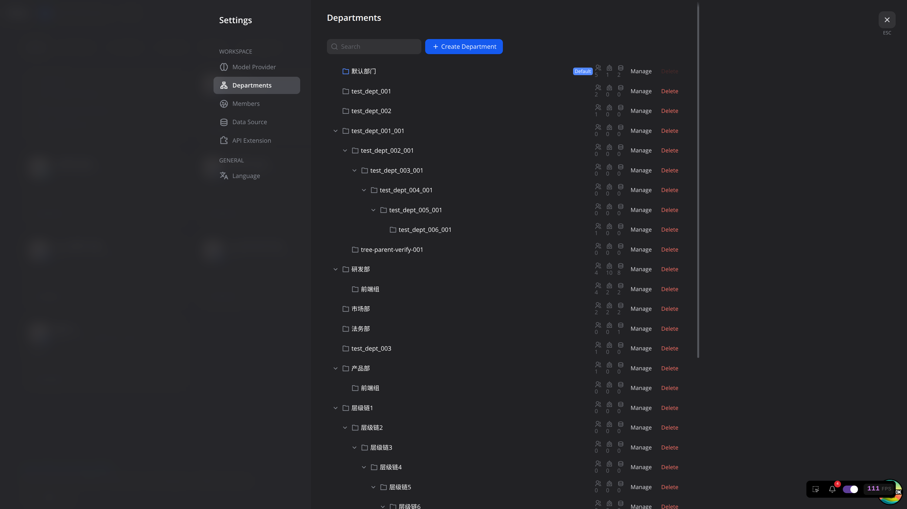
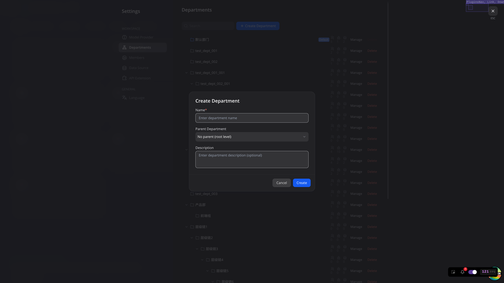
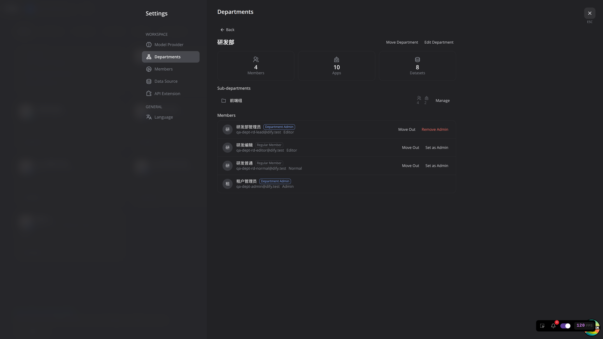
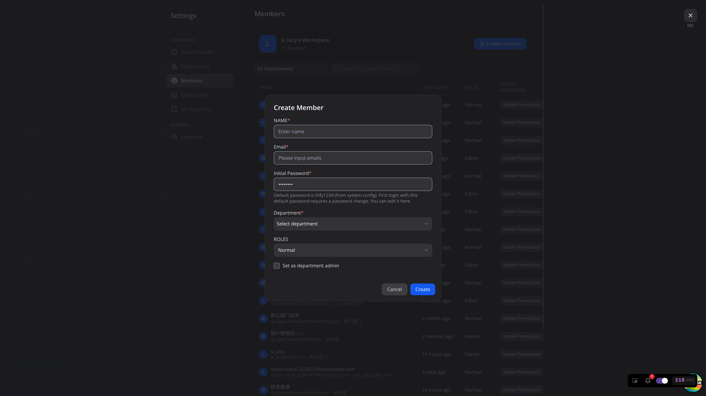
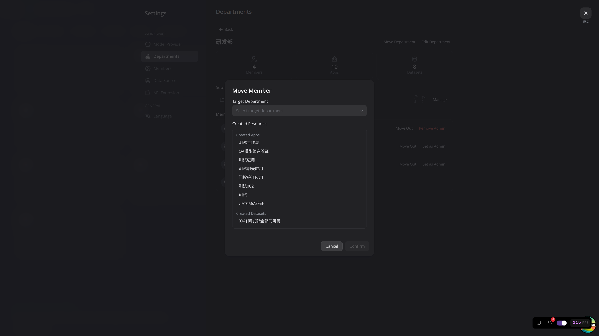
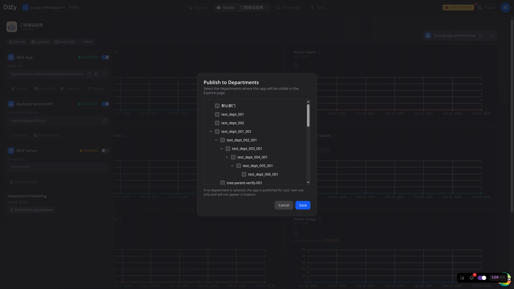
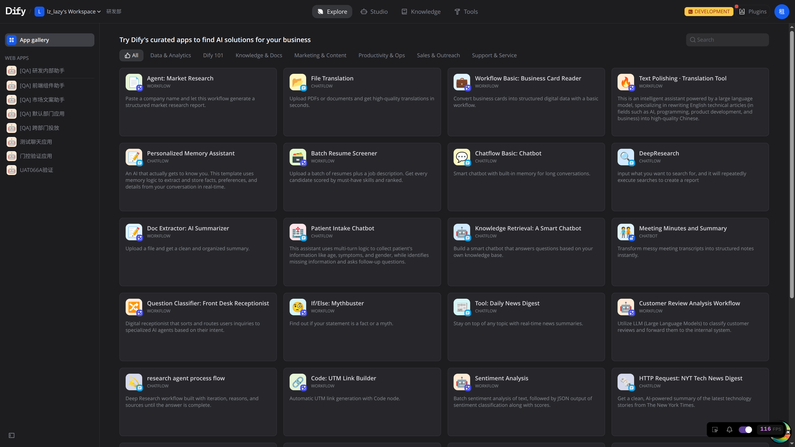
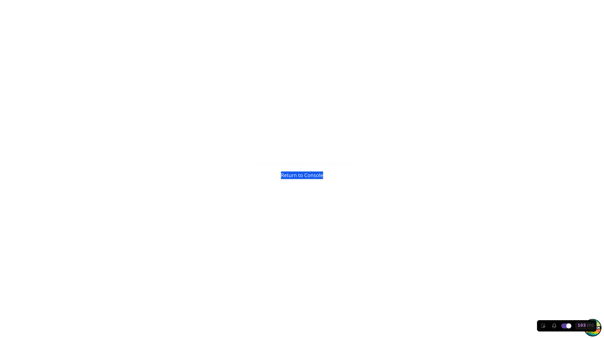
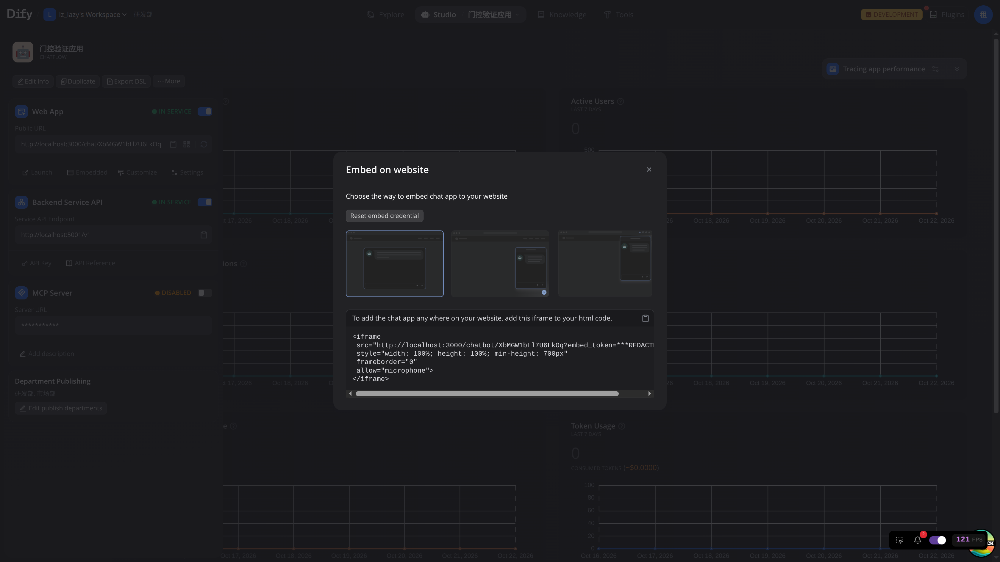
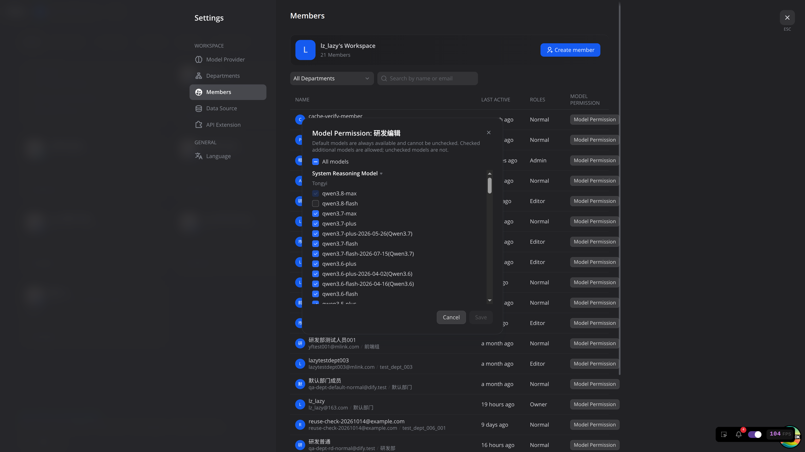

# 智能体平台定制能力使用手册（部门访问控制）

版本：v1.0  
适用：宁波韵升股份有限公司「智能体平台建设项目」定制能力  
行为口径：与 UAT 测试用例 v1.2 / 本地复测 v1.4 一致  
更新日期：2026-10-23

---

## 0. 前言

### 0.1 手册用途与阅读对象

本手册说明本平台在开源 Dify 之上新增的**部门访问控制及相关能力**。假定读者已熟悉工作室、知识库、探索、应用发布等基础操作。

适合：

- 租户所有者 / 管理员（组织与权限总控）
- 部门管理员（管辖范围内的成员与发布）
- 编辑 / 成员（日常创建与使用应用）

### 0.2 与开源 Dify 的差异一览

| 能力 | 开源 Dify | 本平台定制 |
| --- | --- | --- |
| 组织 | 无部门树 | 树形部门（最多 10 级）、默认部门 |
| 工作室 / 知识库可见范围 | 按租户与分享权限 | 再叠加**归属部门**隔离 |
| 探索可用应用 | 已发布且站点开启即可 | 还须**发布到用户所属部门**（或管辖范围） |
| 运行链接 `/chat/{code}` | 多为公开或站点策略 | 须登录，且应用已发布到当前用户部门；**所有者也不豁免** |
| 嵌入 `/chatbot/...` | 常见公开嵌入 | 须带合法 `embed_token`，无 token 显示「嵌入链接无效」 |
| 模型 | 成员一般可用已配置模型 | 租户管理员可按成员配置**模型白名单** |
| 知识库可见性 | 仅我 / 部分成员 / 所有人等 | 增加「**所有部门成员**」（精确同部门，不含子部门） |

### 0.3 文档约定

- 入口写法：`设置 > 部门管理` 表示先打开「设置」，再进入「部门管理」。
- 「租户管理员」含所有者（owner）与管理员（admin），除非另行区分。
- 「部门管理员」指账号带部门管理员徽章（`is_department_admin`），租户角色可为「编辑」或「成员」。
- 界面提示以现网文案为准（例如失败时常为「创建部门失败」「删除部门失败」等通用提示）。
- 本手册不写账号口令；部署与镜像见同目录运维文档。

### 0.4 本手册不含

- 开源 Dify 基础功能（工作流编排、工具、插件、模型供应商接入等）
- 工程侧 API、审计落库、数据迁移、ACL 开关关闭对照

---

## 1. 核心概念（必读）

### 1.1 角色

| 角色 | 说明 |
| --- | --- |
| 租户所有者 / 管理员 | 可管理全部部门树、跨部门转移资产、多部门发布、配置成员模型权限 |
| 部门管理员 | 管理**本部门及子部门**范围内的成员与发布；不能改组织树结构，不能跨部门转移资产 |
| 编辑 | 可在本部门创建/编辑应用与知识库；发布仅限本部门 |
| 成员 | 主要使用探索与已发布应用；无知识库顶栏；不能改发布部门 |

说明：

- 「成员」角色若同时被设为部门管理员，**仍看不到**「设置 > 成员」中的创建入口；部门管理员要创建成员，租户角色须为「编辑」。
- 「编辑」与「成员」都可被设为部门管理员。

### 1.2 默认部门

每个工作区有且仅有一个**默认部门**：

- 不能作为新建部门时的父部门（父部门下拉里不出现）
- 不能删除（删除按钮禁用）
- 不能移动到其他父部门下
- 建议不要随意改名；日常业务请建独立部门

### 1.3 归属部门 vs 发布部门

| 概念 | 作用 | 典型影响 |
| --- | --- | --- |
| **归属部门** | 应用 / 知识库「属于」哪个部门 | 决定谁能在**工作室 / 知识库列表**里看到并编辑 |
| **发布部门** | 应用对哪些部门开放使用 | 决定谁能在**探索**里看到，以及谁能打开**运行链接** |

要点：

- 把应用转移到其他部门，只改归属；**已有发布记录不会自动取消**。原部门成员仍可能在探索里使用，直到取消对应发布勾选。
- 把应用发布到某部门，只给该部门**使用权**，不等于对方能进工作室改配置（权责分离）。

### 1.4 部门树规则

- 同父部门下名称唯一
- 最多 **10** 级；第 11 级创建会失败
- 生产环境已开启部门访问控制，终端用户无需配置开关

### 1.5 本章角色速览

| 概念操作 | 租户管理员 | 部门管理员 | 编辑 | 成员 |
| --- | --- | --- | --- | --- |
| 理解归属 / 发布差异 | 需要 | 需要 | 需要 | 需要（使用侧） |
| 管理默认部门例外 | 是 | 否 | 否 | 否 |

---

## 2. 部门管理

### 2.1 入口

`设置 > 部门管理`

### 2.2 创建根部门 / 子部门

**谁能做**：仅租户管理员。部门管理员页面无「+ 创建部门」。

步骤：

1. 点击右上角「+ 创建部门」
2. 填写部门名称（必填）；可选描述
3. 创建根部门：父部门留空  
   创建子部门：父部门选择已有部门（列表不含默认部门）
4. 点击「创建」

成功提示：「部门创建成功」。同父下重名或超过 10 级会失败（常见提示「创建部门失败」）。

### 2.3 编辑名称与描述

1. 进入部门详情
2. 点击「编辑部门」
3. 修改后保存

成功提示：「部门更新成功」。  
部门管理员可以打开编辑弹窗，但保存会失败（「更新部门失败」），名称不变。

部门详情页同时提供「编辑部门」「移动部门」入口，以及成员 / 子部门一览：

### 2.4 移动部门（改组织树）

**谁能做**：仅租户管理员。部门详情中「移动部门」入口不对部门管理员显示。

1. 进入要移动的部门详情
2. 点击「移动部门」
3. 选择新的父部门并确认

默认部门不能移动（提示「移动失败」）。

### 2.5 删除部门

**谁能做**：仅租户管理员。部门管理员无删除按钮。默认部门删除按钮禁用。

删除前须同时满足：

- 无子部门
- 无成员
- 无归属应用
- 无归属知识库
- 不是任何应用的**发布目标**

不满足时删除失败，部门仍在列表中；页面多为通用提示「删除部门失败」。

确认对话框按钮文案为「确认」（不是「确认删除」）。空部门删除成功提示：「部门删除成功」。

### 2.6 本章能力表

| 操作 | 租户管理员 | 部门管理员 | 编辑 / 成员 |
| --- | --- | --- | --- |
| 创建 / 删除 / 移动部门 | 是 | 否 | 否 |
| 编辑部门信息并保存 | 是 | 否（可开弹窗） | 否 |
| 查看管辖范围内部门详情 | 全部 | 本部门及子部门 | 按权限，通常无管理入口 |

---

## 3. 成员与部门管理员

### 3.1 创建成员

入口：`设置 > 成员`，或部门详情中的创建入口。

**租户管理员**：

1. 点击「+ 创建成员」
2. 填写姓名、邮箱、初始密码
3. 选择所属部门与角色
4. 创建

**部门管理员**（租户角色须为「编辑」）：

- 所属部门仅可选**管辖范围**（本部门及子部门）
- 角色下拉只有「编辑」「成员」，无「所有者」「管理员」
- 创建表单中**没有**「设为部门管理员」选项

邮箱全局唯一；重复邮箱会创建失败。姓名、邮箱、部门为必填。

### 3.2 移动成员

入口：部门详情或成员管理中的「移出部门」。

步骤要点：

1. 选择目标部门并确认
2. 确认流程会展示该成员「创建的资源」（应用、知识库名称列表；无则显示「无」）
3. 移动成功后：人员归属变为新部门；其**创建的应用 / 知识库仍留在原部门**
4. 若被移动者曾是部门管理员，移动后管理员身份取消，徽章变为普通成员

限制：

- 部门管理员不能移出自己（自己的卡片不显示「移出部门」）
- 父部门管理员可移动子部门成员；子部门管理员不能管理父部门成员

### 3.3 设为 / 取消部门管理员

**谁能做**：仅租户管理员。部门管理员看不到「设为 / 取消部门管理员」按钮。

1. 进入目标部门详情
2. 在成员卡片上点击「设为部门管理员」或「取消部门管理员」

「编辑」与「成员」角色均可被设为部门管理员。成功提示分别为「已设为部门管理员」「已取消部门管理员」。

### 3.4 部门管理员修改成员角色

- 部门详情里角色为只读文本
- 在 `设置 > 成员` 中，可对管辖范围内且非本人的成员修改角色，下拉仅「编辑」「成员」
- 不能改为所有者 / 管理员；管辖外成员角色为只读

### 3.5 权限边界（成员列表）

- 打开某部门详情的「成员」列表，只列**该部门直属成员**，不含子部门成员（子部门需进入子部门详情查看）
- 部门管理员对管辖外部门的「管理」按钮为禁用，进不了详情

### 3.6 本章能力表

| 操作 | 租户管理员 | 部门管理员（编辑） | 编辑 | 成员 |
| --- | --- | --- | --- | --- |
| 创建成员 | 任意部门 | 管辖范围；角色限编辑/成员 | 否 | 否 |
| 跨部门移动成员 | 是 | 管辖范围内 | 否 | 否 |
| 设 / 取消部门管理员 | 是 | 否 | 否 | 否 |
| 改他人租户角色 | 是 | 管辖内限编辑/成员 | 否 | 否 |

---

## 4. 工作室与知识库的部门归属

### 4.1 列表隔离

| 角色 | 工作室应用列表 | 知识库列表 |
| --- | --- | --- |
| 租户管理员 | 可见工作区内全部；可用部门筛选 | 可见范围受「所有知识库」勾选等策略影响；可筛选 |
| 部门管理员 | 本部门 + **子部门** | 受部门隔离与知识库分享权限共同约束 |
| 编辑 | 仅本部门 | 仅本部门内有权查看的库；「只有我」且非本人创建的同部门库也不可见 |
| 成员 | 仅本部门（只读使用为主） | **无知识库顶栏**，不能创建知识库 |

### 4.2 转移部门

**谁能做**：仅租户管理员。部门管理员与普通成员的「更多」菜单中**没有**「转移部门」。

步骤：

1. 在应用或知识库卡片「更多」中选择「转移部门」
2. 选择目标部门并确认

成功提示：「部门转移成功」。

**转移后发布记录仍在**：例如应用从研发部转到市场部后，若仍发布到研发部，研发部成员探索里仍可使用；市场部探索需另行发布到市场部才可见。工作室编辑权则跟随新归属部门。

### 4.3 知识库权限「所有部门成员」

在知识库权限中选择「所有部门成员」时：

- **精确同部门**可见（该部门的编辑、成员、部门管理员）
- **子部门成员不可见**
- 父部门管理员也**看不到**子部门下此类库（与「工作室应用可看子部门」不同，请注意）
- 创建者调出该部门后不可见
- 成员调岗后按**新所属部门**立即生效

租户管理员侧：管理员默认勾选「所有知识库」时可看到其他部门的此类库；所有者默认未勾选时列表可能看不到，勾选后可见。

### 4.4 本章能力表

| 操作 | 租户管理员 | 部门管理员 | 编辑 | 成员 |
| --- | --- | --- | --- | --- |
| 看本部门资产 | 是 | 是 | 是 | 是（应用） |
| 看子部门应用 | 是 | 是 | 否 | 否 |
| 转移应用 / 知识库部门 | 是 | 否 | 否 | 否 |
| 创建知识库 | 是 | 视角色 | 是 | 否 |

---

## 5. 探索与发布

### 5.1 入口与前置

- 配置发布部门：应用**概览**中的「发布部门」（须先**启用站点**）
- 使用侧：左侧「探索」

未启用站点时，仍可打开编辑，但保存发布部门会失败（先提示站点未启用相关英文文案，再提示「保存发布部门失败」）。

### 5.2 首次发布门控

新应用尚未配置任何发布部门时，点击「发布」会先弹出「发布到部门」：

- 取消则未真正发布
- 勾选允许的部门并保存后，提示「发布部门保存成功」，站点变为启用，对应部门成员可在探索看到

应用概览中也可随时「编辑发布部门」：

### 5.3 谁能发布到哪些部门

| 角色 | 可勾选范围 | 不可勾选时的表现 |
| --- | --- | --- |
| 编辑 | 仅本部门 | 其他部门勾选框禁用；悬停提示「发布到该部门需要管理员权限」 |
| 部门管理员 | 本部门及子部门 | 管辖外部门禁用，同上提示 |
| 租户管理员 | 多个任意部门 | — |
| 成员 | 无「编辑」发布部门入口 | — |

清空全部发布部门并保存 = 未发布，任何人探索都不再显示。  
关闭站点后探索不可见，但发布部门记录保留；再开站点后无需重配部门即可恢复。

### 5.4 探索可见规则

同时满足才会出现在探索中：

1. 已发布到该用户可见的部门范围  
2. 站点已启用  

补充：

- 租户管理员：可见所有「已发布且站点开启」的应用（不按部门截断）；未发布到任何部门的不出现
- 部门管理员：可见发到本部门或子部门的应用
- 普通成员 / 编辑：可见发到**本人所属部门**的应用
- 取消某部门勾选后，该部门成员刷新探索后立即消失
- 再发布后，原置顶状态可保留
- 成员调岗后，探索列表随新部门立即变化

### 5.5 权责分离

应用归属 A 部门、发布到 B 部门时：

- B 部门用户可在探索中使用
- B 部门用户**不能**在工作室打开该应用做配置
- 因此也没有发布部门的编辑入口

### 5.6 本章能力表

| 操作 | 租户管理员 | 部门管理员 | 编辑 | 成员 |
| --- | --- | --- | --- | --- |
| 多部门发布 | 是 | 管辖范围 | 仅本部门 | 否 |
| 探索看全部已发布 | 是 | 否（管辖范围） | 否（本部门） | 否（本部门） |
| 工作室编辑他部归属应用 | 是 | 否 | 否 | 否 |

---

## 6. 运行链接与嵌入

### 6.1 运行链接 `/chat/{code}`

| 场景 | 行为 |
| --- | --- |
| 未登录访问 | 跳转登录页（地址可带 redirect） |
| 登录后 | **不会**自动按 redirect 回到聊天；需再次打开运行链接 |
| 已登录且本部门已发布 | 直接进入聊天 |
| 本部门未发布 | 页内提示无权限（英文：You do not have permission to access this app.），按钮 Return to Console |
| 所有者 / 管理员 | **不豁免**部门发布要求；探索可见不等于运行链接可用 |
| 站点关闭 | 显示 App not found. |
| 部门管理员 | 可使用已发布到**子部门**的应用运行链接 |
| 创建者 | 可在工作室编辑，但若未发布到本人部门，运行链接仍无权限 |

无权限时的页面示意（已登录，但应用未发布到当前用户所属部门；租户管理员也不豁免）：

### 6.2 嵌入 `/chatbot/{code}?embed_token=...`

入口：应用概览 >「嵌入」，复制 iframe 代码。

| 规则 | 说明 |
| --- | --- |
| 合法 embed_token | 免登录可打开嵌入聊天 |
| 无 token | 显示「嵌入链接无效」，**不跳**控制台登录 |
| 重置嵌入凭证 | 旧嵌入失效；运行链接 `/chat/{code}` 的站点码不变 |
| 重置公开 URL（重新生成） | 旧 `/chat/{旧 code}` 显示 App not found.；**旧嵌入一并失效**，需用新 code 重新复制嵌入 |
| 把 embed_token 接到 `/chat/...` | 不能免登录；仍走登录与部门校验 |

业务系统嵌入时，请使用概览中复制的完整地址（含 `embed_token`）。凭证泄露或人员变动后，可在嵌入弹窗「重置嵌入凭证」并更新外站代码。

### 6.3 本章能力表

| 操作 | 租户管理员 | 部门管理员 | 编辑 | 成员 |
| --- | --- | --- | --- | --- |
| 配置 / 重置嵌入与公开 URL | 是（有应用管理权时） | 有应用编辑权时 | 有应用编辑权时 | 否 |
| 免登录用嵌入页 | 访客可用合法 token | 同左 | 同左 | 同左 |
| 运行链接豁免部门 | 否 | 否 | 否 | 否 |

---

## 7. 模型权限

### 7.1 入口

`设置 > 成员` → 成员行「模型权限」  

**仅租户所有者 / 管理员**可见该列；部门管理员成员页无此列。

弹窗标题：「模型权限：姓名」  
说明：「默认模型始终可用且不可取消勾选。勾选的其他模型该成员可以使用，未勾选的不能使用。」  
顶部有「全部模型」总勾选（不是按单个类型全选）。

### 7.2 配置要点

1. 打开目标成员的「模型权限」
2. 勾选允许使用的模型（系统默认模型已勾选且不可取消）
3. 保存：成功时仅关闭弹窗，**无成功 Toast**；失败提示「模型权限保存失败，请重试。」

注意：

- 只要对该成员保存过名单，即视为受限；之后平台**新加的模型不会自动加入**其白名单
- 勾选「全部模型」可让其看到保存当时已配置的全部模型；不要把「某一类型全部勾满」当成取消限制
- 限制作用在**模型选择器**；若应用已保存某模型，即使后来移出白名单，对话仍可继续用该已保存模型（运行时不拦截）

### 7.3 本章能力表

| 操作 | 租户管理员 | 部门管理员 | 编辑 / 成员 |
| --- | --- | --- | --- |
| 配置他人模型权限 | 是 | 否 | 否 |
| 受白名单约束 | 否（管理员选择器全量） | 可作为被配置对象 | 可作为被配置对象 |

---

## 8. 常见场景速查

### 8.1 新建组织并任命部门管理员

1. 租户管理员在 `设置 > 部门管理` 创建根部门与子部门  
2. 在 `设置 > 成员` 创建账号到对应部门（建议部门管理员使用「编辑」角色）  
3. 进入部门详情，将目标成员「设为部门管理员」

### 8.2 跨部门协作：A 建应用，B 使用

1. A 部门编辑在工作室创建并配置应用（归属 A）  
2. 启用站点，在发布部门中勾选 B（若编辑只能发本部门，需由租户管理员或有权的部门管理员勾选 B）  
3. B 部门成员在**探索**中使用；B **不能**在工作室改 A 的配置  
4. 若希望 B 也能维护配置，需由租户管理员将应用**转移部门**到 B（注意：转移不自动取消原发布）

### 8.3 员工调岗

1. 租户或有权的部门管理员「移出部门」到新部门  
2. 其创建的应用 / 知识库仍留在原部门  
3. 若曾是部门管理员，徽章取消  
4. 该员工工作室列表与探索列表按**新部门**立即变化

### 8.4 父部门管理员管理子部门

- 可进入子部门详情、移动子部门成员、将应用发布到子部门  
- 子部门详情成员列表可见子部门成员；父部门详情成员列表**不含**子部门成员  
- 子部门「所有部门成员」知识库：父部门管理员也不可见（精确同部门规则）

### 8.5 删除部门前检查清单

删除前请确认该部门：

- [ ] 无子部门（或已先删/移子部门）  
- [ ] 无成员（或已移出）  
- [ ] 无归属应用（或已转移）  
- [ ] 无归属知识库（或已转移）  
- [ ] 无任何应用仍勾选该部门为发布目标（或已取消发布）  
- [ ] 不是默认部门  

---

## 9. 附录

### 9.1 角色 × 能力矩阵（汇总）

| 能力 | 租户管理员 | 部门管理员 | 编辑 | 成员 |
| --- | --- | --- | --- | --- |
| 部门 CRUD / 移动树 | 是 | 否 | 否 | 否 |
| 创建成员 | 是 | 管辖范围（须编辑角色） | 否 | 否 |
| 设部门管理员 | 是 | 否 | 否 | 否 |
| 转移应用/知识库部门 | 是 | 否 | 否 | 否 |
| 工作室看子部门应用 | 是 | 是 | 否 | 否 |
| 发布部门范围 | 全部 | 本部门+子部门 | 本部门 | 无编辑入口 |
| 探索范围 | 全部已发布 | 本部门+子部门已发布 | 本部门已发布 | 本部门已发布 |
| 运行链接豁免部门 | 否 | 否 | 否 | 否 |
| 配置模型权限 | 是 | 否 | 否 | 否 |

### 9.2 常用入口索引

| 功能 | 入口 |
| --- | --- |
| 部门树 | 设置 > 部门管理 |
| 成员与模型权限 | 设置 > 成员 |
| 发布部门 / 站点 / 嵌入 | 应用概览 |
| 使用已发布应用 | 探索 |
| 运行链接 | `/chat/{code}` |
| 嵌入页 | `/chatbot/{code}?embed_token=...` |

### 9.3 与 UAT 模块对照（可选）

| 手册章节 | UAT 模块（v1.2） |
| --- | --- |
| §2 部门管理 | UAT-001～018 |
| §3 成员与部门管理员 | UAT-019～035、052～057 |
| §4 归属与隔离 | UAT-037～045A、050 |
| §5 探索与发布 | UAT-058～074 |
| §6 运行与嵌入 | UAT-075～085 |
| §7 模型权限 | UAT-091～093 |

### 9.4 相关文档

- 客户验收用例：`docs/test_case/宁波韵升…测试用例v1.2@2026-10-18.md` 及 v1.4 复测报告  
- 通用部门 ACL UAT（范围更全，个别行为以 v1.2 为准）：`docs/test_case/uat-部门ACL-v1.1.md`  
- 工程验收（API / 审计 / 迁移）：`docs/test_case/engineering-部门ACL-v1.1.md`  
- 生产镜像构建：`docs/nbys/production-thin-image-build.md`  
- 开源能力请参阅 Dify 官方文档

---
