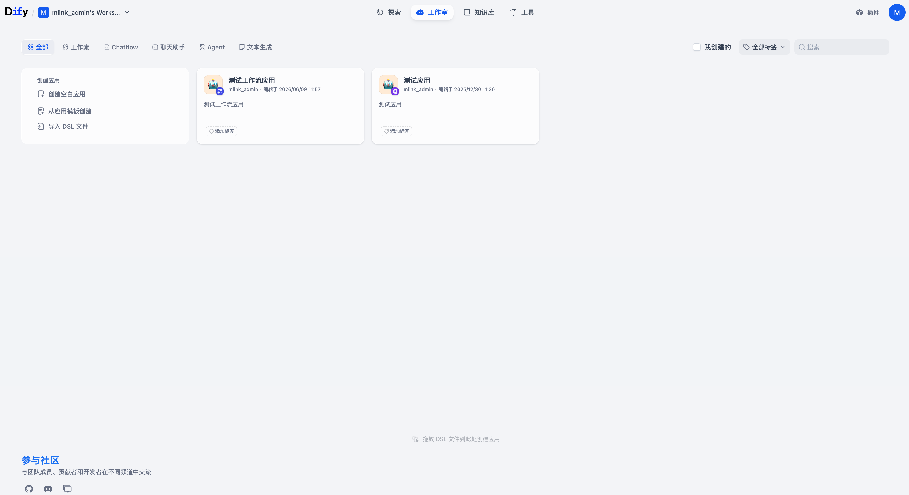
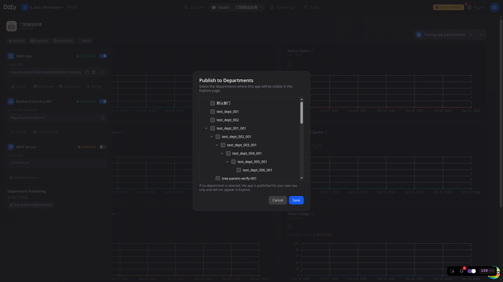
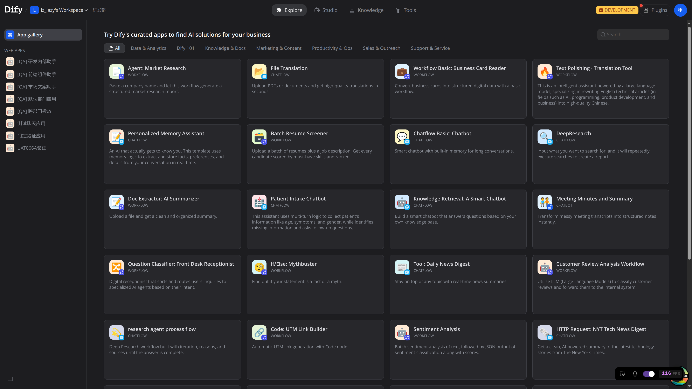
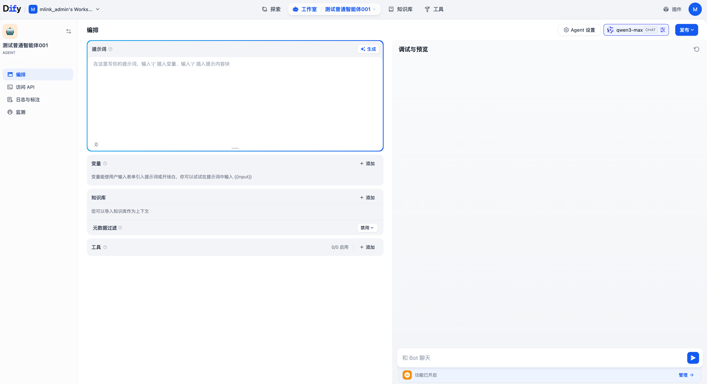
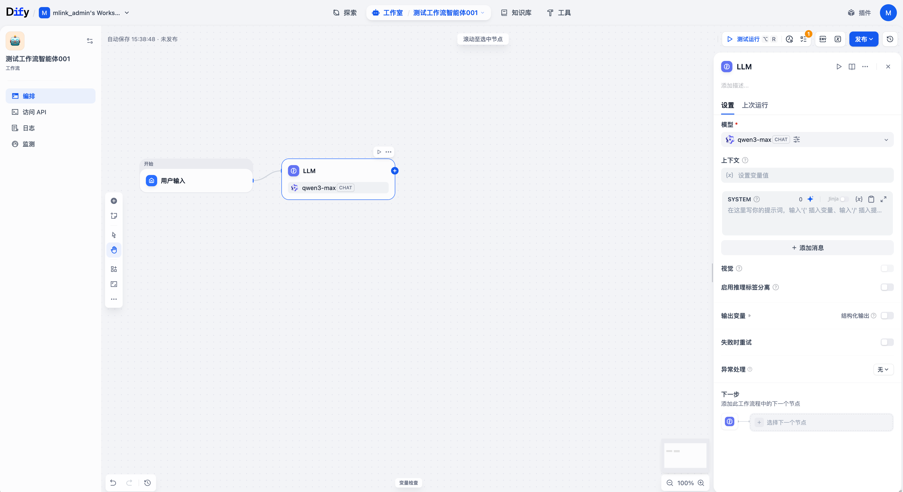
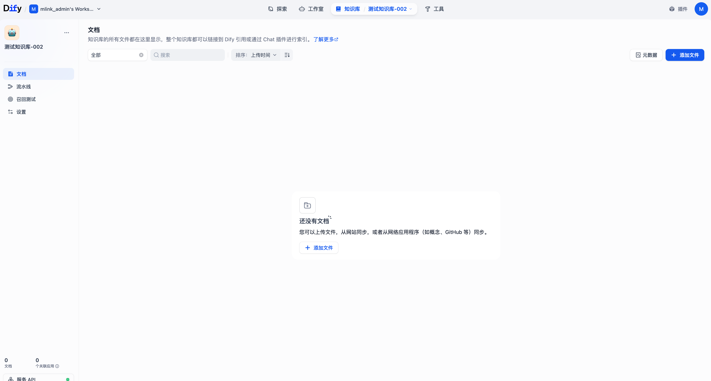
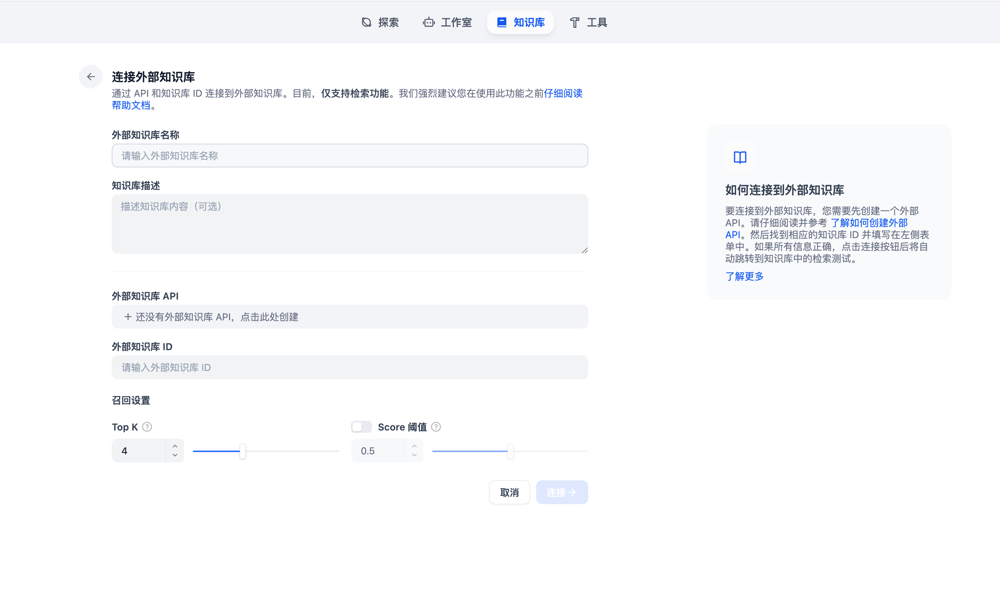

# Dify 使用讲解 · PPT 大纲（v3.4）

| 项 | 内容 |
| --- | --- |
| 文档用途 | 与成稿 pptx 逐页对齐，便于改文案 |
| 版本 | v3.4 · 2026-07-04 |
| 成稿 PPT | `docs/pptx/Dify-使用讲解-v3.4.pptx`（旧成稿） |
| 大纲试看 | [`docs/pptx/Dify-使用讲解-v3.4-outline-preview.pptx`](../../pptx/Dify-使用讲解-v3.4-outline-preview.pptx)（本大纲生成，Swiss + 阿里橙，57 页） |
| 生成脚本 | [`docs/pptx/generate-dify-outline-ppt.js`](../../pptx/generate-dify-outline-ppt.js) |
| 实际页数 | **57**（原 54 + 权限部分 3 页：分隔页 + 2 页正文） |
| 版式风格 | **SWISS STYLE**（国际主义：强网格、大字号、细线、留白） |
| 主题色 | 阿里橙 `#FF6A00`（强调色；辅色浅橙底 `#FFF3E8` 仅作弱底；暗底高亮 `#FF8F40`） |
| 截图目录 | [`dify-ppt-v3.4-screenshots/`](./dify-ppt-v3.4-screenshots/)（自 pptx 抽出，共 5 张） |
| 权限口径 | [`docs/nbys/培训-定制功能-PPT大纲.md`](../../nbys/培训-定制功能-PPT大纲.md) 浓缩为第二部分 2 页正文 |
| 对照旧大纲 | [`docs/superpowers/specs/2026-07-04-dify-ppt-outline-v2.md`](./2026-07-04-dify-ppt-outline-v2.md) |

**讨论说明**

- 在成稿 PPT 提取稿基础上修订：自定制培训大纲浓缩 **第二部分 · 平台权限管理及使用说明**（分隔页 + 2 页正文），其后各部分序号顺延。
- 视觉口径：**SWISS STYLE 版式 + 阿里橙强调色**（结构/网格走 Swiss；色相不用克莱因蓝，改用 `#FF6A00`）。
- 大纲页码以本文件序号 1–57 为准；原 pptx 页脚 `/ 63` 等残留改片时一并修正。
- 总结分隔页统一为 **第十一部分**（不再使用「第十三部分」旧序号）。
- 原「案例要点总结 / 检索策略优化」仍保留在普通知识库段落后，疑似已删「工作流知识库」残留，改片时可删或并入上一页。
- 原成稿带图页顺延后为：第 6 / 14 / 21 / 35 / 45 页；权限部分另引 `docs/nbys/manual-screenshots/`。
- 权限细节以使用手册为准；本部分两页只讲规则与路径，不展开逐步点击。
- 试看片由 `docs/pptx/generate-dify-outline-ppt.js` 自本大纲生成；改大纲后可重跑脚本刷新试看。

---

## 视觉风格（SWISS STYLE + 阿里橙）

出片与预览：**国际主义版式（Swiss）**，强调色为 **阿里橙**（非克莱因蓝）。对齐既有 Swiss 片骨架（大字号、细线、非对称网格、克制装饰），仅替换 accent。

| 角色 | 色值 | 用法 |
| --- | --- | --- |
| 强调色 accent | `#FF6A00` | 页眉细线、标题下划线 / keyline、分隔页大号序号、页码当前态、截图顶线 |
| 浅橙底（弱） | `#FFF3E8` | 仅必要时作窄条标签底；不作大面积圆角卡片底 |
| 暗底高亮 | `#FF8F40` | 深色底上的细线或小号强调字 |
| 正文 | `#111111` / `#1A1A1A` | 标题与正文（偏重、高对比） |
| 次要说明 | `#666666` | 页脚、版本号、注释 |
| 纸面底 | `#FFFFFF` | 全片默认白底 |
| 分割线 | `#111111` 或 `#FF6A00` | 1–2px 直线；忌粗彩条堆叠 |

**Swiss 版式通则**

- 网格：宽银幕非对称；左边距固定，标题区与正文区用水平细线分隔；留白优先于填满。
- 字体：无衬线（Helvetica / Inter / 微软雅黑等）；封面与分隔页大字号、轻字重或重字重对比；正文中等字号、紧凑行距。
- 封面：白底；左侧或顶部 **2–4px 橙 keyline**；主标题超大近黑；角标小号大写 + 橙点缀；风格标注写 `SWISS STYLE`；版本灰字。
- 分隔页：超大「第 N 部分」用 `#FF6A00`；主题名近黑大字；少装饰，可用一条水平橙线；避免大块浅橙圆角底板。
- 内容页：页标题近黑 + 下方 2px 橙线（swiss rule）；小节标题可左侧 2px 橙竖线；列表近黑圆点或无点悬挂缩进；橙字只点缀关键词。
- 案例页（场景 / 方案 / 效果）：三栏网格 + 顶线区分，弱浅橙底可选；边框用细线而非厚阴影。
- 截图：直角白底 + 细灰边；顶部 **2px 橙线（swiss-lined）**；说明文字小号灰字。
- 页脚：`01 / 57` 式等宽页码；当前页可用橙；底边可用 1px 黑线或橙线二选一，全片统一。
- 禁止：紫系渐变、克莱因蓝主色、大面积发光、厚阴影、过度圆角「营销卡片」、满页橙色块。

---

## 全片结构一览（57 页）

1. 封面
2. 第一部分 · 平台概览（分隔页）
3. 1. Dify 是什么
4. 2. 核心功能
5. 3. 应用场景
6. 4. 界面导览
7. 第二部分 · 平台权限管理及使用说明（分隔页）
8. 5. 权限模型与组织
9. 6. 使用路径与操作要点
10. 第三部分 · 应用类型概览（分隔页）
11. 7. 五种应用类型
12. 第四部分 · 普通智能体（分隔页）
13. 8. 什么是普通智能体
14. 9. 创建流程
15. 10. 系统提示词设计
16. 11. 工具添加
17. 12. 案例演示：法律知识问答助手
18. 13. 案例要点总结
19. 第五部分 · 工作流智能体（分隔页）
20. 14. 什么是工作流智能体
21. 15. 工作流设计器
22. 16. 节点类型
23. 17. 变量传递
24. 18. 案例演示：信息提取助手
25. 19. 案例要点总结
26. 第六部分 · Chatflow 智能体（分隔页）
27. 20. 什么是 Chatflow
28. 21. 对话流设计
29. 22. 上下文管理
30. 23. 对话开场白
31. 24. 案例演示：多轮问答助手
32. 25. 案例要点总结
33. 第七部分 · 普通知识库（分隔页）
34. 26. 什么是知识库
35. 27. 创建知识库
36. 28. 文档上传
37. 29. 分段策略
38. 30. 检索模式
39. 31. 案例演示：产品手册问答
40. 32. 案例要点总结
41. 33. 案例要点总结
42. 第八部分 · 外部知识库（分隔页）
43. 34. 什么是外部知识库
44. 35. 外部知识库 API
45. 36. 创建外部知识库
46. 37. 检索配置
47. 38. 使用场景：连接企业知识系统（企业网盘）
48. 第九部分 · API 集成（分隔页）
49. 39. API集成概览
50. 第十部分 · 最佳实践 — 会议纪要助手（分隔页）
51. 40. 案例场景
52. 41. 知识库与工作流设计
53. 42. 智能体配置
54. 43. 发布与总结
55. 第十一部分 · 总结（分隔页）
56. 44. 内容回顾
57. 感谢聆听 / Q&A

---

## 第 1 页 · 封面

**版式建议**：SWISS STYLE；白底 + 左侧 2–4px 橙 keyline；主标题超大近黑；角标小号；风格标注保留 SWISS STYLE

**要点**

- 角标：DIFY · V3.4
- 主标题：Dify 使用分享
- 版本：v3.4 | 2026-07-04
- 风格标注：2026-07-04 · SWISS STYLE

---

## 第 2 页 · 第一部分 · 平台概览（分隔页）

**版式建议**：SWISS 分隔页；大号「第一部分」用 `#FF6A00`；「平台概览」近黑；一条水平橙线；少装饰（后续各分隔页同此）

**要点**

- 分隔页：第一部分
- 主题：平台概览

---

## 第 3 页 · 1. Dify 是什么

**要点**

- 一句话定义
  - Dify 是一个开源的大语言模型（LLM）应用开发平台
  - 让开发者和业务人员快速构建 AI 应用，无需复杂编程
- 核心价值
  - 可视化编排：通过拖拽节点构建复杂工作流
  - 模型无关：支持数百种 LLM 模型，灵活切换
  - 快速部署：Docker 一键部署，开箱即用
  - 企业级：支持团队协作、权限管理、API 集成
  - 安全可控：配合私有化部署模型，数据安全不联网

---

## 第 4 页 · 2. 核心功能

**要点**

- 工作流（Workflow）：可视化流程编排，支持条件分支、循环、变量传递
- Agent（智能体）：具备推理和工具调用能力，可自主决策完成复杂任务
- RAG（检索增强生成）：基于知识库的问答系统，减少模型幻觉
- 模型管理：统一配置多家模型供应商，灵活切换和对比
- API 集成：提供标准 REST API，轻松集成到现有系统

---

## 第 5 页 · 3. 应用场景

**要点**

- 智能客服：7x24 小时自动回复，处理常见问题，提升客户满意度
- 内容生成：文章撰写、营销文案、产品描述，提高创作效率
- 数据分析：从非结构化数据中提取洞察，生成报告和摘要
- 知识问答：基于企业内部文档构建问答系统，快速检索知识
- 代码助手：代码生成、代码审查、技术文档生成
- 教育培训：个性化学习助手、智能答疑、课程内容生成

---

## 第 6 页 · 4. 界面导览

**要点**

- 控制台：应用列表、快速入口、使用统计
- 应用列表：管理所有创建的应用，支持搜索和筛选
- 知识库：管理文档、配置检索策略
- 工具：内置工具和自定义工具管理
- 插件：扩展 Dify 功能的插件市场
- 截图：Dify 控制台主界面

---

## 第 7 页 · 第二部分 · 平台权限管理及使用说明（分隔页）

**版式建议**：SWISS 分隔页；大号「第二部分」用 `#FF6A00`；主题名近黑；一条水平橙线（与各分隔页一致）

**要点**

- 分隔页：第二部分
- 主题：平台权限管理及使用说明
- 口径来源：[`docs/nbys/培训-定制功能-PPT大纲.md`](../../nbys/培训-定制功能-PPT大纲.md) 浓缩；细节回指 [`使用手册-部门访问控制.md`](../../nbys/使用手册-部门访问控制.md)

---

## 第 8 页 · 5. 权限模型与组织

**版式建议**：左「相对开源差异」+ 右「角色」双栏；底部一条橙强调：「改配置看归属，能不能用看发布。」

**要点**

- 相对开源多了什么
  - 部门树与组织分权
  - 工作室 / 知识库按归属部门隔离
  - 发布到部门后，探索与 `/chat` 才可用
  - `/chat` 须登录且发布到当前用户部门（所有者也不豁免）
  - 嵌入须合法 `embed_token`
  - 模型白名单（控成本与合规）；知识库「所有部门成员」= 精确同部门、不含子部门
- 四类角色
  - 租户管理员 / 部门管理员 / 编辑 / 成员
  - 部门管理员徽章 ≠ 租户管理员；建部门树仅租户管理员
- 核心概念：归属 vs 发布
  - 归属 = 谁能在工作室改配置；发布 = 谁能在探索 / `/chat` 使用
  - 一句话：改配置看归属，能不能用看发布
- 默认部门与误区
  - 默认部门不可作父部门、不可删、不可移；业务请建独立部门
  - 树：同父唯一名、最多 10 级
  - 误区：转移 ≠ 取消发布；发布到 B ≠ B 能改配置
- 能力边界（精简矩阵）
  - 部门 CRUD / 设部门管理员 / 转移归属 / 配模型权限：主要租户管理员
  - 创建成员：租户管理员；部门管理员须具备「编辑」角色才能建人
  - 发布：编辑通常只能发本部门；探索可见性看发布部门 ∩ 用户部门（或管辖范围）

---

## 第 9 页 · 6. 使用路径与操作要点

**版式建议**：上半「怎么管 / 怎么发」步骤条；下半「协作路径 + 运行与模型」两卡；右下角注明手册路径

**要点**

- 部门与成员
  - 入口：`设置 > 部门管理`；删前检查：无子部门、无成员、无归属资产、无发布勾选
  - 创建成员：姓名 / 邮箱 / 密码 / 部门 / 角色；邮箱全局唯一
  - 任命部门管理员仅租户管理员；管辖 = 本部门 + 子部门
  - 调岗：人走、资产留原部门；曾是部门管理员则徽章取消
- 工作室 / 知识库可见性
  - 租户可全量筛选；部门管理员见本部门 + 子部门；编辑仅本部门；成员无知识库顶栏
  - 新建落入当前账号部门；转移归属仅租户管理员
- 发布、探索与标准协作
  - 启用站点 + 勾选发布部门；探索 = 已发布 + 站点开 + 发布到用户部门（或管辖范围）
  - 推荐路径：A 建 → 发布到 B → B 探索可用、工作室改不了；仅当 B 要维护配置时才转移归属并复核发布勾选
- 运行链接、嵌入与模型白名单
  - `/chat/{code}`：须登录 + 发布到当前用户部门
  - 嵌入 `/chatbot`：须合法 `embed_token`（snippet 自带；可签发 / 重置）
  - 模型权限：仅租户管理员，`设置 > 成员` → 模型权限；默认模型始终可用；保存过名单后新模型不会自动加入
- 课后速查 / 细节
  - 建组织并任命、跨部门协作、调岗、删部门检查清单 → 见使用手册 §8
  - 高频 FAQ（转移后仍可见、看不到创建部门、所有者 `/chat` 失败等）→ 见使用手册 / 定制培训 FAQ
  - 配套：[`docs/nbys/使用手册-部门访问控制.md`](../../nbys/使用手册-部门访问控制.md)
- 截图（可选，相对 `docs/nbys/`）
  - 部门列表 / 创建：`manual-screenshots/01-department-list.png`、`02-create-department.png`
  - 发布与探索：`manual-screenshots/06-publish-departments.png`、`07-explore.png`
  - 模型权限：`manual-screenshots/09-model-permissions.png`

---

## 第 10 页 · 第三部分 · 应用类型概览（分隔页）

**要点**

- 分隔页：第三部分
- 主题：应用类型概览

---

## 第 11 页 · 7. 五种应用类型

**要点**

- Chatbot（聊天助手）
  - 多轮对话应用，支持上下文记忆，适用于客服、问答
- Completion（文本生成）
  - 单次文本生成，输入-输出模式，适用于翻译、摘要、写作
- Agent（智能体）
  - 具备推理和工具调用能力，自主决策，适用于复杂任务
- Workflow（工作流）
  - 可视化流程编排，节点拖拽、条件分支，适用于数据处理、自动化流程
- Chatflow（对话流）
  - 基于工作流的对话应用，多轮对话 + 流程控制，适用于复杂对话场景

---

## 第 12 页 · 第四部分 · 普通智能体（分隔页）

**要点**

- 分隔页：第四部分
- 主题：普通智能体

---

## 第 13 页 · 8. 什么是普通智能体

**要点**

- 定义
  - 普通智能体是 Dify 中最基础的应用类型，通过配置提示词和工具，让模型完成特定任务
- 特点
  - 配置简单：只需设置提示词和选择模型
  - 快速上手：无需编排工作流，适合简单场景
  - 灵活扩展：可添加工具增强能力
- 适用场景
  - 简单问答、文本生成、翻译、摘要等
- 包含的应用类型
  - 聊天助手（Chatbot）、文本生成（Completion）、Agent（智能体）

---

## 第 14 页 · 9. 创建流程

**要点**

- 步骤 1：点击【创建应用】，选择应用类型（聊天助手/文本生成/Agent）
- 步骤 2：填写应用名称和描述
- 步骤 3：选择模型（如通义千问等）
- 步骤 4：配置系统提示词，定义模型的角色和行为
- 步骤 5：（可选）添加工具，增强模型能力
- 步骤 6：点击【发布】，应用即可使用
- 截图：创建应用界面

---

## 第 15 页 · 10. 系统提示词设计

**要点**

- 角色设定
  - 明确告诉模型它是谁，如【你是一位专业的法律顾问】
- 规则约束
  - 定义模型的行为边界，如【只回答法律问题，拒绝回答其他问题】
- 输出格式
  - 指定输出结构，如【回答必须包含：法律依据、分析过程、建议措施】
- 示例
  - 你是一位专业的法律顾问，专注于民事法律问题。请根据用户描述的情况，提供法律依据、分析过程和建议措施。如果问题超出民事法律范围，请明确告知。

---

## 第 16 页 · 11. 工具添加

**要点**

- 内置工具
  - Dify 提供 50+ 内置工具
  - 直接在应用配置中勾选需要的工具即可
- 使用场景
  - 查询实时数据（天气、股票、新闻）
  - 调用企业内部 API（订单、库存、用户信息）
  - 执行特定操作（发送邮件、创建任务）

---

## 第 17 页 · 12. 案例演示：法律知识问答助手

**要点**

- 场景
  - 用户需要一个能解答民事法律问题的智能助手，提供法律依据和建议。
- 方案
  - 创建聊天助手，配置系统提示词定义法律专家角色，设定回答格式包含法律依据、分析过程和建议措施。
- 效果
  - 智能体能准确识别法律问题，引用相关法条，给出专业且易懂的法律建议。

---

## 第 18 页 · 13. 案例要点总结

**要点**

- 提示词设计技巧
  - 角色设定要具体：明确专业领域和身份
  - 规则约束要清晰：定义什么能做、什么不能做
  - 输出格式要规范：结构化输出便于用户理解
- 边界处理
  - 明确告知模型能力范围，超出范围时主动说明
  - 添加免责声明，提醒用户咨询专业律师

---

## 第 19 页 · 第五部分 · 工作流智能体（分隔页）

**要点**

- 分隔页：第五部分
- 主题：工作流智能体

---

## 第 20 页 · 14. 什么是工作流智能体

**要点**

- 定义
  - 工作流智能体通过可视化流程编排，将多个节点连接起来，完成复杂任务
- 与普通智能体的区别
  - 普通智能体：单步执行，模型直接生成结果
  - 工作流智能体：多步执行，可包含条件判断、循环、变量传递
- 适用场景
  - 需要多步骤处理的复杂任务
  - 需要条件分支的逻辑处理
  - 需要调用多个工具或 API 的场景

---

## 第 21 页 · 15. 工作流设计器

**要点**

- 画布操作：拖拽节点、连线、缩放、平移
- 节点拖拽：从左侧面板拖拽节点到画布
- 连线：点击节点输出端口，拖拽到另一个节点输入
- 调试：点击【调试】按钮，测试工作流执行
- 版本管理：保存多个版本，可随时回滚
- 截图：工作流设计器界面

---

## 第 22 页 · 16. 节点类型

**要点**

- 开始节点
  - 工作流入口，定义输入变量
- LLM 节点
  - 调用大语言模型，生成文本
- 条件节点
  - 根据条件分支，执行不同路径
- 变量节点
  - 定义和传递变量
- 结束节点
  - 工作流出口，定义输出变量

---

## 第 23 页 · 17. 变量传递

**要点**

- 输入变量
  - 从开始节点传入，或从上游节点输出
- 输出变量
  - 节点执行后产生的结果，可传递给下游节点
- 变量引用
  - 在节点中使用 {{variable_name}} 引用变量
  - 支持字符串、数字、对象、数组等类型
- 示例
  - 开始节点输入：{{user_input}}
  - LLM 节点输出：{{llm_result}}
  - 结束节点输出：{{final_output}}

---

## 第 24 页 · 18. 案例演示：信息提取助手

**要点**

- 场景
  - 从非结构化文本中提取关键信息（人名、时间、地点、事件），输出结构化 JSON。
- 方案
  - 设计工作流：开始节点接收文本 → LLM 节点提取信息  → 结束节点输出。
- 效果
  - 自动从任意文本中提取结构化信息，准确率高，输出格式统一。

---

## 第 25 页 · 19. 案例要点总结

**要点**

- 节点编排
  - 合理拆分任务，每个节点完成一个明确的子任务
  - 使用条件节点处理不同情况
- 输出格式化
  - 使用代码节点格式化输出，确保结构统一
  - 异常处理

---

## 第 26 页 · 第六部分 · Chatflow 智能体（分隔页）

**要点**

- 分隔页：第六部分
- 主题：Chatflow 智能体

---

## 第 27 页 · 20. 什么是 Chatflow

**要点**

- 定义
  - Chatflow 是基于工作流的对话应用，结合了工作流的流程控制和对话的多轮交互
- 与工作流的区别
  - 工作流：单次执行，输入→处理→输出
  - Chatflow：多轮对话，支持上下文记忆和流程控制
- 适用场景
  - 需要多轮对话收集信息的场景
  - 需要根据对话内容动态调整流程的场景
  - 复杂的客服、咨询、导购场景

---

## 第 28 页 · 21. 对话流设计

**要点**

- 多轮对话
  - 支持上下文记忆，模型能记住之前的对话内容
- 上下文传递
  - 通过变量在不同节点间传递对话上下文
- 流程控制
  - 根据用户回答动态调整对话流程
  - 使用条件节点判断用户意图，进入不同分支

---

## 第 29 页 · 22. 上下文管理

**要点**

- 会话记忆
  - 自动保存对话历史，支持多轮交互
  - 可配置记忆轮数，控制上下文长度
- 变量作用域
  - 全局变量：整个会话期间有效
  - 局部变量：单个节点内有效
  - 会话变量：单次对话内有效

---

## 第 30 页 · 23. 对话开场白

**要点**

- 设置方法
  - 在应用配置中设置开场白内容
  - 支持文本、图片、按钮等多种元素
- 引导设计
  - 明确告诉用户能做什么、不能做什么
  - 提供示例问题，引导用户提问
  - 设置快捷按钮，方便用户选择

---

## 第 31 页 · 24. 案例演示：多轮问答助手

**要点**

- 场景
  - 构建一个能通过多轮对话收集用户信息并给出建议的助手。
- 方案
  - 使用 Chatflow 设计对话流程：开场引导 → 问题分类 → 追问收集 → 综合建议。
- 效果
  - 助手能自然地引导对话，收集完整信息后给出个性化建议。

---

## 第 32 页 · 25. 案例要点总结

**要点**

- 上下文管理技巧
  - 合理设置记忆轮数，避免上下文过长影响性能
  - 使用变量保存关键信息，便于后续使用
  - 设计清晰的对话流程，避免用户迷路

---

## 第 33 页 · 第七部分 · 普通知识库（分隔页）

**要点**

- 分隔页：第七部分
- 主题：普通知识库

---

## 第 34 页 · 26. 什么是知识库

**要点**

- 定义
  - 知识库是存储和管理文档的系统，支持基于文档的问答
- RAG 原理简介
  - RAG（Retrieval-Augmented Generation）= 检索 + 生成
  - 先从知识库检索相关文档，再让模型基于检索结果生成回答
  - 减少模型幻觉，提高回答准确性

---

## 第 35 页 · 27. 创建知识库

**要点**

- 步骤 1：进入知识库页面，点击【创建知识库】
- 步骤 2：填写知识库名称和描述
- 步骤 3：选择索引模式（高质量/经济）
- 步骤 4：上传文档，等待处理完成
- 截图：创建知识库界面

---

## 第 36 页 · 28. 文档上传

**要点**

- 支持格式
  - 文本文件：TXT、MD、HTML
  - 办公文档：PDF、DOCX、PPTX、XLSX
  - 电子书：EPUB
- 大小限制
  - 单文件最大 15MB
  - 单个知识库最多 1000 个文档

---

## 第 37 页 · 29. 分段策略

**要点**

- 自动分段
  - 系统自动按段落、句子分段
  - 适合结构清晰的文档
- 自定义分段
  - 按指定分隔符分段（如换行、特定标记）
  - 适合特定格式的文档
- 分段长度
  - 建议 300-500 token，平衡检索精度和上下文

---

## 第 38 页 · 30. 检索模式

**要点**

- 语义检索（向量检索）
  - 基于向量相似度检索，理解语义
  - 适合模糊查询、概念匹配
- 关键词检索（全文检索）
  - 基于关键词匹配，精确查找
  - 适合专有名词、编号查询
- 混合检索
  - 结合语义和关键词，综合排序
  - 推荐默认使用，效果最佳

---

## 第 39 页 · 31. 案例演示：产品手册问答

**要点**

- 场景
  - 基于产品手册构建问答系统，用户可查询产品功能和使用方法。
- 方案
  - 创建知识库上传产品手册，配置混合检索模式，创建聊天助手关联知识库。
- 效果
  - 用户提问产品相关问题时，系统从手册中检索相关内容并生成准确回答。

---

## 第 40 页 · 32. 案例要点总结

**要点**

- 分段策略选择
  - 结构化文档（如手册）：使用自动分段
  - 非结构化文档（如笔记）：使用自定义分段
- 召回优化
  - 调整 TopK 参数，控制返回文档数量
  - 使用 Rerank 模型，提高检索精度

---

## 第 41 页 · 33. 案例要点总结

**要点**

- 检索策略优化
  - 根据实际效果调整 TopK 和 Score 阈值
  - 使用 Rerank 模型提高检索精度
  - 定期更新知识库，保持内容新鲜

---

## 第 42 页 · 第八部分 · 外部知识库（分隔页）

**要点**

- 分隔页：第八部分
- 主题：外部知识库

---

## 第 43 页 · 34. 什么是外部知识库

**要点**

- 定义
  - 连接外部数据源的知识库，如企业已有的文档系统、数据库
- 与内部知识库的区别
  - 内部知识库：文档上传到 Dify，由 Dify 管理
  - 外部知识库：文档保留在外部系统，Dify 通过 API 检索
- 适用场景
  - 企业已有成熟的文档管理系统
  - 文档量大，不适合全部上传到 Dify
  - 需要实时检索最新数据

---

## 第 44 页 · 35. 外部知识库 API

**要点**

- API 规范
  - 遵循 Dify 外部知识库 API 规范
  - 提供检索接口，接收查询请求，返回相关文档
- 认证方式
  - API Key：简单认证，适合内部系统
  - OAuth：标准认证，适合第三方系统
- 请求格式
  - POST 请求，包含查询文本和参数
  - 返回 JSON 格式，包含检索结果

---

## 第 45 页 · 36. 创建外部知识库

**要点**

- 步骤 1：配置 API 端点和认证信息
- 步骤 2：创建外部知识库，填写名称和描述
- 步骤 3：绑定数据源，配置检索参数
- 步骤 4：测试检索，确认配置正确
- 截图：创建外部知识库界面

---

## 第 46 页 · 37. 检索配置

**要点**

- 检索参数
  - TopK：返回文档数量
  - Score 阈值：最低相关性分数
- 重排序
  - 使用 Rerank 模型对结果重新排序
- 过滤条件
  - 按文档类型、时间、标签等过滤

---

## 第 47 页 · 38. 使用场景：连接企业知识系统（企业网盘）

**要点**

- 场景
  - 企业已有内部知识库系统，需要在 Dify 中集成使用。
- 方案
  - 开发 API 适配层，在 Dify 中配置外部知识库连接，实现统一检索入口。
- 效果
  - 员工可通过 Dify 统一访问企业知识系统，无需切换多个平台。

---

## 第 48 页 · 第九部分 · API 集成（分隔页）

**要点**

- 分隔页：第九部分
- 主题：API 集成

---

## 第 49 页 · 39. API集成概览

**要点**

- API 概览
  - Dify 提供完整的 REST API，可集成到任何系统
  - 支持对话、文本生成、知识库检索等功能
- 认证方式
  - API Key：在请求头中传递 Authorization: Bearer {api_key}

---

## 第 50 页 · 第十部分 · 最佳实践 — 会议纪要助手（分隔页）

**要点**

- 分隔页：第十部分
- 主题：最佳实践 — 会议纪要助手

---

## 第 51 页 · 40. 案例场景

**要点**

- 场景
  - 输入会议内容（语音或文字），输出结构化会议纪要，包含议题、决议、待办事项。
- 方案
  - 使用 Dify 构建工作流：语音转文字 → 提取关键信息 → 生成结构化纪要。
- 效果
  - 自动从会议内容中提取关键信息，生成规范的会议纪要，节省人工整理时间。

---

## 第 52 页 · 41. 知识库与工作流设计

**要点**

- 知识库准备
  - 上传会议纪要模板，定义输出格式
  - 上传历史优秀纪要，作为参考
- 工作流设计
  - LLM 节点 1：提取关键信息（议题、决议、待办）
  - LLM 节点 2：基于模板生成结构化纪要
  - 代码节点：格式化输出

---

## 第 53 页 · 42. 智能体配置

**要点**

- 关联知识库
  - 绑定会议纪要模板知识库
- 提示词设计
  - 角色：专业的会议纪要整理助手
  - 任务：从会议内容中提取关键信息，按模板生成纪要
  - 输出格式：包含议题、决议、待办事项、负责人、截止时间

---

## 第 54 页 · 43. 发布与总结

**要点**

- 通过 API 将案例暴露为服务
  - 获取 API 密钥，集成到企业微信、钉钉或自有系统
  - 员工可直接在 IM 中发送会议内容，自动获取纪要
- 提示词技巧
  - 明确输出格式，使用结构化提示
- 性能优化
  - 使用合适的模型，平衡质量和成本
- 成本控制
  - 设置 Token 限制，避免超长输入

---

## 第 55 页 · 第十一部分 · 总结（分隔页）

**要点**

- 分隔页：第十一部分
- 主题：总结

---

## 第 56 页 · 44. 内容回顾

**要点**

- 平台权限管理及使用说明（部门归属 / 发布 / 角色）
- 法律知识问答助手（普通智能体）
- 信息提取助手（工作流智能体）
- 多轮问答助手（Chatflow 智能体）
- 产品手册问答（普通知识库）
- 连接企业知识系统（外部知识库）
- 核心知识点
  - 应用类型、平台权限、知识库、工作流、API 集成

---

## 第 57 页 · 感谢聆听 / Q&A

**要点**

- 感谢聆听
- Q&A 答疑环节

---

## 与 v2 大纲差异（摘要）

- v3.4 成稿相对 v2 大纲压缩：去掉模型配置、工作流知识库、工具与插件、发布与嵌入等整段章节。
- 现序分区为：平台概览 → **平台权限管理及使用说明** → 应用类型概览 → 普通智能体 → 工作流智能体 → Chatflow → 普通知识库 → 外部知识库 → API 集成 → 最佳实践（会议纪要助手）→ 总结（共十一部分，57 页）。
- 第二部分 2 页正文浓缩自 [`培训-定制功能-PPT大纲.md`](../../nbys/培训-定制功能-PPT大纲.md)；细节仍以使用手册为准。
- 页脚与旧 pptx 部分序号残留改片时一并修正；视觉口径为 **SWISS STYLE + 阿里橙** `#FF6A00`。
