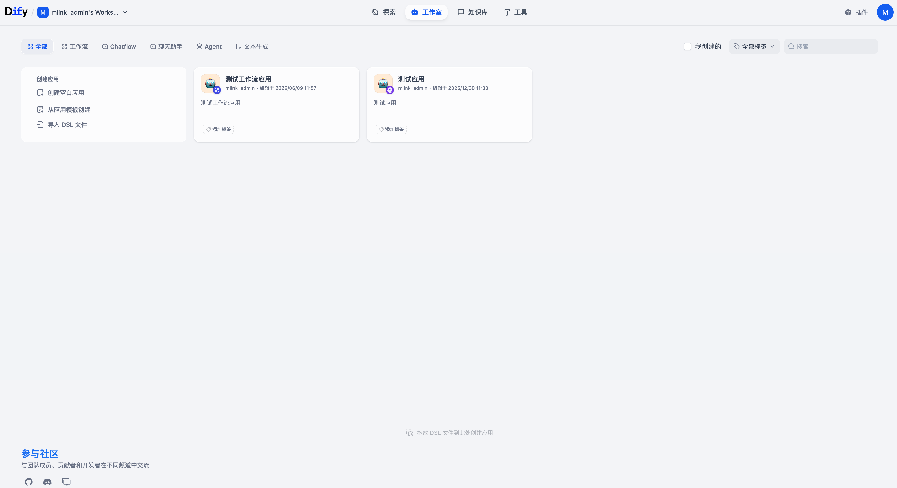
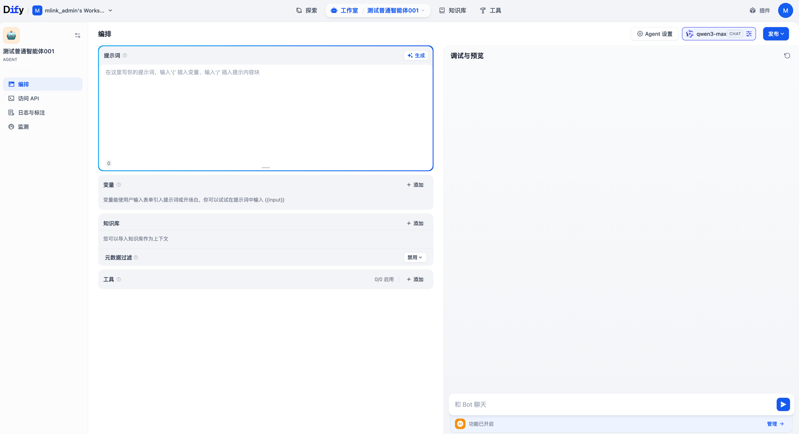
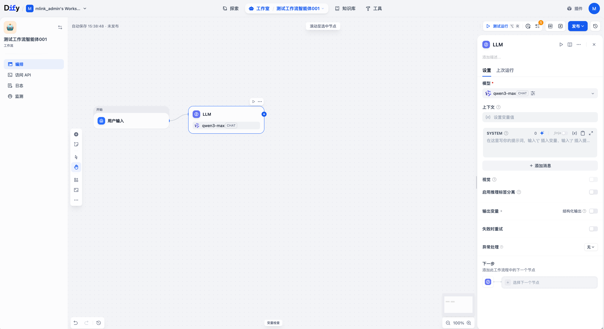
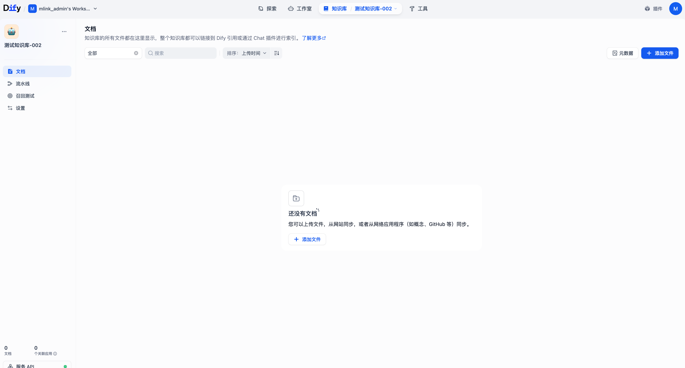
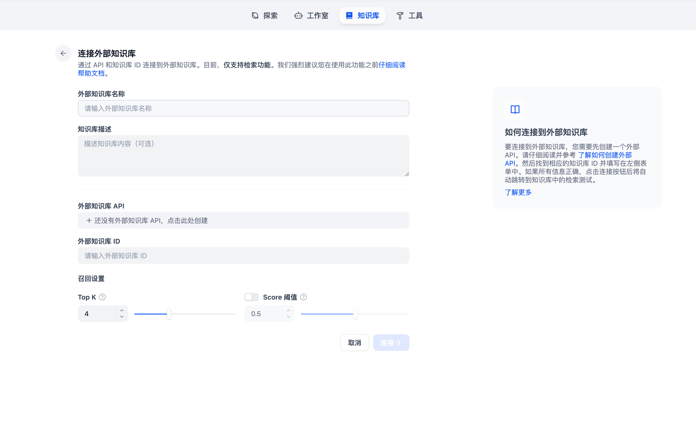

<style>
/* 大纲预览：SWISS STYLE + 阿里橙强调色（部分渲染器可能忽略） */
:root {
  --ali-orange: #FF6A00;
  --ali-orange-soft: #FFF3E8;
  --ali-orange-bright: #FF8F40;
}
h1 { color: #1A1A1A; border-bottom: 3px solid var(--ali-orange); padding-bottom: 0.35em; }
h2 { color: #1A1A1A; border-left: 4px solid var(--ali-orange); padding-left: 0.55em; }
table thead th { background: var(--ali-orange); color: #fff; }
hr { border: 0; border-top: 2px solid var(--ali-orange); opacity: 0.85; }
blockquote { border-left: 4px solid var(--ali-orange); background: var(--ali-orange-soft); }
a { color: var(--ali-orange); }
strong { color: #C25500; }
</style>

# Dify 使用讲解 · PPT 大纲（v3.5）

| 项 | 内容 |
| --- | --- |
| 文档用途 | 与成稿 pptx 逐页对齐，便于改文案 |
| 版本 | v3.5 · 基于 v3.4 大纲复制，待修订 |
| 成稿 PPT | `docs/pptx/Dify-使用讲解-v3.4.pptx`（旧成稿） |
| 大纲试看 | [`docs/pptx/Dify-使用讲解-v3.5.pptx`](../../pptx/Dify-使用讲解-v3.5.pptx)（本大纲生成，Swiss + 阿里橙，46 页；同页撑满布局） |
| 生成脚本 | [`docs/pptx/generate-dify-outline-ppt.js`](../../pptx/generate-dify-outline-ppt.js) |
| 实际页数 | **46**（工作流 / Chatflow / 普通知识库 三组「案例+要点」各合 1 页） |
| 版式风格 | **SWISS STYLE**（国际主义：强网格、大字号、细线、留白） |
| 正文字体 | **微软雅黑**（全片统一；含标题、正文、页脚） |
| 主题色 | 阿里橙 `#FF6A00`（强调色；辅色浅橙底 `#FFF3E8` 仅作弱底；暗底高亮 `#FF8F40`） |
| 截图目录 | [`dify-ppt-v3.4-screenshots/`](./dify-ppt-v3.4-screenshots/)（自 pptx 抽出，共 5 张） |
| 权限口径 | [`docs/nbys/培训-定制功能-PPT大纲.md`](../../nbys/培训-定制功能-PPT大纲.md) 浓缩为第二部分 2 页正文 |
| 对照旧大纲 | [`docs/superpowers/specs/2026-07-04-dify-ppt-outline-v2.md`](./2026-07-04-dify-ppt-outline-v2.md) |

**讨论说明**

- 本文件由 [`2026-11-18-dify-ppt-outline-v3.4.md`](./2026-11-18-dify-ppt-outline-v3.4.md) **原样复制** 为 v3.5，供独立修订；请勿回写覆盖 v3.4。
- 在成稿 PPT 提取稿基础上修订：自定制培训大纲浓缩 **第二部分 · 平台权限管理及使用说明**（分隔页 + 2 页正文），其后各部分序号顺延。
- 视觉口径：**SWISS STYLE 版式 + 阿里橙强调色**（结构/网格走 Swiss；色相不用克莱因蓝，改用 `#FF6A00`）。
- 大纲页码以本文件序号 1–46 为准；原 pptx 页脚 `/ 63` 等残留改片时一并修正。
- 总结分隔页统一为 **第十一部分**（不再使用「第十三部分」旧序号）。
- 原两页重复「案例要点总结」（含工作流知识库残留口径）已合并为第 37 页一页。
- 第八部分外部知识库：正文由 5 页压为 2 页（「是什么」+「接入与配置」）。
- 普通智能体：原「案例演示」与「案例要点总结」合并为第 17 页「12. 案例：法律知识问答助手」。
- 原成稿带图页顺延后为：第 6 / 14 / 20 / 32 / 37 页；权限部分另引 `docs/nbys/manual-screenshots/`。
- 权限细节以使用手册为准；本部分两页只讲规则与路径，不展开逐步点击。
- 试看片由 `docs/pptx/generate-dify-outline-ppt.js` 自本大纲生成；改大纲后可重跑脚本刷新试看。
- 第 4 页同页双区：上「A 核心能力」五卡 + 下「B 系统架构」用 PPT 形状直接画四层（不贴图）。

---

## 视觉风格（SWISS STYLE + 阿里橙）

出片与预览：**国际主义版式（Swiss）**，强调色为 **阿里橙**（非克莱因蓝）。对齐既有 Swiss 片骨架（大字号、细线、非对称网格、克制装饰），仅替换 accent。

| 角色 | 色值 | 用法 |
| --- | --- | --- |
| 强调色 accent | `#FF6A00` | 页眉细线、标题下划线 / keyline、分隔页大号序号、页码当前态、截图顶线 |
| 浅橙底（弱） | `#FFF3E8` | 仅必要时作窄条标签底；不作大面积圆角卡片底 |
| 暗底高亮 | `#FF8F40` | 深色底上的细线或小号强调字 |
| 正文 | `#111111` / `#1A1A1A` | 标题与正文（偏重、高对比） |
| 次要说明 | `#666666` | 页脚、版本号、注释 |
| 纸面底 | `#FFFFFF` | 全片默认白底 |
| 分割线 | `#111111` 或 `#FF6A00` | 1–2px 直线；忌粗彩条堆叠 |

**Swiss 版式通则**

- 网格：宽银幕非对称；左边距固定，标题区与正文区用水平细线分隔；留白优先于填满。
- 字体：全片统一 **微软雅黑**（英文/数字亦用微软雅黑，不再混用 Helvetica / Inter / Arial）；封面与分隔页大字号、字重对比；正文中等字号、紧凑行距。
- 封面：白底；左侧或顶部 **2–4px 橙 keyline**；主标题超大近黑；角标小号大写 + 橙点缀；风格标注写 `SWISS STYLE`；版本灰字。
- 分隔页：超大「第 N 部分」用 `#FF6A00`；主题名近黑大字；少装饰，可用一条水平橙线；避免大块浅橙圆角底板。
- 内容页：页标题近黑 + 下方 2px 橙线（swiss rule）；小节标题可左侧 2px 橙竖线；列表近黑圆点或无点悬挂缩进；橙字只点缀关键词。
- 案例页（场景 / 方案 / 效果）：三栏网格 + 顶线区分，弱浅橙底可选；边框用细线而非厚阴影。
- 截图：直角白底 + 细灰边；顶部 **2px 橙线（swiss-lined）**；说明文字小号灰字。
- 页脚：`01 / 46` 式等宽页码；当前页可用橙；底边可用 1px 黑线或橙线二选一，全片统一。
- 禁止：紫系渐变、克莱因蓝主色、大面积发光、厚阴影、过度圆角「营销卡片」、满页橙色块。

---

## 全片结构一览（46 页）

1. 封面
2. 第一部分 · 平台概览（分隔页）
3. 1. Dify 是什么
4. 2. 系统架构与核心功能
5. 3. 应用场景
6. 4. 界面导览
7. 第二部分 · 平台权限管理及使用说明（分隔页）
8. 5. 权限模型与组织
9. 6. 使用路径与操作要点
10. 第三部分 · 应用类型概览（分隔页）
11. 7. 五种应用类型
12. 第四部分 · 普通智能体（分隔页）
13. 8. 什么是普通智能体
14. 9. 创建流程
15. 10. 系统提示词设计
16. 11. 工具添加
17. 12. 案例：法律知识问答助手
18. 第五部分 · 工作流智能体（分隔页）
19. 13. 什么是工作流智能体
20. 14. 工作流设计器
21. 15. 节点与变量
22. 16. 案例：信息提取助手
23. 第六部分 · Chatflow 智能体（分隔页）
24. 17. 什么是 Chatflow
25. 18. 对话流设计
26. 19. 上下文管理
27. 20. 对话开场白
28. 21. 案例：多轮问答助手
29. 第七部分 · 普通知识库（分隔页）
30. 22. 什么是知识库
31. 23. 创建知识库
32. 24. 文档、分段与检索
33. 25. 案例：产品手册问答
34. 第八部分 · 外部知识库（分隔页）
35. 26. 外部知识库是什么
36. 27. 接入与配置
37. 第九部分 · API 集成（分隔页）
38. 28. API集成概览
39. 第十部分 · 最佳实践 — 会议纪要助手（分隔页）
40. 29. 案例场景
41. 30. 知识库与工作流设计
42. 31. 智能体配置
43. 32. 发布与总结
44. 第十一部分 · 总结（分隔页）
45. 33. 内容回顾
46. 感谢聆听 / Q&A

---

## 第 1 页 · 封面

**版式建议**：SWISS STYLE；白底 + 左侧 2–4px 橙 keyline；主标题超大近黑；角标小号；风格标注保留 SWISS STYLE

**要点**

- 角标：DIFY · V3.5
- 主标题：Dify 使用分享
- 版本：v3.5 | 待定
- 风格标注：待定 · SWISS STYLE

---

## 第 2 页 · 第一部分 · 平台概览（分隔页）

**版式建议**：SWISS 分隔页；大号「第一部分」用 `#FF6A00`；「平台概览」近黑；一条水平橙线；少装饰（后续各分隔页同此）

**要点**

- 分隔页：第一部分
- 主题：平台概览

---

## 第 3 页 · 1. Dify 是什么

**版式建议（图形页）**：上「定义条」+ 下「五柱价值」；勿纯列表。Swiss：白底、橙序号、细线分隔；微软雅黑。

**图形结构**

```text
┌─────────────────────────────────────────────────────────────┐
│  1. Dify 是什么                                              │
│  ─────────────────────────────────────────────────────────  │  ← 2px 橙 rule
│                                                             │
│  ┌─ 定义条（通栏，左 4px 橙竖线）─────────────────────────┐ │
│  │  开源 LLM 应用开发平台                                   │ │
│  │  让开发者与业务人员快速构建 AI 应用 · 无需复杂编程      │ │
│  └─────────────────────────────────────────────────────────┘ │
│                                                             │
│  核心价值                                                    │
│  ┌────┐ ┌────┐ ┌────┐ ┌────┐ ┌────┐                        │
│  │ 01 │ │ 02 │ │ 03 │ │ 04 │ │ 05 │   ← 五等分柱，顶橙线   │
│  │编排│ │模型│ │部署│ │企业│ │安全│                        │
│  │…   │ │…   │ │…   │ │…   │ │…   │                        │
│  └────┘ └────┘ └────┘ └────┘ └────┘                        │
└─────────────────────────────────────────────────────────────┘
```

**要点（出片用）**

- 定义条（大字 / 次行）
  - 主句：开源的大语言模型（LLM）应用开发平台
  - 副句：让开发者和业务人员快速构建 AI 应用，无需复杂编程
- 五柱（每柱：橙序号 + 短标题 + 一行说明）
  - 01 可视化编排 — 拖拽节点构建复杂工作流
  - 02 模型无关 — 支持数百种 LLM，灵活切换
  - 03 快速部署 — Docker 一键部署，开箱即用
  - 04 企业级 — 团队协作、权限管理、API 集成
  - 05 安全可控 — 私有化部署模型，数据不联网

---

## 第 4 页 · 2. 系统架构与核心功能

**版式建议（同页双区）**：**上核心能力、下系统架构**（PPT 形状直接画，**不贴图**）。上区约 38% 五卡一行；下区约 55% 四层扁条（左层名浅橙底 + 左橙竖条 + 右组件横排；层间小橙三角）。中间 1px 分隔。Swiss：白底、区标小号橙字、卡顶 2px 橙线；微软雅黑。

**图形结构**

```text
┌─────────────────────────────────────────────────────────────┐
│  2. 系统架构与核心功能                                       │
│  ─────────────────────────────────────────────────────────  │
│                                                             │
│  A  核心能力                                      ← 小号区标 │
│  ┌─────┐ ┌─────┐ ┌─────┐ ┌─────┐ ┌─────┐                  │
│  │WORK │ │AGENT│ │ RAG │ │MODEL│ │ API │                  │
│  │工作流│ │智能体│ │检索 │ │模型 │ │集成 │                  │
│  └─────┘ └─────┘ └─────┘ └─────┘ └─────┘                  │
│  ························· 分隔线 ························· │
│  B  系统架构（形状绘制）                          ← 小号区标 │
│  ┌─ 展示层 ──┤ Web 控制台 · API · 实时推送               │  │
│  ┌─ 应用层 ──┤ 工作流引擎 · RAG · 智能体 · 应用管理      │  │
│  ┌─ 核心层 ──┤ 模型运行时 · 知识库 · 工具 · 提示词引擎   │  │
│  ┌─ 基础设施 ┤ PostgreSQL · Redis · 向量库 · 对象存储 · MQ│  │
└─────────────────────────────────────────────────────────────┘
```

**要点（出片用）**

- 区 A · 核心能力（五卡；英文小标 + 中文名 + 半行说明；顶橙线）
  - WORKFLOW 工作流 — 可视化编排；分支 / 循环 / 变量
  - AGENT 智能体 — 推理与工具调用
  - RAG 检索增强 — 知识库问答，降幻觉
  - MODELS 模型管理 — 多供应商统一配置
  - API 集成 — 标准 REST，嵌入现有系统
- 区 B · 系统架构（出片用形状画四层；左层名 + 右组件）
  - 展示层 — Web 控制台、API、实时推送
  - 应用层 — 工作流引擎、RAG、智能体、应用管理
  - 核心层 — 模型运行时、知识库、工具、提示词引擎
  - 基础设施层 — PostgreSQL、Redis、向量库、对象存储、消息队列
- 素材对照：`docs/architecture/03-architecture-overview.md`（标签压缩，不写版本号）

---

## 第 5 页 · 3. 应用场景

**版式建议（图形页）**：2×3 场景宫格；每格「场景名（粗）+ 一句价值」。格间距均匀；每格顶橙细线或左橙竖线；场景名近黑，说明灰字。

**图形结构**

```text
┌─────────────────────────────────────────────────────────────┐
│  3. 应用场景                                                 │
│  ─────────────────────────────────────────────────────────  │
│                                                             │
│  ┌─ 智能客服 ─────────┐  ┌─ 内容生成 ─────────┐  ┌─ 数据分析 ─┐ │
│  │ 7×24 自动回复      │  │ 文案·描述·创作提效 │  │ 洞察·报告  │ │
│  └────────────────────┘  └────────────────────┘  └───────────┘ │
│                                                             │
│  ┌─ 知识问答 ─────────┐  ┌─ 代码助手 ─────────┐  ┌─ 教育培训 ─┐ │
│  │ 企内文档快速检索   │  │ 生成·审查·写文档   │  │ 答疑·个性化│ │
│  └────────────────────┘  └────────────────────┘  └───────────┘ │
└─────────────────────────────────────────────────────────────┘
```

**要点（出片用）**

- 智能客服 — 7×24 自动回复常见问题，提升满意度
- 内容生成 — 文章 / 营销文案 / 产品描述，提高创作效率
- 数据分析 — 非结构化数据提取洞察，生成报告与摘要
- 知识问答 — 基于企业内部文档构建问答，快速检索
- 代码助手 — 代码生成、审查与技术文档生成
- 教育培训 — 个性化学习助手、智能答疑、课程内容生成

---

## 第 6 页 · 4. 界面导览

**要点**

- 控制台：应用列表、快速入口、使用统计
- 应用列表：管理所有创建的应用，支持搜索和筛选
- 知识库：管理文档、配置检索策略
- 工具：内置工具和自定义工具管理
- 插件：扩展 Dify 功能的插件市场
- 截图：Dify 控制台主界面



---

## 第 7 页 · 第二部分 · 平台权限管理及使用说明（分隔页）

**版式建议**：SWISS 分隔页；大号「第二部分」用 `#FF6A00`；主题名近黑；一条水平橙线（与各分隔页一致）

**要点**

- 分隔页：第二部分
- 主题：平台权限管理及使用说明
- 口径来源：[`docs/nbys/培训-定制功能-PPT大纲.md`](../../nbys/培训-定制功能-PPT大纲.md) 浓缩；细节回指 [`使用手册-部门访问控制.md`](../../nbys/使用手册-部门访问控制.md)

---

## 第 8 页 · 5. 权限模型与组织

**版式建议（图形页）**：中部大对比「归属 | 发布」；上四角色胶囊；下四能力点宫格；底条橙强调一句。勿长列表。Swiss + 微软雅黑。

**图形结构**

```text
┌────────────────────────────────────────────────────────────┐
│  5. 权限模型与组织                                          │
│  ──────────────────────────────────────────────────────── │
│  [租户管理员] [部门管理员] [编辑] [成员]   ← 四角色横排     │
│   ※ 部门管理员 ≠ 租户管理员；建树仅租户管理员               │
│                                                            │
│  ┌──────── 归属 ────────┐    ┌──────── 发布 ────────┐     │
│  │ 谁能改配置            │ vs │ 谁能用（探索/运行页）  │     │
│  │ 工作室 / 知识库       │    │ 勾选到哪些部门        │     │
│  └──────────────────────┘    └──────────────────────┘     │
│         改配置看归属  ·  能不能用看发布                      │
│                                                            │
│  ┌部门树┐ ┌可见隔离┐ ┌运行须发布┐ ┌模型白名单┐              │
│  │组织分权│ │按归属看 │ │登录+部门 │ │租户可配  │              │
│  └──────┘ └───────┘ └─────────┘ └─────────┘              │
│  误区：转移≠取消发布；发布到 B ≠ B 能改配置                  │
└────────────────────────────────────────────────────────────┘
```

**要点（出片用）**

- 四角色（横排胶囊）
  - 租户管理员 / 部门管理员 / 编辑 / 成员
  - 注：部门管理员徽章 ≠ 租户管理员；建部门树仅租户管理员
- 核心对比（大双卡）
  - 归属：谁能在工作室 / 知识库改配置
  - 发布：谁能在「探索」与「应用运行页」使用
  - 金句：改配置看归属，能不能用看发布
- 相对开源多了什么（四宫格，每格一词+半句）
  - 部门树 — 组织分权
  - 可见隔离 — 工作室/知识库按归属部门
  - 运行须发布 — 须登录，且发布到当前用户部门
  - 模型白名单 — 控成本与合规（租户配置）
- 误区（底条，两条）
  - 转移 ≠ 取消发布
  - 发布到 B ≠ B 能改配置

---

## 第 9 页 · 6. 使用路径与操作要点

**版式建议（简化）**：上「三步条」+ 中「协作一句」+ 下「三条硬规则」；细节回手册。口语化，少路径符号。

**图形结构**

```text
┌────────────────────────────────────────────────────────────┐
│  6. 使用路径与操作要点                                      │
│  ──────────────────────────────────────────────────────── │
│  ① 建部门与成员  →  ② 发布到部门  →  ③ 探索 / 打开运行页   │
│                                                            │
│  推荐协作：A 建 → 发布到 B → B 能用、改不了；要改配置再转移   │
│                                                            │
│  ┌ 应用运行页 ────┐ ┌ 网页嵌入 ──────┐ ┌ 模型权限 ──────┐ │
│  │ 须登录          │ │ 须有效嵌入令牌 │ │ 仅租户管理员配 │ │
│  │ 且已发布到      │ │ （复制代码自带）│ │               │ │
│  │ 你所在的部门    │ │               │ │               │ │
│  └────────────────┘ └────────────────┘ └────────────────┘ │
│  细节 · FAQ → 使用手册-部门访问控制                         │
└────────────────────────────────────────────────────────────┘
```

**要点（出片用 · 精简）**

- 三步
  - ① 建部门与成员（入口：设置 > 部门管理）
  - ② 启用站点并勾选发布部门
  - ③ 在「探索」里找到应用，或打开「应用运行页」使用（须已发布到你所在部门）
- 推荐协作（一句）
  - A 建 → 发布到 B → B 能用、工作室改不了；仅当 B 要改配置时才转移归属
- 三条硬规则
  - 应用运行页：必须登录，且应用已发布到你当前所在部门（应用所有者也不例外）
  - 网页嵌入：必须带有效嵌入令牌（复制嵌入代码时一般已自带）
  - 模型权限：仅租户管理员在「设置 > 成员 → 模型权限」里配置
- 回指
  - 任命、调岗、删部门、可见性细则、FAQ → [`使用手册-部门访问控制.md`](../../nbys/使用手册-部门访问控制.md)
- 截图（可选，最多 1 张）
  - `manual-screenshots/06-publish-departments.png` 或 `07-explore.png`

---

## 第 10 页 · 第三部分 · 应用类型概览（分隔页）

**要点**

- 分隔页：第三部分
- 主题：应用类型概览

---

## 第 11 页 · 7. 五种应用类型

**要点**

- Chatbot（聊天助手）
  - 多轮对话应用，支持上下文记忆，适用于客服、问答
- Completion（文本生成）
  - 单次文本生成，输入-输出模式，适用于翻译、摘要、写作
- Agent（智能体）
  - 具备推理和工具调用能力，自主决策，适用于复杂任务
- Workflow（工作流）
  - 可视化流程编排，节点拖拽、条件分支，适用于数据处理、自动化流程
- Chatflow（对话流）
  - 基于工作流的对话应用，多轮对话 + 流程控制，适用于复杂对话场景

---

## 第 12 页 · 第四部分 · 普通智能体（分隔页）

**要点**

- 分隔页：第四部分
- 主题：普通智能体

---

## 第 13 页 · 8. 什么是普通智能体

**要点**

- 定义
  - 普通智能体是 Dify 中最基础的应用类型，通过配置提示词和工具，让模型完成特定任务
- 特点
  - 配置简单：只需设置提示词和选择模型
  - 快速上手：无需编排工作流，适合简单场景
  - 灵活扩展：可添加工具增强能力
- 适用场景
  - 简单问答、文本生成、翻译、摘要等
- 包含的应用类型
  - 聊天助手（Chatbot）、文本生成（Completion）、Agent（智能体）

---

## 第 14 页 · 9. 创建流程

**要点**

- 步骤 1：点击【创建应用】，选择应用类型（聊天助手/文本生成/Agent）
- 步骤 2：填写应用名称和描述
- 步骤 3：选择模型（如通义千问等）
- 步骤 4：配置系统提示词，定义模型的角色和行为
- 步骤 5：（可选）添加工具，增强模型能力
- 步骤 6：点击【发布】，应用即可使用
- 截图：创建应用界面



---

## 第 15 页 · 10. 系统提示词设计

**要点**

- 角色设定
  - 明确告诉模型它是谁，如【你是一位专业的法律顾问】
- 规则约束
  - 定义模型的行为边界，如【只回答法律问题，拒绝回答其他问题】
- 输出格式
  - 指定输出结构，如【回答必须包含：法律依据、分析过程、建议措施】
- 示例
  - 你是一位专业的法律顾问，专注于民事法律问题。请根据用户描述的情况，提供法律依据、分析过程和建议措施。如果问题超出民事法律范围，请明确告知。

---

## 第 16 页 · 11. 工具添加

**要点**

- 内置工具
  - Dify 提供 50+ 内置工具
  - 直接在应用配置中勾选需要的工具即可
- 使用场景
  - 查询实时数据（天气、股票、新闻）
  - 调用企业内部 API（订单、库存、用户信息）
  - 执行特定操作（发送邮件、创建任务）

---

## 第 17 页 · 12. 案例：法律知识问答助手

**版式建议（案例+要点合并）**：上半「场景 / 方案 / 效果」三卡；下半「提示词技巧 + 边界处理」双栏。Swiss 顶橙线、微软雅黑；一页讲完演示与收束。

**图形结构**

```text
┌────────────────────────────────────────────────────────────┐
│  12. 案例：法律知识问答助手                                 │
│  ──────────────────────────────────────────────────────── │
│  ┌ 场景 ──────────┐ ┌ 方案 ──────────┐ ┌ 效果 ──────────┐ │
│  │ 民事法律问答    │ │ 聊天助手+提示词 │ │ 引法条·给建议  │ │
│  │ 要依据与建议    │ │ 角色/格式约束   │ │ 专业且易懂     │ │
│  └────────────────┘ └────────────────┘ └────────────────┘ │
│  ┌ 提示词技巧 ─────────────────┐ ┌ 边界处理 ─────────────┐ │
│  │ 角色具体 · 规则清晰 · 格式规范│ │ 能力边界 · 免责声明   │ │
│  └─────────────────────────────┘ └───────────────────────┘ │
└────────────────────────────────────────────────────────────┘
```

**要点（出片用）**

- 场景 — 需要解答民事法律问题的助手，给出法律依据与建议
- 方案 — 聊天助手 + 系统提示词（法律专家角色）；回答含依据、分析、建议
- 效果 — 识别法律问题、引用法条、建议专业易懂
- 提示词技巧
  - 角色设定要具体（领域与身份）
  - 规则约束要清晰（能做 / 不能做）
  - 输出格式要规范（结构化便于理解）
- 边界处理
  - 超出能力范围时主动说明
  - 添加免责声明，提醒咨询专业律师

---

## 第 18 页 · 第五部分 · 工作流智能体（分隔页）

**要点**

- 分隔页：第五部分
- 主题：工作流智能体

---

## 第 19 页 · 13. 什么是工作流智能体

**要点**

- 定义
  - 工作流智能体通过可视化流程编排，将多个节点连接起来，完成复杂任务
- 与普通智能体的区别
  - 普通智能体：单步执行，模型直接生成结果
  - 工作流智能体：多步执行，可包含条件判断、循环、变量传递
- 适用场景
  - 需要多步骤处理的复杂任务
  - 需要条件分支的逻辑处理
  - 需要调用多个工具或 API 的场景

---

## 第 20 页 · 14. 工作流设计器

**要点**

- 画布操作：拖拽节点、连线、缩放、平移
- 节点拖拽：从左侧面板拖拽节点到画布
- 连线：点击节点输出端口，拖拽到另一个节点输入
- 调试：点击【调试】按钮，测试工作流执行
- 版本管理：保存多个版本，可随时回滚
- 截图：工作流设计器界面



---

## 第 21 页 · 15. 节点与变量

**版式建议（合并页）**：左「五类节点」横条/竖列；右「变量传递」三行（输入 / 输出 / 引用）+ 一行示例。一张讲清「节点干什么、变量怎么流」。

**图形结构**

```text
┌──────────────────────────────────────────────────────────┐
│  16. 节点与变量                                           │
│  ────────────────────────────────────────────────────── │
│  节点                         │  变量传递                  │
│  01 开始 · 入口/输入变量      │  输入 ← 开始或上游输出     │
│  02 LLM  · 调用模型生成       │  输出 → 传给下游           │
│  03 条件 · 分支路径           │  引用 {{variable_name}}    │
│  04 变量 · 定义与传递         │  类型：字符串/数字/对象/数组│
│  05 结束 · 出口/输出变量      │                            │
│                               │  示例：{{user_input}} →    │
│                               │  {{llm_result}} →          │
│                               │  {{final_output}}          │
└──────────────────────────────────────────────────────────┘
```

**要点（出片用）**

- 节点（五类）
  - 开始 — 工作流入口，定义输入变量
  - LLM — 调用大语言模型，生成文本
  - 条件 — 按条件分支，走不同路径
  - 变量 — 定义与传递变量
  - 结束 — 工作流出口，定义输出变量
- 变量传递
  - 输入：来自开始节点，或上游节点输出
  - 输出：节点结果传给下游
  - 引用：`{{variable_name}}`；支持字符串、数字、对象、数组
  - 示例：`{{user_input}}` → `{{llm_result}}` → `{{final_output}}`

---

## 第 22 页 · 16. 案例：信息提取助手

**版式建议（案例+要点合并）**：上「场景 / 方案 / 效果」三卡；下「节点编排 + 输出格式化」双栏。Swiss 顶橙线、微软雅黑。

**图形结构**

```text
┌────────────────────────────────────────────────────────────┐
│  16. 案例：信息提取助手                                               │
│  ──────────────────────────────────────────────────────── │
│  ┌ 场景 ──────────┐ ┌ 方案 ──────────┐ ┌ 效果 ──────────┐ │
│  │ 非结构化文本提取人名/时间/ │ │ 开始收文本 → LLM 提取 │ │ 结构化输出统一、准确率高   │ │
│  └────────────────┘ └────────────────┘ └────────────────┘ │
│  ┌ 节点编排 ──────────────┐ ┌ 输出格式化 ──────────┐ │
│  │ 合理拆分：每节点一个子任务 · 用条件节点处理分支    │ │ 代码节点统一结构 · 做好异常处理      │ │
│  └────────────────────────────┘ └────────────────────────┘ │
└────────────────────────────────────────────────────────────┘
```

**要点（出片用）**

- 场景 — 非结构化文本提取人名/时间/地点/事件 → JSON
- 方案 — 开始收文本 → LLM 提取 → 结束输出
- 效果 — 结构化输出统一、准确率高
- 节点编排
  - 合理拆分：每节点一个子任务
  - 用条件节点处理分支
- 输出格式化
  - 代码节点统一结构
  - 做好异常处理

---

## 第 23 页 · 第六部分 · Chatflow 智能体（分隔页）

**要点**

- 分隔页：第六部分
- 主题：Chatflow 智能体

---

## 第 24 页 · 17. 什么是 Chatflow

**要点**

- 定义
  - Chatflow 是基于工作流的对话应用，结合了工作流的流程控制和对话的多轮交互
- 与工作流的区别
  - 工作流：单次执行，输入→处理→输出
  - Chatflow：多轮对话，支持上下文记忆和流程控制
- 适用场景
  - 需要多轮对话收集信息的场景
  - 需要根据对话内容动态调整流程的场景
  - 复杂的客服、咨询、导购场景

---

## 第 25 页 · 18. 对话流设计

**要点**

- 多轮对话
  - 支持上下文记忆，模型能记住之前的对话内容
- 上下文传递
  - 通过变量在不同节点间传递对话上下文
- 流程控制
  - 根据用户回答动态调整对话流程
  - 使用条件节点判断用户意图，进入不同分支

---

## 第 26 页 · 19. 上下文管理

**要点**

- 会话记忆
  - 自动保存对话历史，支持多轮交互
  - 可配置记忆轮数，控制上下文长度
- 变量作用域
  - 全局变量：整个会话期间有效
  - 局部变量：单个节点内有效
  - 会话变量：单次对话内有效

---

## 第 27 页 · 20. 对话开场白

**要点**

- 设置方法
  - 在应用配置中设置开场白内容
  - 支持文本、图片、按钮等多种元素
- 引导设计
  - 明确告诉用户能做什么、不能做什么
  - 提供示例问题，引导用户提问
  - 设置快捷按钮，方便用户选择

---

## 第 28 页 · 21. 案例：多轮问答助手

**版式建议（案例+要点合并）**：上「场景 / 方案 / 效果」三卡；下「上下文技巧 + 流程要点」双栏。Swiss 顶橙线、微软雅黑。

**图形结构**

```text
┌────────────────────────────────────────────────────────────┐
│  21. 案例：多轮问答助手                                               │
│  ──────────────────────────────────────────────────────── │
│  ┌ 场景 ──────────┐ ┌ 方案 ──────────┐ ┌ 效果 ──────────┐ │
│  │ 多轮对话收集信息并给建议   │ │ Chatflow：开场 →  │ │ 自然引导，建议个性化     │ │
│  └────────────────┘ └────────────────┘ └────────────────┘ │
│  ┌ 上下文技巧 ──────────────┐ ┌ 流程要点 ──────────┐ │
│  │ 记忆轮数适中，避免过长 · 变量保存关键信息       │ │ 设计清晰对话流程，避免迷路 · 开场引导用户 │ │
│  └────────────────────────────┘ └────────────────────────┘ │
└────────────────────────────────────────────────────────────┘
```

**要点（出片用）**

- 场景 — 多轮对话收集信息并给建议
- 方案 — Chatflow：开场 → 分类 → 追问 → 建议
- 效果 — 自然引导，建议个性化
- 上下文技巧
  - 记忆轮数适中，避免过长
  - 变量保存关键信息
- 流程要点
  - 设计清晰对话流程，避免迷路
  - 开场引导用户预期

---

## 第 29 页 · 第七部分 · 普通知识库（分隔页）

**要点**

- 分隔页：第七部分
- 主题：普通知识库

---

## 第 30 页 · 22. 什么是知识库

**要点**

- 定义
  - 知识库是存储和管理文档的系统，支持基于文档的问答
- RAG 原理简介
  - RAG（Retrieval-Augmented Generation）= 检索 + 生成
  - 先从知识库检索相关文档，再让模型基于检索结果生成回答
  - 减少模型幻觉，提高回答准确性

---

## 第 31 页 · 23. 创建知识库

**要点**

- 步骤 1：进入知识库页面，点击【创建知识库】
- 步骤 2：填写知识库名称和描述
- 步骤 3：选择索引模式（高质量/经济）
- 步骤 4：上传文档，等待处理完成
- 截图：创建知识库界面



---

## 第 32 页 · 24. 文档、分段与检索

**版式建议（三栏合并）**：通栏标题下三等分竖栏，每栏顶 2px 橙线 + 栏名；栏内短标签+一行说明。Swiss 网格、微软雅黑；忌三页列表硬贴。

**图形结构**

```text
┌────────────────────────────────────────────────────────────┐
│  27. 文档、分段与检索                                       │
│  ──────────────────────────────────────────────────────── │
│  ┌ 上传 ──────────┐ ┌ 分段 ──────────┐ ┌ 检索 ──────────┐ │
│  │ 格式             │ │ 自动           │ │ 语义（向量）   │ │
│  │ TXT/MD/HTML      │ │ 按段·句，结构清 │ │ 模糊/概念匹配  │ │
│  │ PDF/DOCX/PPTX…   │ │                │ │                │ │
│  │ EPUB             │ │ 自定义         │ │ 关键词（全文） │ │
│  │                  │ │ 分隔符，定长格式│ │ 专名/编号精确  │ │
│  │ 限制             │ │                │ │                │ │
│  │ 单文件 ≤15MB     │ │ 长度           │ │ 混合（推荐）   │ │
│  │ 库内 ≤1000 文档  │ │ 300–500 token  │ │ 语义+关键词    │ │
│  └──────────────────┘ └────────────────┘ └────────────────┘ │
└────────────────────────────────────────────────────────────┘
```

**要点（出片用）**

- 上传
  - 格式：TXT / MD / HTML；PDF / DOCX / PPTX / XLSX；EPUB
  - 限制：单文件 ≤15MB；单库 ≤1000 文档
- 分段
  - 自动：按段落、句子；适合结构清晰文档
  - 自定义：按分隔符；适合特定格式
  - 长度：建议 300–500 token
- 检索
  - 语义：向量相似度；模糊 / 概念
  - 关键词：精确匹配；专名 / 编号
  - 混合：综合排序；**推荐默认**

---

## 第 33 页 · 25. 案例：产品手册问答

**版式建议（案例+要点合并）**：上「场景 / 方案 / 效果」三卡；下「分段怎么选 + 检索怎么调」双栏。Swiss 顶橙线、微软雅黑。

**图形结构**

```text
┌────────────────────────────────────────────────────────────┐
│  25. 案例：产品手册问答                                               │
│  ──────────────────────────────────────────────────────── │
│  ┌ 场景 ──────────┐ ┌ 方案 ──────────┐ ┌ 效果 ──────────┐ │
│  │ 基于产品手册查询功能与用法  │ │ 上传手册 + 混合检索 +  │ │ 检索手册内容并准确作答    │ │
│  └────────────────┘ └────────────────┘ └────────────────┘ │
│  ┌ 分段怎么选 ──────────────┐ ┌ 检索怎么调 ──────────┐ │
│  │ 结构化（手册）→ 自动分段 · 非结构化（笔记）→ 自定 │ │ 按效果调 TopK / Score · Re │ │
│  └────────────────────────────┘ └────────────────────────┘ │
└────────────────────────────────────────────────────────────┘
```

**要点（出片用）**

- 场景 — 基于产品手册查询功能与用法
- 方案 — 上传手册 + 混合检索 + 聊天助手关联
- 效果 — 检索手册内容并准确作答
- 分段怎么选
  - 结构化（手册）→ 自动分段
  - 非结构化（笔记）→ 自定义分段
- 检索怎么调
  - 按效果调 TopK / Score
  - Rerank 提高精度
  - 定期更新知识库

---

## 第 34 页 · 第八部分 · 外部知识库（分隔页）

**要点**

- 分隔页：第八部分
- 主题：外部知识库

---

## 第 35 页 · 26. 外部知识库是什么

**版式建议**：左「定义 + 内外对比」+ 右「何时用」双栏；底条企业网盘场景（场景→适配层→统一入口）。Swiss 细线、微软雅黑。

**图形结构**

```text
┌────────────────────────────────────────────────────────────┐
│  30. 外部知识库是什么                                       │
│  ──────────────────────────────────────────────────────── │
│  ┌ 定义与对比 ─────────────┐  ┌ 何时用 ─────────────────┐ │
│  │ 连接外系统文档/数据库    │  │ 已有成熟文档系统        │ │
│  │ 内：文档在 Dify 管理     │  │ 文档量大不宜全量上传    │ │
│  │ 外：文档在外，API 检索   │  │ 需要实时最新数据        │ │
│  └─────────────────────────┘  └─────────────────────────┘ │
│  企业网盘：已有内部知识系统 → API 适配层 → Dify 统一检索入口 │
└────────────────────────────────────────────────────────────┘
```

**要点（出片用）**

- 定义
  - 连接外部数据源（企业文档系统、数据库等）的知识库
- 内外对比
  - 内部：文档上传到 Dify，由 Dify 管理
  - 外部：文档留在外系统，Dify 经 API 检索
- 何时用
  - 已有成熟文档管理系统
  - 文档量大，不适合全部上传
  - 需要实时检索最新数据
- 典型场景（企业网盘）
  - 场景：企业内部知识系统要在 Dify 里用
  - 方案：开发 API 适配层并配置外部知识库
  - 效果：统一检索入口，少切平台

---

## 第 36 页 · 27. 接入与配置

**版式建议**：上「创建四步」横条；下左「API 要点」+ 下右「检索配置」；右侧或下方保留 1 张创建界面截图。

**图形结构**

```text
┌────────────────────────────────────────────────────────────┐
│  31. 接入与配置                                             │
│  ──────────────────────────────────────────────────────── │
│  ① 配端点与认证 → ② 创建外部库 → ③ 绑定参数 → ④ 测试检索   │
│                                                            │
│  ┌ API 要点 ──────────────┐  ┌ 检索配置 ───────────────┐  │
│  │ 遵循外部知识库 API 规范 │  │ TopK · Score 阈值       │  │
│  │ 认证：API Key / OAuth   │  │ Rerank 重排序           │  │
│  │ POST 查询 → JSON 结果   │  │ 可按类型/时间/标签过滤  │  │
│  └────────────────────────┘  └─────────────────────────┘  │
│  [截图：创建外部知识库界面]                                   │
└────────────────────────────────────────────────────────────┘
```

**要点（出片用）**

- 创建四步
  - ① 配置 API 端点与认证
  - ② 创建外部知识库（名称、描述）
  - ③ 绑定数据源并配置检索参数
  - ④ 测试检索，确认可用
- API 要点
  - 遵循 Dify 外部知识库 API 规范；提供检索接口
  - 认证：API Key（内部）/ OAuth（第三方）
  - 请求：POST（查询文本与参数）→ JSON 结果
- 检索配置
  - TopK、Score 阈值
  - Rerank 重排序
  - 可按文档类型、时间、标签过滤
- 截图：创建外部知识库界面



---

## 第 37 页 · 第九部分 · API 集成（分隔页）

**要点**

- 分隔页：第九部分
- 主题：API 集成

---

## 第 38 页 · 28. API集成概览

**要点**

- API 概览
  - Dify 提供完整的 REST API，可集成到任何系统
  - 支持对话、文本生成、知识库检索等功能
- 认证方式
  - API Key：在请求头中传递 Authorization: Bearer {api_key}

---

## 第 39 页 · 第十部分 · 最佳实践 — 会议纪要助手（分隔页）

**要点**

- 分隔页：第十部分
- 主题：最佳实践 — 会议纪要助手

---

## 第 40 页 · 29. 案例场景

**要点**

- 场景
  - 输入会议内容（语音或文字），输出结构化会议纪要，包含议题、决议、待办事项。
- 方案
  - 使用 Dify 构建工作流：语音转文字 → 提取关键信息 → 生成结构化纪要。
- 效果
  - 自动从会议内容中提取关键信息，生成规范的会议纪要，节省人工整理时间。

---

## 第 41 页 · 30. 知识库与工作流设计

**要点**

- 知识库准备
  - 上传会议纪要模板，定义输出格式
  - 上传历史优秀纪要，作为参考
- 工作流设计
  - LLM 节点 1：提取关键信息（议题、决议、待办）
  - LLM 节点 2：基于模板生成结构化纪要
  - 代码节点：格式化输出

---

## 第 42 页 · 31. 智能体配置

**要点**

- 关联知识库
  - 绑定会议纪要模板知识库
- 提示词设计
  - 角色：专业的会议纪要整理助手
  - 任务：从会议内容中提取关键信息，按模板生成纪要
  - 输出格式：包含议题、决议、待办事项、负责人、截止时间

---

## 第 43 页 · 32. 发布与总结

**要点**

- 通过 API 将案例暴露为服务
  - 获取 API 密钥，集成到企业微信、钉钉或自有系统
  - 员工可直接在 IM 中发送会议内容，自动获取纪要
- 提示词技巧
  - 明确输出格式，使用结构化提示
- 性能优化
  - 使用合适的模型，平衡质量和成本
- 成本控制
  - 设置 Token 限制，避免超长输入

---

## 第 44 页 · 第十一部分 · 总结（分隔页）

**要点**

- 分隔页：第十一部分
- 主题：总结

---

## 第 45 页 · 33. 内容回顾

**要点**

- 平台权限管理及使用说明（部门归属 / 发布 / 角色）
- 法律知识问答助手（普通智能体）
- 信息提取助手（工作流智能体）
- 多轮问答助手（Chatflow 智能体）
- 产品手册问答（普通知识库）
- 连接企业知识系统（外部知识库）
- 核心知识点
  - 应用类型、平台权限、知识库、工作流、API 集成

---

## 第 46 页 · 感谢聆听 / Q&A

**要点**

- 感谢聆听
- Q&A 答疑环节

---

## 与 v2 大纲差异（摘要）

- v3.4 成稿相对 v2 大纲压缩：去掉模型配置、工作流知识库、工具与插件、发布与嵌入等整段章节。
- 现序分区为：平台概览 → **平台权限管理及使用说明** → 应用类型概览 → 普通智能体 → 工作流智能体 → Chatflow → 普通知识库 → 外部知识库 → API 集成 → 最佳实践（会议纪要助手）→ 总结（共十一部分，46 页）。
- 第二部分 2 页正文浓缩自 [`培训-定制功能-PPT大纲.md`](../../nbys/培训-定制功能-PPT大纲.md)；细节仍以使用手册为准。
- 页脚与旧 pptx 部分序号残留改片时一并修正；视觉口径为 **SWISS STYLE + 阿里橙** `#FF6A00`。
- v3.5：原「节点类型」「变量传递」合并为第 22 页「16. 节点与变量」，其后页码与条目序号 -1。
- v3.5：原「文档上传」「分段策略」「检索模式」合并为第 35 页「27. 文档、分段与检索」，其后页码与条目序号 -2。
- v3.5：原第 37–38 页两则「案例要点总结」合并为第 37 页（去重 TopK/Rerank），其后 -1。
- v3.5：外部知识库正文 5→2 页（第 39–40 页），其后页码与条目序号 -3；全片 46 页。
- v3.5：普通智能体案例演示与要点总结合并为第 17 页，其后 -1；全片 46 页。
- v3.5：工作流/Chatflow/普通知识库三组案例+要点各合 1 页，全片 46 页。
- v3.5：第 3 页恢复「定义条 + 五柱价值」；第 4 页改题「系统架构与核心功能」，上五卡核心能力、下用 PPT 形状画四层架构（不贴图）。
