# 宁波韵升股份有限公司“智能体平台建设项目”测试报告

**测试用例来源**：《宁波韵升股份有限公司“智能体平台建设项目”测试用例v1.2@2026-10-18.md》

**测试环境**：本地开发环境，DEPARTMENT_ACCESS_CONTROL_ENABLED=true

**部署地址**：http://192.168.1.168:3000（前端），接口 http://192.168.1.168:5001

**工作区**：lz_lazy's Workspace

**测试开始时间**：2026-10-18 21:25

**执行方式**：只在浏览器里点击、输入、提交。不直接调用接口下结论。

## 测试环境信息

| **项目** | **值** |
| --- | --- |
| 部署方式 | 本地开发（vinext :3000，Flask :5001） |
| ACL 开关 | DEPARTMENT_ACCESS_CONTROL_ENABLED=true |
| 所有者 | lz_lazy@163.com（默认部门） |
| 部门管理员账号 | qa-dept-rd-lead@dify.test（编辑，研发部） |
| 说明 | 正文里的「技术部」按本次新建的根部门「技术部」操作；「产品部」在移动类用例中按市场部操作。不改「默认部门」的名称。账号口令不写入本报告。 |

## 测试结果汇总

本报告按章节追加。下面是已经在浏览器里执行完的章节。

| **状态** | **数量** |
| --- | --- |
| 通过 | 62 |
| 不通过 | 8 |
| 阻塞 | 2 |
| 未执行 | 1 |
| **已写入本报告** | **73** |

### 第 2 章 部门管理

| **编号** | **模块** | **结果** |
| --- | --- | --- |
| UAT-001 | 创建部门 | 通过 |
| UAT-002 | 创建部门 | 通过 |
| UAT-003 | 创建部门 | 通过 |
| UAT-004 | 创建部门 | 通过 |
| UAT-005 | 创建部门 | 通过 |
| UAT-006 | 创建部门 | 通过 |
| UAT-007 | 创建部门 | 通过 |
| UAT-008 | 删除部门 | 通过 |
| UAT-009 | 删除部门 | 通过 |
| UAT-010 | 删除部门 | 通过 |
| UAT-011 | 删除部门 | 通过 |
| UAT-012 | 删除部门 | 通过 |
| UAT-013 | 删除部门 | 通过 |
| UAT-014 | 删除部门 | 通过 |
| UAT-015 | 删除部门 | 通过 |
| UAT-016 | 更新部门 | 阻塞 |
| UAT-017 | 更新部门 | 阻塞 |
| UAT-017A | 更新部门 | 未执行 |
| UAT-017B | 更新部门 | 通过 |
| UAT-018 | 更新部门 | 不通过 |

## 结果字段说明

每条用例后附以下字段：

- **实际结果**：测试中观察到的实际行为
- **测试是否通过**：通过 / 不通过 / 阻塞 / 未执行
- **问题描述**：不通过或阻塞时的具体问题
- **测试时间**：执行该条测试的时间
- **通过时间**：该条测试通过的时间（不通过则留空）
- **备注**：其他需要说明的信息

## 2. 部门管理

### UAT-001

| **字段** | **内容** |
| --- | --- |
| 编号 | UAT-001 |
| 模块 | 创建部门 |
| 目的 | 租户管理员创建根部门 |
| 登录 | lz_lazy（lz_lazy@163.com） |
| **实际结果** | 先删掉上一轮留下的空「技术部」，再按步骤创建。父部门留空。提示「部门创建成功」。列表出现「技术部」，缩进与默认部门相同（根部门）。 |
| **测试是否通过** | 通过 |
| **问题描述** |  |
| **测试时间** | 2026-10-18 21:28 |
| **通过时间** | 2026-10-18 21:28 |
| **备注** | 环境里原先已有同名部门，本轮先删除空部门再创建，以满足「当前没有技术部」的前置。 |

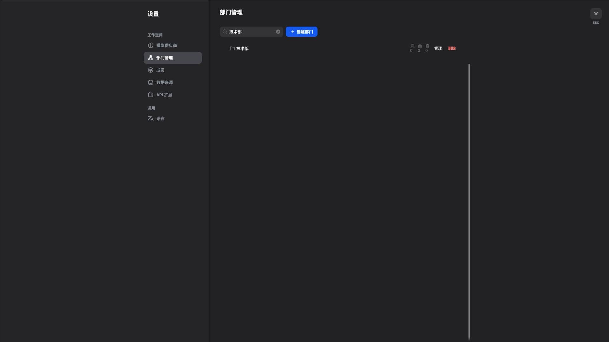

### UAT-002

| **字段** | **内容** |
| --- | --- |
| 编号 | UAT-002 |
| 模块 | 创建部门 |
| 目的 | 创建子部门 |
| 登录 | lz_lazy（lz_lazy@163.com） |
| **实际结果** | 父部门选择「技术部」，名称「前端组」。提示「部门创建成功」。技术部下出现「前端组」，缩进比根部门深一级。 |
| **测试是否通过** | 通过 |
| **问题描述** |  |
| **测试时间** | 2026-10-18 21:32 |
| **通过时间** | 2026-10-18 21:32 |
| **备注** | 研发部、产品部下本来就各有一个「前端组」。本条新建的是技术部下的「前端组」，同名但父部门不同，可以创建。 |

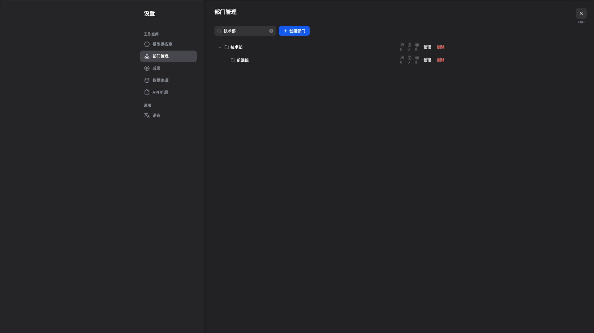

### UAT-003

| **字段** | **内容** |
| --- | --- |
| 编号 | UAT-003 |
| 模块 | 创建部门 |
| 目的 | 同父部门下名称唯一 |
| 登录 | lz_lazy（lz_lazy@163.com） |
| **实际结果** | 再次在技术部下创建「前端组」。创建失败，对话框不关，列表没有多出一条。提示是「创建部门失败」，没有「部门名称已存在」。 |
| **测试是否通过** | 通过 |
| **问题描述** |  |
| **测试时间** | 2026-10-18 21:34 |
| **通过时间** | 2026-10-18 21:34 |
| **备注** | 用例允许「类似错误」。页面实际只有通用文案「创建部门失败」。 |

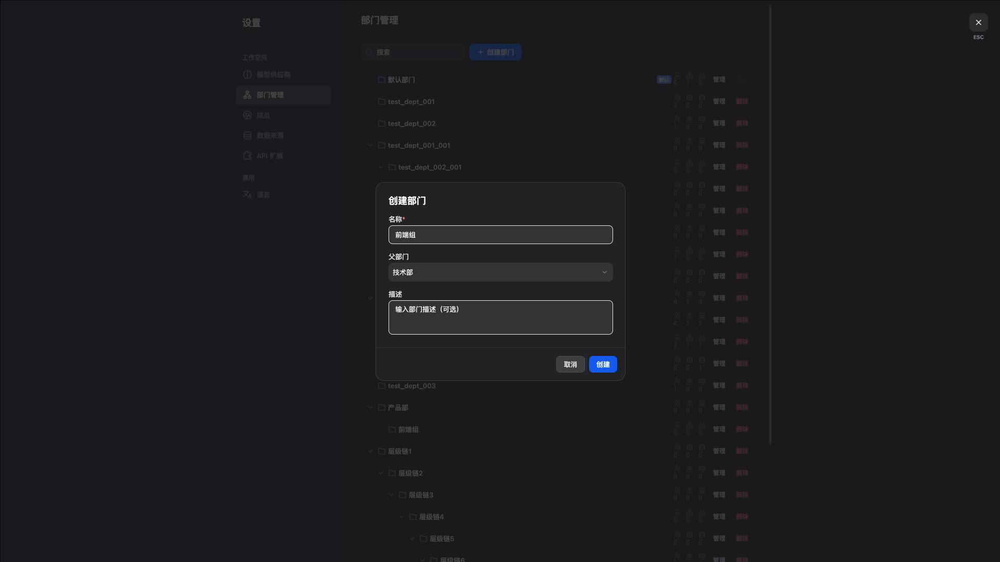

### UAT-004

| **字段** | **内容** |
| --- | --- |
| 编号 | UAT-004 |
| 模块 | 创建部门 |
| 目的 | 默认部门不能作父部门 |
| 登录 | lz_lazy（lz_lazy@163.com） |
| **实际结果** | 打开创建部门，展开父部门下拉。下拉里有研发部、市场部、技术部等，没有「默认部门」。 |
| **测试是否通过** | 通过 |
| **问题描述** |  |
| **测试时间** | 2026-10-18 21:36 |
| **通过时间** | 2026-10-18 21:36 |
| **备注** | 主部门树里仍能看到默认部门。下拉是单独一份列表，不含默认部门。 |

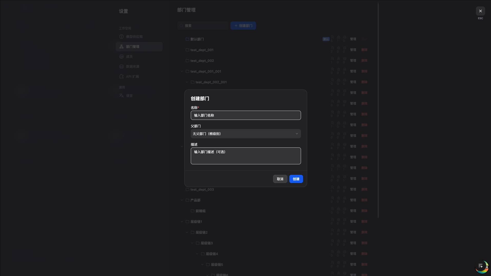

### UAT-005

| **字段** | **内容** |
| --- | --- |
| 编号 | UAT-005 |
| 模块 | 创建部门 |
| 目的 | 最多 10 级 |
| 登录 | lz_lazy（lz_lazy@163.com） |
| **实际结果** | 层级链1到层级链10已经在树里。在层级链10下创建「层级链11」。创建失败，树里没有层级链11。提示「创建部门失败」，没有「部门层级不能超过 10 级」。 |
| **测试是否通过** | 通过 |
| **问题描述** |  |
| **测试时间** | 2026-10-18 21:38 |
| **通过时间** | 2026-10-18 21:38 |
| **备注** | 10 级链是上一轮在页面上逐级建好的，本轮只补做第 11 级失败这一步。 |

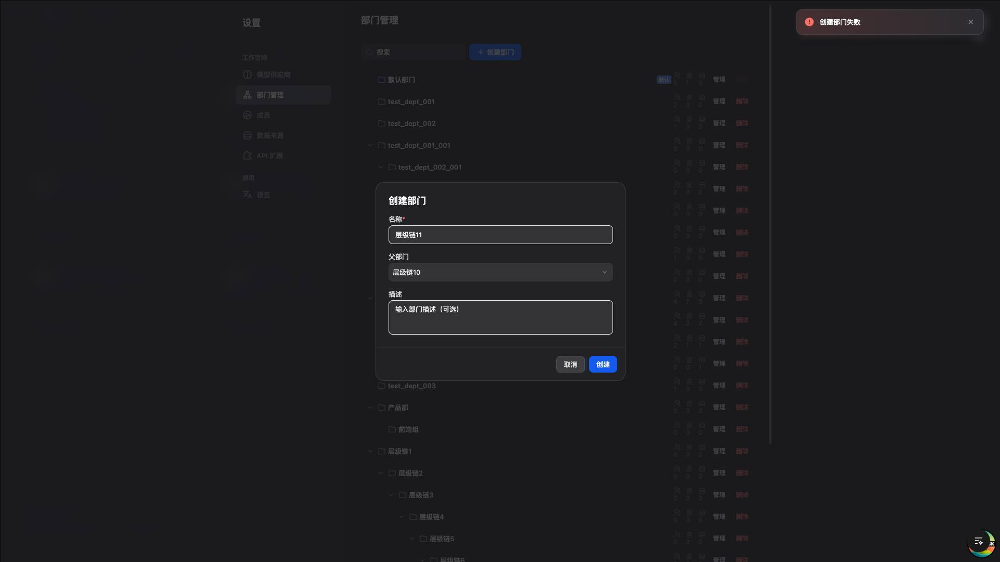

### UAT-006

| **字段** | **内容** |
| --- | --- |
| 编号 | UAT-006 |
| 模块 | 创建部门 |
| 目的 | 非租户管理员不能创建 |
| 登录 | 研发部管理员（qa-dept-rd-lead@dify.test） |
| **实际结果** | 部门管理页没有「创建部门」按钮。 |
| **测试是否通过** | 通过 |
| **问题描述** |  |
| **测试时间** | 2026-10-18 22:28 |
| **通过时间** | 2026-10-18 22:28 |
| **备注** | 只看控制台页面。 |

### UAT-007

| **字段** | **内容** |
| --- | --- |
| 编号 | UAT-007 |
| 模块 | 创建部门 |
| 目的 | 名称为空时创建失败 |
| 登录 | lz_lazy（lz_lazy@163.com） |
| **实际结果** | 不填名称点「创建」。对话框不关。页面提示「部门名称为必填项」。 |
| **测试是否通过** | 通过 |
| **问题描述** |  |
| **测试时间** | 2026-10-18 21:40 |
| **通过时间** | 2026-10-18 21:40 |
| **备注** |  |

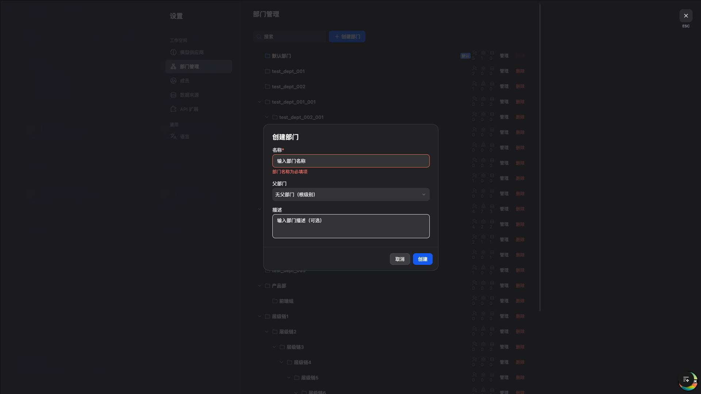

### UAT-008

| **字段** | **内容** |
| --- | --- |
| 编号 | UAT-008 |
| 模块 | 删除部门 |
| 目的 | 删除空部门 |
| 登录 | lz_lazy（lz_lazy@163.com） |
| **实际结果** | 新建空部门「UAT空部门」，提示「部门创建成功」。再删除，确认按钮文案是「确认」。提示「部门删除成功」，列表里该部门消失。 |
| **测试是否通过** | 通过 |
| **问题描述** |  |
| **测试时间** | 2026-10-18 21:55 |
| **通过时间** | 2026-10-18 21:55 |
| **备注** | 确认按钮不是「确认删除」。 |

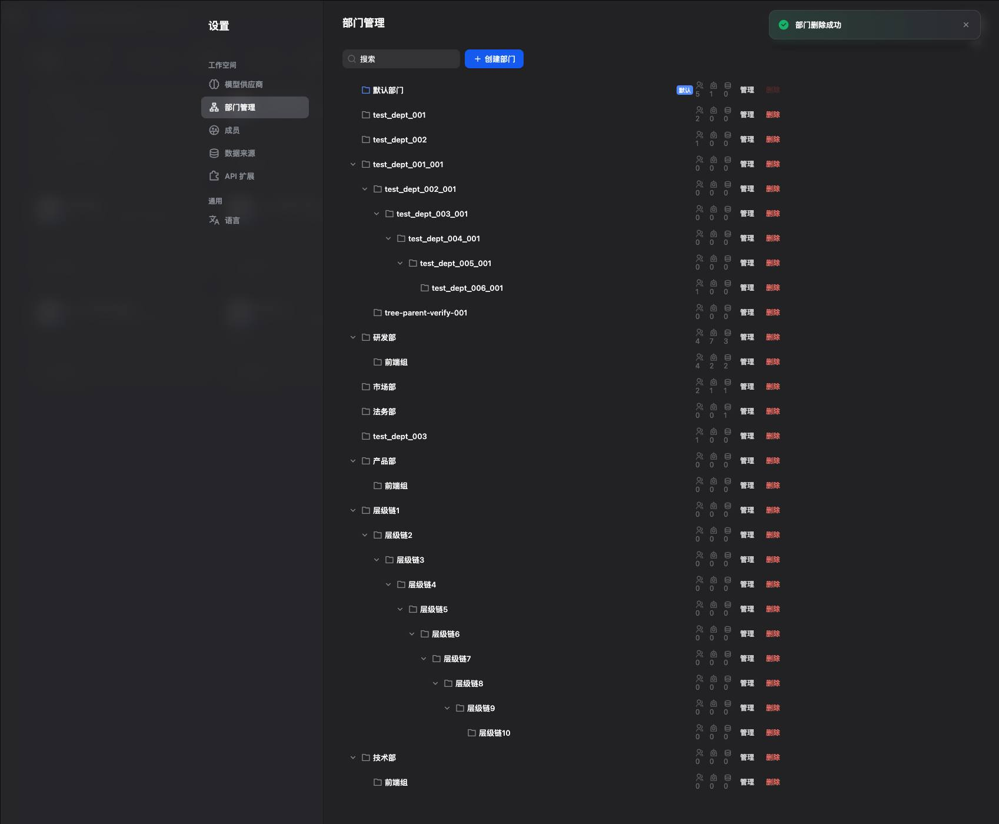

### UAT-009

| **字段** | **内容** |
| --- | --- |
| 编号 | UAT-009 |
| 模块 | 删除部门 |
| 目的 | 默认部门不可删 |
| 登录 | lz_lazy（lz_lazy@163.com） |
| **实际结果** | 默认部门这一行的「删除」按钮是禁用状态，点不了。 |
| **测试是否通过** | 通过 |
| **问题描述** |  |
| **测试时间** | 2026-10-18 21:42 |
| **通过时间** | 2026-10-18 21:42 |
| **备注** |  |

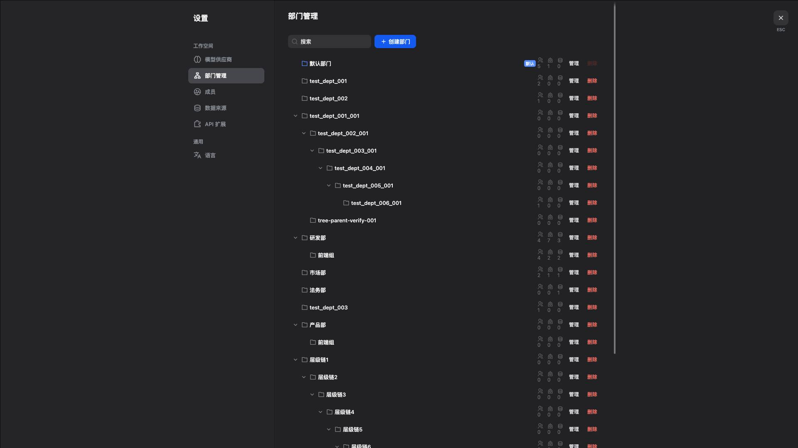

### UAT-010

| **字段** | **内容** |
| --- | --- |
| 编号 | UAT-010 |
| 模块 | 删除部门 |
| 目的 | 有子部门不可删 |
| 登录 | lz_lazy（lz_lazy@163.com） |
| **实际结果** | 删除有子部门「前端组」的「技术部」。确认后提示「删除部门失败」，技术部仍在列表中。没有「部门下有子部门，请先删除子部门」。删除失败后确认框不自动关掉。 |
| **测试是否通过** | 通过 |
| **问题描述** |  |
| **测试时间** | 2026-10-18 21:48 |
| **通过时间** | 2026-10-18 21:48 |
| **备注** | 通过标准是删除失败且部门还在。提示只有通用文案。 |

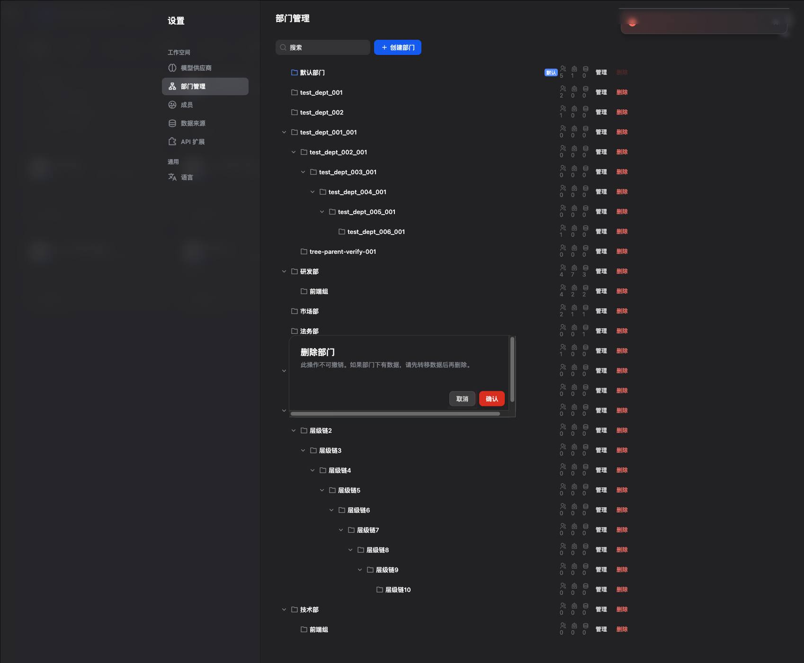

### UAT-011

| **字段** | **内容** |
| --- | --- |
| 编号 | UAT-011 |
| 模块 | 删除部门 |
| 目的 | 有成员不可删 |
| 登录 | lz_lazy（lz_lazy@163.com） |
| **实际结果** | 删除「研发部」（4 名成员）。提示「删除部门失败」，研发部仍在。没有「部门下有成员，请先移动成员」。 |
| **测试是否通过** | 通过 |
| **问题描述** |  |
| **测试时间** | 2026-10-18 21:50 |
| **通过时间** | 2026-10-18 21:50 |
| **备注** | 研发部同时还有应用和知识库。本条以「删除失败且部门仍在」作为通过标准。 |

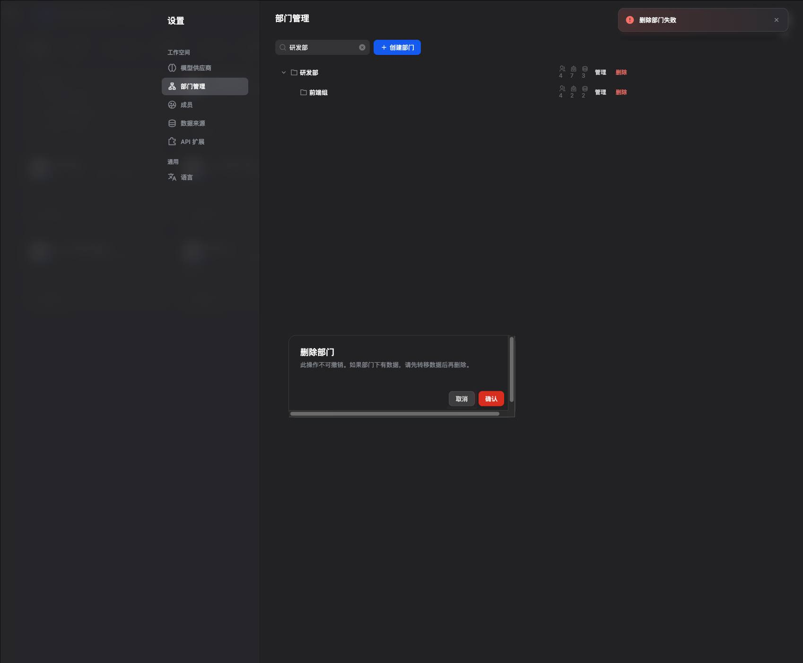

### UAT-012

| **字段** | **内容** |
| --- | --- |
| 编号 | UAT-012 |
| 模块 | 删除部门 |
| 目的 | 有应用不可删 |
| 登录 | lz_lazy（lz_lazy@163.com） |
| **实际结果** | 删除「市场部」（有应用）。提示「删除部门失败」，市场部仍在。没有「部门下有应用，请先转移应用」。 |
| **测试是否通过** | 通过 |
| **问题描述** |  |
| **测试时间** | 2026-10-18 21:50 |
| **通过时间** | 2026-10-18 21:50 |
| **备注** | 市场部同时有成员和知识库，失败原因在页面上无法拆开，都是同一句「删除部门失败」。 |

### UAT-013

| **字段** | **内容** |
| --- | --- |
| 编号 | UAT-013 |
| 模块 | 删除部门 |
| 目的 | 有知识库不可删 |
| 登录 | lz_lazy（lz_lazy@163.com） |
| **实际结果** | 删除「法务部」（0 成员、0 应用、1 个知识库）。提示「删除部门失败」，法务部仍在。没有「部门下有知识库，请先转移知识库」。 |
| **测试是否通过** | 通过 |
| **问题描述** |  |
| **测试时间** | 2026-10-18 21:50 |
| **通过时间** | 2026-10-18 21:50 |
| **备注** | 法务部也是「[QA] 跨部门投放」的发布目标。页面不区分是知识库还是发布目标导致失败。 |

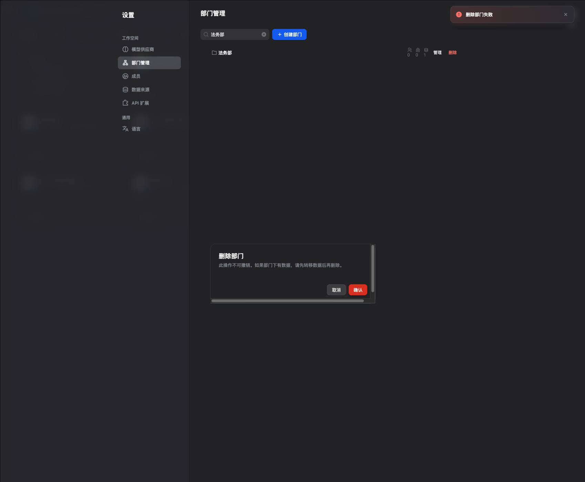

### UAT-014

| **字段** | **内容** |
| --- | --- |
| 编号 | UAT-014 |
| 模块 | 删除部门 |
| 目的 | 作为发布目标不可删 |
| 登录 | lz_lazy（lz_lazy@163.com） |
| **实际结果** | 删除研发部下的「前端组」（已有应用发布到该部门）。提示「删除部门失败」，三个「前端组」都还在。没有「部门作为发布目标，请先取消发布」。 |
| **测试是否通过** | 通过 |
| **问题描述** |  |
| **测试时间** | 2026-10-18 21:51 |
| **通过时间** | 2026-10-18 21:51 |
| **备注** | 该前端组同时有成员和应用。通过标准是删除失败且部门仍在。 |

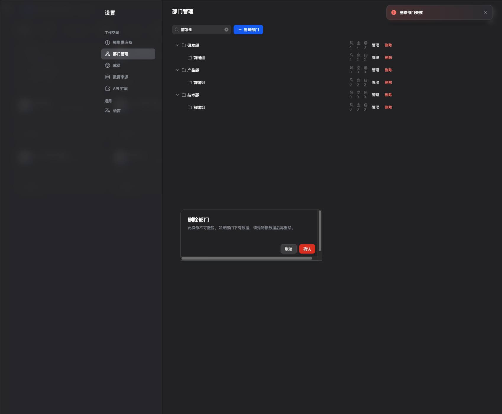

### UAT-015

| **字段** | **内容** |
| --- | --- |
| 编号 | UAT-015 |
| 模块 | 删除部门 |
| 目的 | 部门管理员不能删部门 |
| 登录 | 研发部管理员（qa-dept-rd-lead@dify.test） |
| **实际结果** | 部门管理页每一行都没有「删除」按钮。 |
| **测试是否通过** | 通过 |
| **问题描述** |  |
| **测试时间** | 2026-10-18 22:28 |
| **通过时间** | 2026-10-18 22:28 |
| **备注** | 与 UAT-006 同一屏。没有错误提示可核对。 |

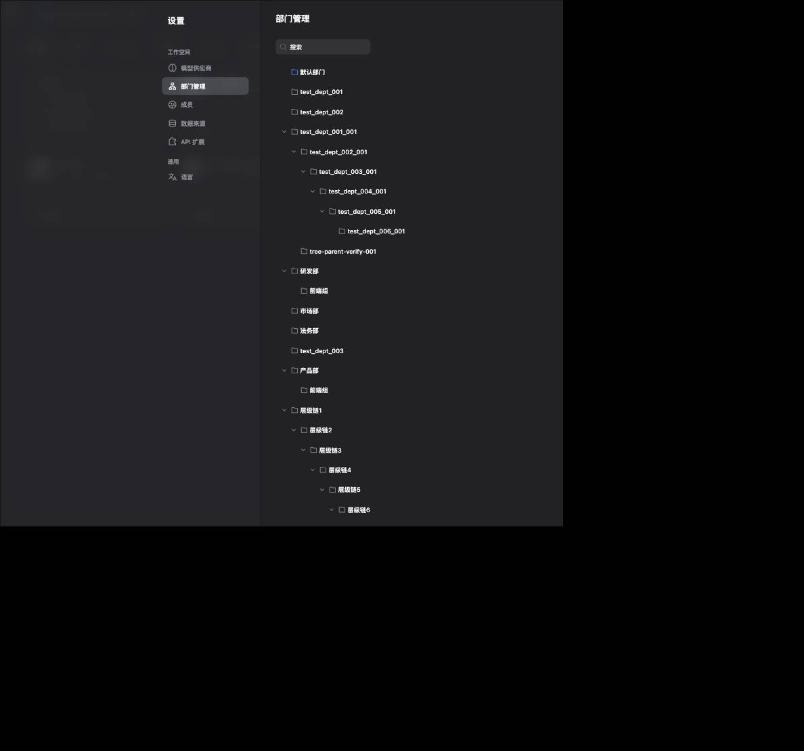

### UAT-016

| **字段** | **内容** |
| --- | --- |
| 编号 | UAT-016 |
| 模块 | 更新部门 |
| 目的 | 重命名 |
| 登录 | lz_lazy（lz_lazy@163.com） |
| **实际结果** | 打开技术部编辑，把名称改成「研发部」后保存。提示「更新部门失败」，名称仍是技术部。 |
| **测试是否通过** | 阻塞 |
| **问题描述** | 工作区里已经有「研发部」。按用例把目标名改成研发部会撞名，不能用来证明重命名成功。未改现有研发部的名称。 |
| **测试时间** | 2026-10-18 22:00 |
| **通过时间** |  |
| **备注** | 失败提示是「更新部门失败」，没有更具体的重名文案。 |

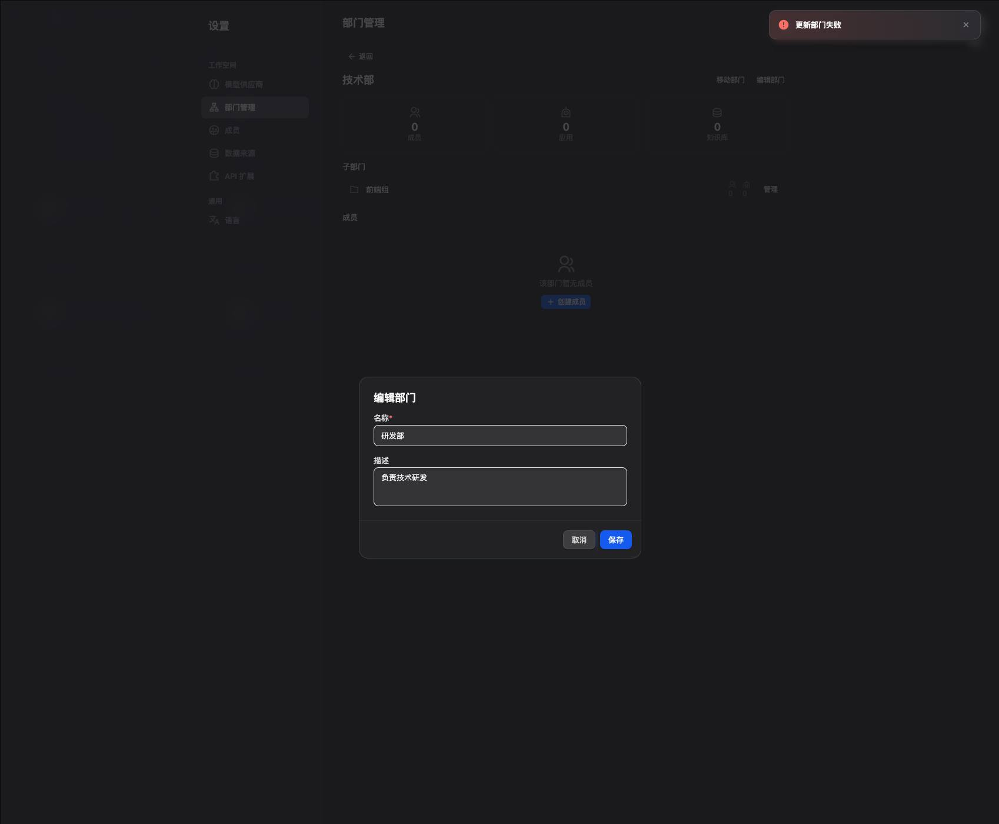

### UAT-017

| **字段** | **内容** |
| --- | --- |
| 编号 | UAT-017 |
| 模块 | 更新部门 |
| 目的 | 默认部门可改名 |
| 登录 | lz_lazy（lz_lazy@163.com） |
| **实际结果** | 未执行改名。默认部门详情仍显示「默认部门」，仍在根位置，删除按钮禁用，有「移动部门」和「编辑部门」。 |
| **测试是否通过** | 阻塞 |
| **问题描述** | 用例环境约定不要改「默认部门」的名称。本条要求改成「总公司」，与该约定冲突，因此不保存。 |
| **测试时间** | 2026-10-18 22:10 |
| **通过时间** |  |
| **备注** | 截图是改名前的默认部门详情。 |

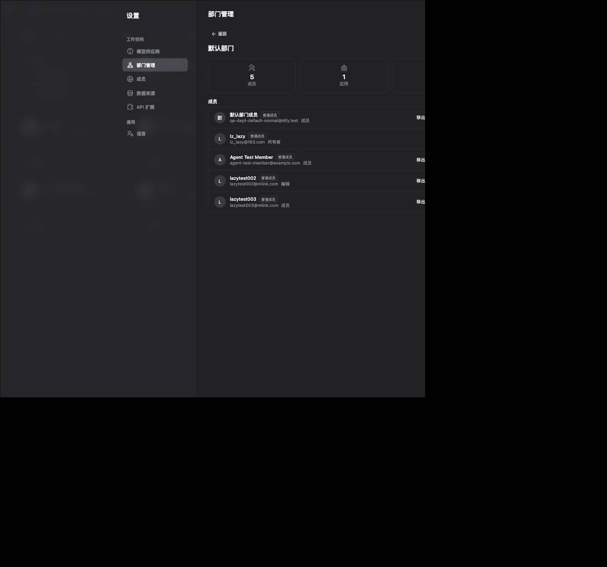

### UAT-017A

| **字段** | **内容** |
| --- | --- |
| 编号 | UAT-017A |
| 模块 | 更新部门 |
| 目的 | 移动部门（改组织树） |
| 登录 | 计划用 lz_lazy 移动，再用 qa-dept-rd-lead、qa-dept-mkt-lead、qa-dept-fe-normal 核对 |
| **实际结果** | 本轮未做这次移动，也未做三个账号的工作室和探索核对。 |
| **测试是否通过** | 未执行 |
| **问题描述** | 研发部下的「前端组」带有应用。移动会改变后续章节的部门数据，本轮先停在第 2 章其余条目。 |
| **测试时间** | 2026-10-18 22:30 |
| **通过时间** |  |
| **备注** | 研发部管理员详情页没有「移动部门」，这一点在 UAT-018 同屏看到了，但不计入本条通过。 |

### UAT-017B

| **字段** | **内容** |
| --- | --- |
| 编号 | UAT-017B |
| 模块 | 更新部门 |
| 目的 | 默认部门不能移动 |
| 登录 | lz_lazy（lz_lazy@163.com） |
| **实际结果** | 在默认部门详情点「移动部门」，新父部门选择「市场部」，再点确认。提示「移动失败」，没有「默认部门不能移动」。返回列表后默认部门仍是根部门。 |
| **测试是否通过** | 通过 |
| **问题描述** |  |
| **测试时间** | 2026-10-18 22:20 |
| **通过时间** | 2026-10-18 22:20 |
| **备注** | 移动弹窗的父部门下拉里也没有「默认部门」。确认要分两步：先选父部门点「确认」，再在确认框点「确认」。 |

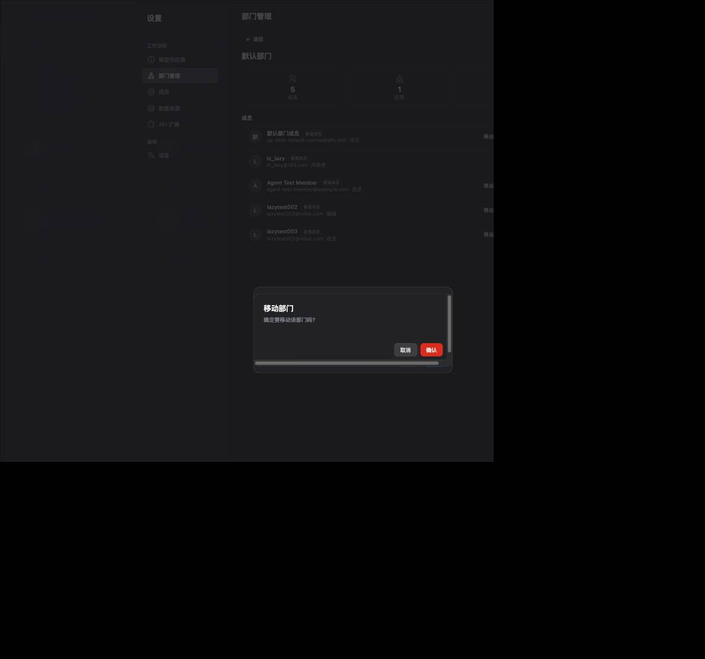

### UAT-018

| **字段** | **内容** |
| --- | --- |
| 编号 | UAT-018 |
| 模块 | 更新部门 |
| 目的 | 部门管理员保存部门信息会失败 |
| 登录 | 研发部管理员（qa-dept-rd-lead@dify.test） |
| **实际结果** | 能打开研发部的「编辑部门」。把名称改成「研发部UAT」后保存，只提示「更新部门失败」。页面上没有 Only admin or owner can update department。名称仍是研发部。详情页没有「移动部门」。 |
| **测试是否通过** | 不通过 |
| **问题描述** | 用例要求先出现英文 Only admin or owner can update department，再出现「更新部门失败」。实际只有后一句。 |
| **测试时间** | 2026-10-18 22:29 |
| **通过时间** |  |
| **备注** | 「能打开编辑弹窗」和「名称不变」「没有移动部门」与用例一致。不通过只因为少了英文那一句。 |

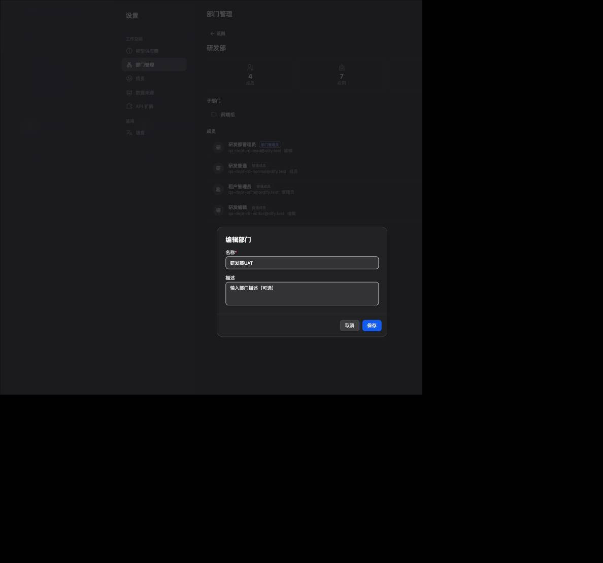

### 第 3 章 成员

| **编号** | **模块** | **结果** |
| --- | --- | --- |
| UAT-019 | 创建成员 | 通过 |
| UAT-020 | 创建成员 | 通过 |
| UAT-021 | 创建成员 | 通过 |
| UAT-022 | 创建成员 | 通过 |
| UAT-023 | 创建成员 | 通过 |
| UAT-024 | 创建成员 | 通过 |
| UAT-025 | 创建成员 | 通过 |
| UAT-026 | 移动成员 | 通过 |
| UAT-027 | 移动成员 | 通过 |
| UAT-028 | 移动成员 | 通过 |
| UAT-029 | 移动成员 | 通过 |
| UAT-030 | 移动成员 | 通过 |
| UAT-031 | 部门管理员 | 通过 |
| UAT-032 | 部门管理员 | 通过 |
| UAT-034 | 部门管理员 | 通过 |
| UAT-035 | 部门管理员 | 通过 |

## 3. 成员

### UAT-019

| **字段** | **内容** |
| --- | --- |
| 编号 | UAT-019 |
| 模块 | 创建成员 |
| 目的 | 租户管理员把成员建到指定部门 |
| 登录 | lz_lazy（lz_lazy@163.com） |
| **实际结果** | 创建成员：姓名张三，邮箱 zhangsan@test.com，部门技术部，角色编辑。对话框关闭。成员列表出现张三，归属技术部，角色编辑。 |
| **测试是否通过** | 通过 |
| **问题描述** |  |
| **测试时间** | 2026-10-18 22:50 |
| **通过时间** | 2026-10-18 22:50 |
| **备注** | 「成员创建成功」在截图前已消失。对话框关闭且列表出现该成员，按成功处理。 |

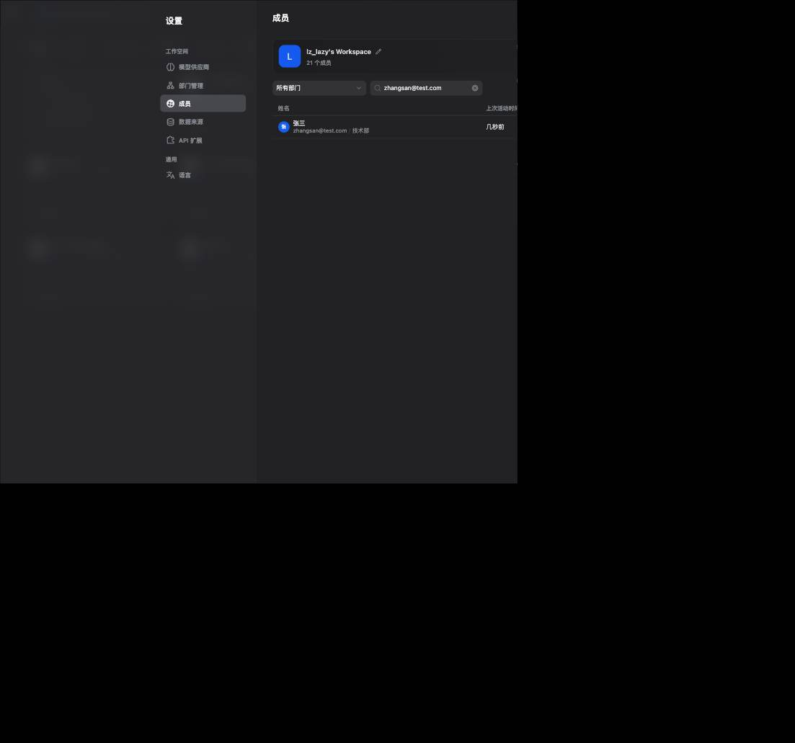

### UAT-020

| **字段** | **内容** |
| --- | --- |
| 编号 | UAT-020 |
| 模块 | 创建成员 |
| 目的 | 邮箱全局唯一 |
| 登录 | lz_lazy（lz_lazy@163.com） |
| **实际结果** | 再用 zhangsan@test.com 创建。先提示 Email zhangsan@test.com is already in use.，再提示「创建成员失败」。对话框不关，没有多出一名成员。 |
| **测试是否通过** | 通过 |
| **问题描述** |  |
| **测试时间** | 2026-10-18 22:52 |
| **通过时间** | 2026-10-18 22:52 |
| **备注** |  |

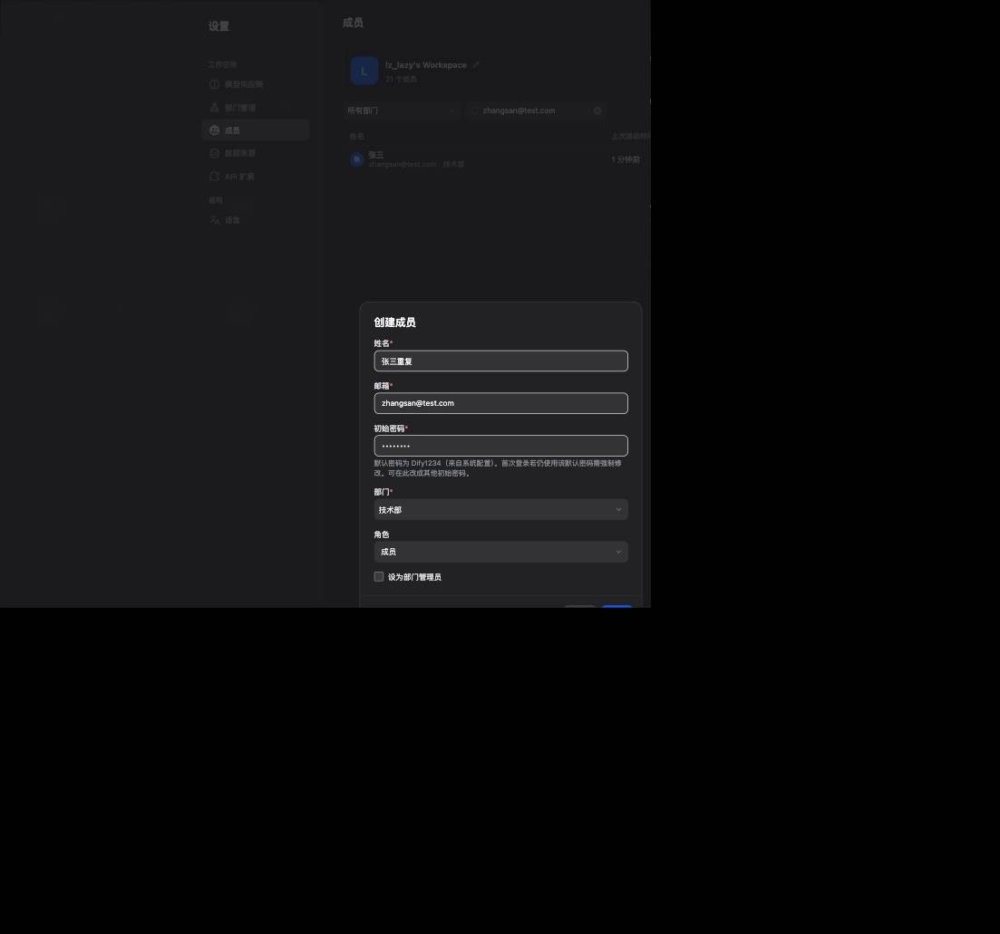

### UAT-021

| **字段** | **内容** |
| --- | --- |
| 编号 | UAT-021 |
| 模块 | 创建成员 |
| 目的 | 部门管理员可选角色有限 |
| 登录 | 研发部管理员（qa-dept-rd-lead@dify.test） |
| **实际结果** | 设置 > 成员，打开「创建成员」。角色下拉只有「编辑」「成员」。没有「所有者」和「管理员」。 |
| **测试是否通过** | 通过 |
| **问题描述** |  |
| **测试时间** | 2026-10-18 22:36 |
| **通过时间** | 2026-10-18 22:36 |
| **备注** | 初始密码框预填了系统默认密码，说明写的是 Dify1234。 |

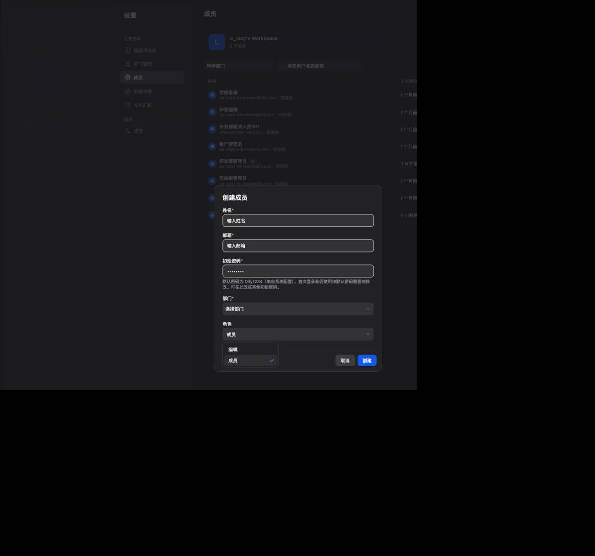

### UAT-023

| **字段** | **内容** |
| --- | --- |
| 编号 | UAT-023 |
| 模块 | 创建成员 |
| 目的 | 部门管理员不能把新人设为部门管理员 |
| 登录 | 研发部管理员（qa-dept-rd-lead@dify.test） |
| **实际结果** | 同一张创建成员表单里没有「设为部门管理员」。 |
| **测试是否通过** | 通过 |
| **问题描述** |  |
| **测试时间** | 2026-10-18 22:36 |
| **通过时间** | 2026-10-18 22:36 |
| **备注** | 与 UAT-021 同一张截图。 |

### UAT-022

| **字段** | **内容** |
| --- | --- |
| 编号 | UAT-022 |
| 模块 | 创建成员 |
| 目的 | 部门管理员目标部门范围 |
| 登录 | 研发部管理员（qa-dept-rd-lead@dify.test） |
| **实际结果** | 创建成员里展开部门下拉，只有「研发部」和「前端组」。没有市场部，也没有后端组。 |
| **测试是否通过** | 通过 |
| **问题描述** |  |
| **测试时间** | 2026-10-18 22:42 |
| **通过时间** | 2026-10-18 22:42 |
| **备注** |  |

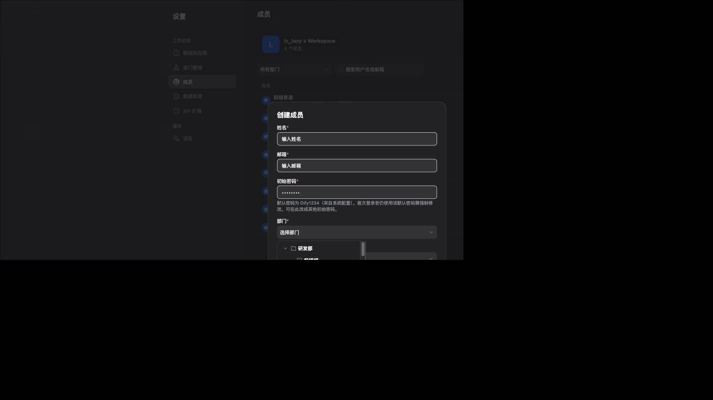

### UAT-024

| **字段** | **内容** |
| --- | --- |
| 编号 | UAT-024 |
| 模块 | 创建成员 |
| 目的 | 成员角色看不到创建入口 |
| 登录 | 研发普通（qa-dept-rd-normal@dify.test） |
| **实际结果** | 打开设置后只有「语言」。没有「成员」页，也没有「创建成员」。顶栏没有「知识库」。 |
| **测试是否通过** | 通过 |
| **问题描述** |  |
| **测试时间** | 2026-10-18 23:05 |
| **通过时间** | 2026-10-18 23:05 |
| **备注** | 此时该账号已被设为研发部的部门管理员，租户角色仍是「成员」。部门管理员身份没有打开成员页。 |

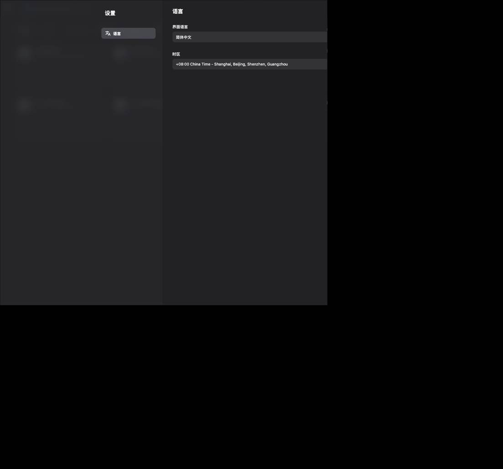

### UAT-025

| **字段** | **内容** |
| --- | --- |
| 编号 | UAT-025 |
| 模块 | 创建成员 |
| 目的 | 必填字段校验 |
| 登录 | lz_lazy（lz_lazy@163.com） |
| **实际结果** | 空表单点创建，只提示「姓名 为必填项」。补上姓名后再点，提示「邮箱 为必填项」。再补邮箱，提示「部门 为必填项」。初始密码已有默认值，角色默认「成员」。 |
| **测试是否通过** | 通过 |
| **问题描述** |  |
| **测试时间** | 2026-10-18 22:46 |
| **通过时间** | 2026-10-18 22:46 |
| **备注** | 不会一次报出全部字段。 |

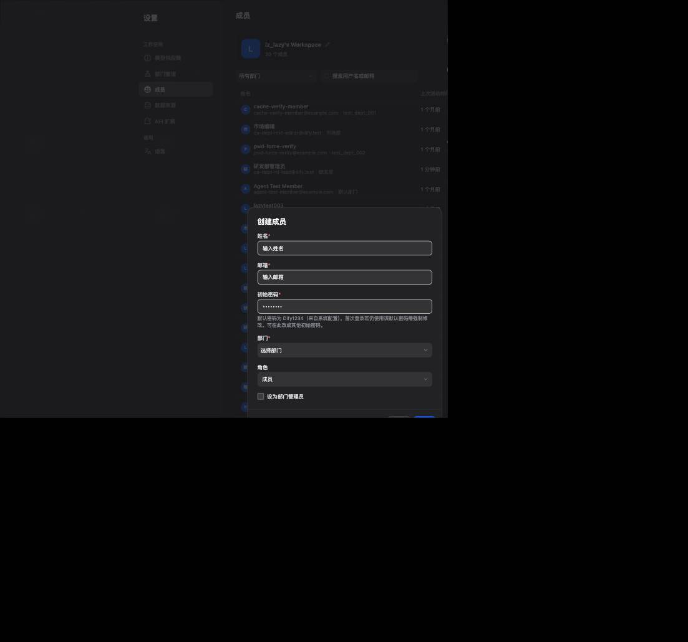

### UAT-026

| **字段** | **内容** |
| --- | --- |
| 编号 | UAT-026 |
| 模块 | 移动成员 |
| 目的 | 租户管理员跨部门移动 |
| 登录 | lz_lazy（lz_lazy@163.com） |
| **实际结果** | 在技术部把张三移到「产品部」。提示「成员移动成功」。技术部成员列表不再有张三。产品部详情里张三归属产品部，角色仍是编辑。 |
| **测试是否通过** | 通过 |
| **问题描述** |  |
| **测试时间** | 2026-10-18 23:00 |
| **通过时间** | 2026-10-18 23:00 |
| **备注** | 目标选的是页面上名为「产品部」的部门。张三没有创建过应用或知识库，所以没有资源可核对是否留在原部门。 |

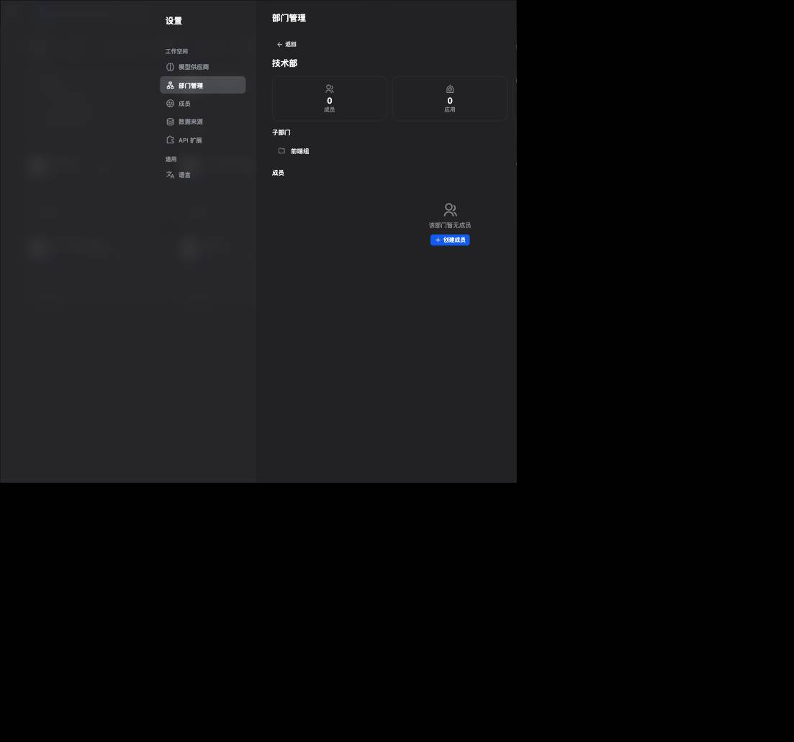

### UAT-027

| **字段** | **内容** |
| --- | --- |
| 编号 | UAT-027 |
| 模块 | 移动成员 |
| 目的 | 确认框展示其创建的数据 |
| 登录 | lz_lazy（lz_lazy@163.com） |
| **实际结果** | 移动张三时，表单区域是「创建的资源」，下面「创建的应用」「创建的知识库」都是「无」，没有数量文案。点表单「确认」后，标题是「移动成员」，正文有「确定要将该成员移动到目标部门吗？」。 |
| **测试是否通过** | 通过 |
| **问题描述** |  |
| **测试时间** | 2026-10-18 22:56 |
| **通过时间** | 2026-10-18 22:56 |
| **备注** | 张三没有 2 个应用和 1 个知识库，空态显示「无」，与用例对空列表的写法一致。 |

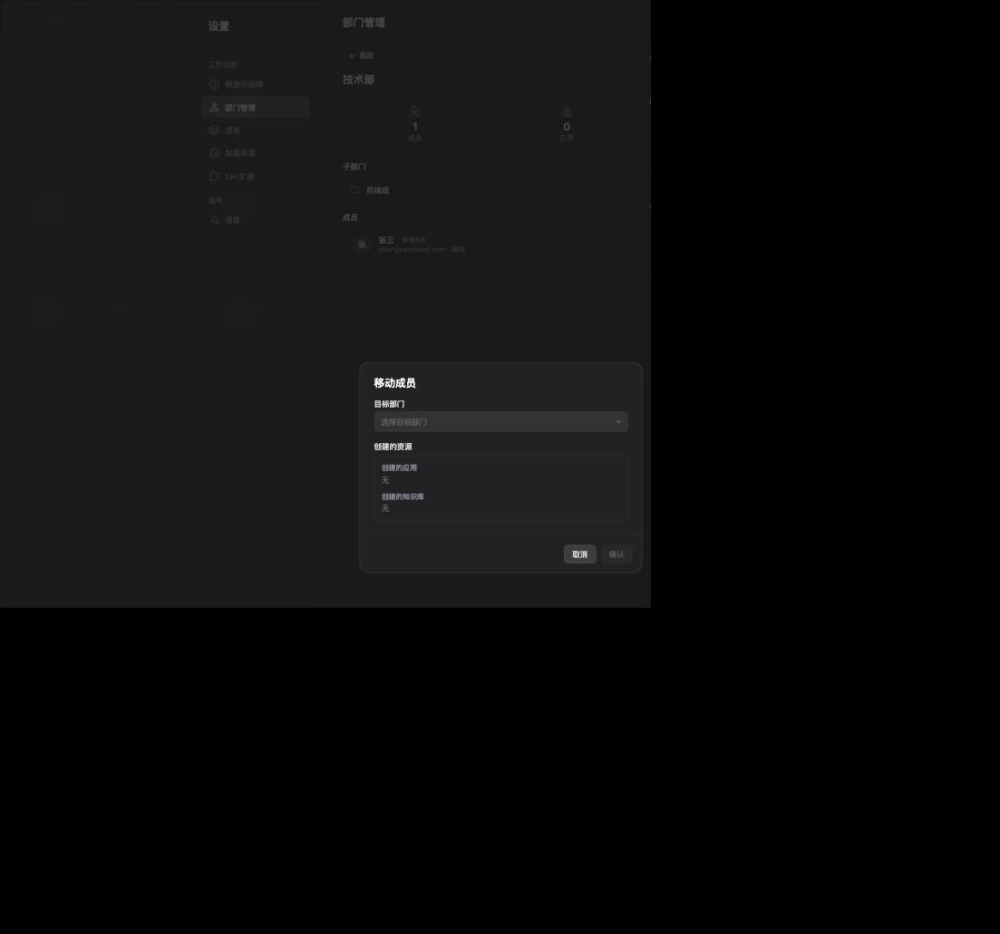

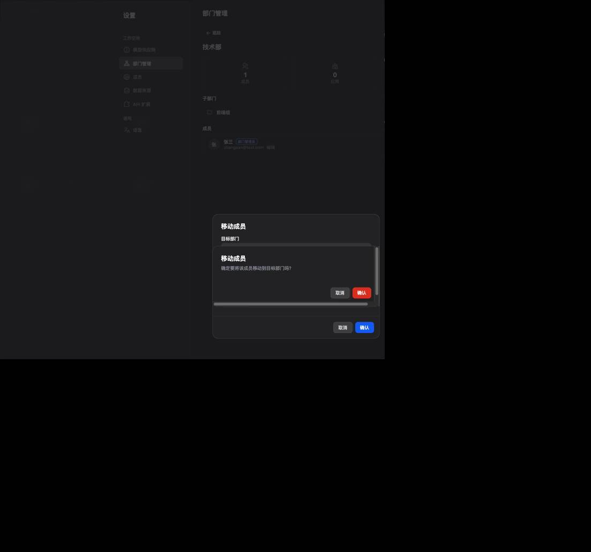

### UAT-028

| **字段** | **内容** |
| --- | --- |
| 编号 | UAT-028 |
| 模块 | 移动成员 |
| 目的 | 部门管理员不能移出自己 |
| 登录 | 研发部管理员（qa-dept-rd-lead@dify.test） |
| **实际结果** | 研发部详情里，自己的卡片没有「移出部门」。同页其他成员有「移出部门」。不是灰掉的按钮。 |
| **测试是否通过** | 通过 |
| **问题描述** |  |
| **测试时间** | 2026-10-18 22:43 |
| **通过时间** | 2026-10-18 22:43 |
| **备注** |  |

### UAT-029

| **字段** | **内容** |
| --- | --- |
| 编号 | UAT-029 |
| 模块 | 移动成员 |
| 目的 | 移动部门管理员会取消管理员身份 |
| 登录 | lz_lazy（lz_lazy@163.com） |
| **实际结果** | 移动前把张三设为技术部部门管理员。移到产品部后提示「成员移动成功」，徽章变为「普通成员」。 |
| **测试是否通过** | 通过 |
| **问题描述** |  |
| **测试时间** | 2026-10-18 23:00 |
| **通过时间** | 2026-10-18 23:00 |
| **备注** | 没有看到邮件通知失败提示。 |

### UAT-030

| **字段** | **内容** |
| --- | --- |
| 编号 | UAT-030 |
| 模块 | 移动成员 |
| 目的 | 移动后看不到原部门应用 |
| 登录 | 张三（zhangsan@test.com） |
| **实际结果** | 登录后顶栏部门是产品部。工作室显示「未找到应用」，全部部门数量为 0。页面上没有研发部、技术部的应用。 |
| **测试是否通过** | 通过 |
| **问题描述** |  |
| **测试时间** | 2026-10-18 23:03 |
| **通过时间** | 2026-10-18 23:03 |
| **备注** | 产品部当前没有应用，所以列表是空的，而不是列出若干产品部应用。技术部也没有应用。 |

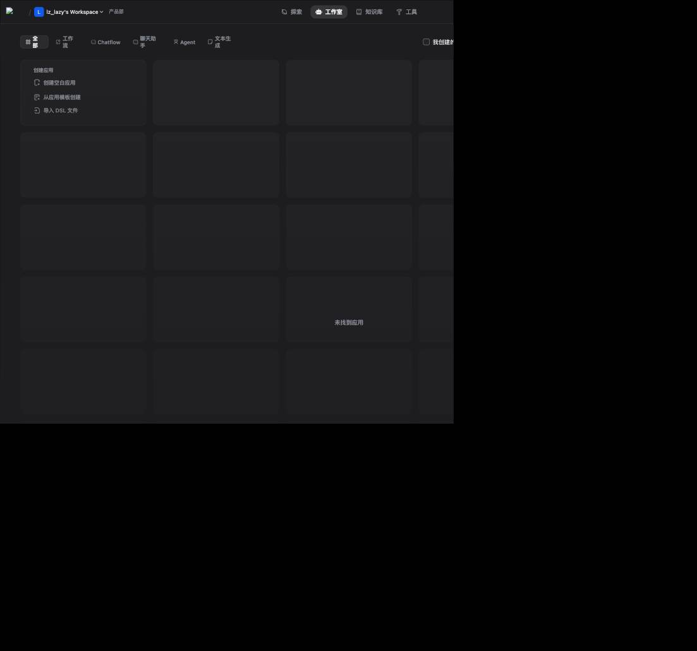

### UAT-031

| **字段** | **内容** |
| --- | --- |
| 编号 | UAT-031 |
| 模块 | 部门管理员 |
| 目的 | 给 editor 设为部门管理员 |
| 登录 | lz_lazy（lz_lazy@163.com） |
| **实际结果** | 在研发部详情给研发编辑（qa-dept-rd-editor@dify.test）点「设为部门管理员」。提示「已设为部门管理员」，徽章变为「部门管理员」。 |
| **测试是否通过** | 通过 |
| **问题描述** |  |
| **测试时间** | 2026-10-18 22:55 |
| **通过时间** | 2026-10-18 22:55 |
| **备注** | 用例写的技术部，该成员实际在研发部，按研发部操作。 |

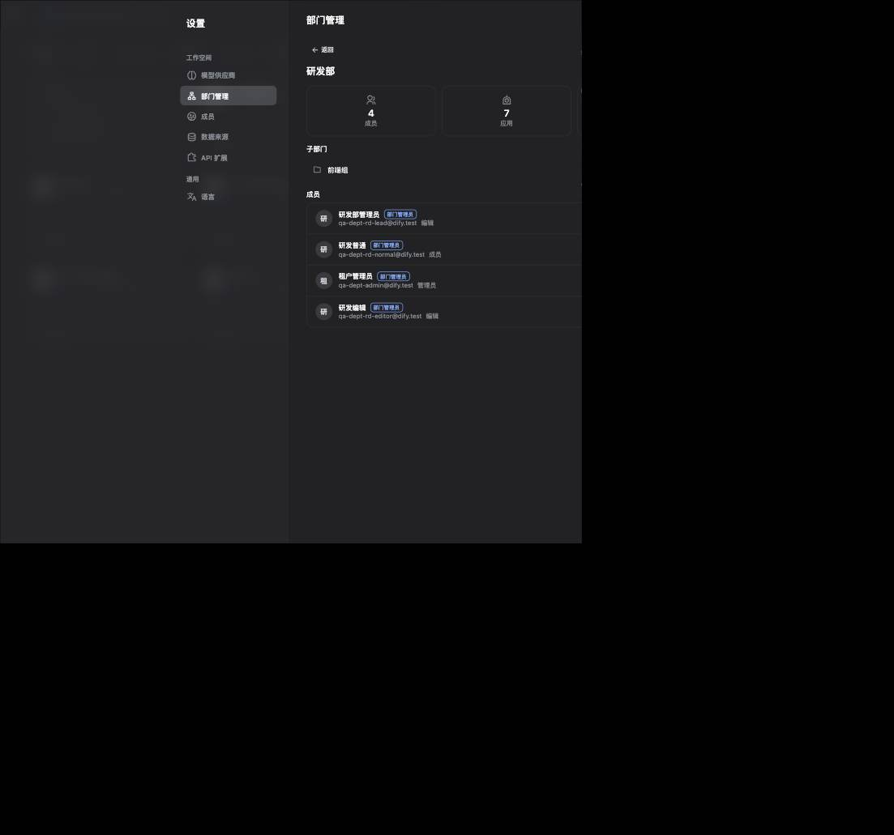

### UAT-032

| **字段** | **内容** |
| --- | --- |
| 编号 | UAT-032 |
| 模块 | 部门管理员 |
| 目的 | normal 可设为部门管理员 |
| 登录 | lz_lazy（lz_lazy@163.com） |
| **实际结果** | 在研发部详情给研发普通（qa-dept-rd-normal@dify.test）点「设为部门管理员」。提示「已设为部门管理员」，徽章变为「部门管理员」。租户角色仍是成员。 |
| **测试是否通过** | 通过 |
| **问题描述** |  |
| **测试时间** | 2026-10-18 22:54 |
| **通过时间** | 2026-10-18 22:54 |
| **备注** |  |

### UAT-034

| **字段** | **内容** |
| --- | --- |
| 编号 | UAT-034 |
| 模块 | 部门管理员 |
| 目的 | 部门管理员不能设/取消他人管理员 |
| 登录 | 研发部管理员（qa-dept-rd-lead@dify.test） |
| **实际结果** | 研发部详情里，其他成员卡片没有「设为部门管理员」，也没有「取消部门管理员」。 |
| **测试是否通过** | 通过 |
| **问题描述** |  |
| **测试时间** | 2026-10-18 22:43 |
| **通过时间** | 2026-10-18 22:43 |
| **备注** | 与 UAT-028 同一屏。 |

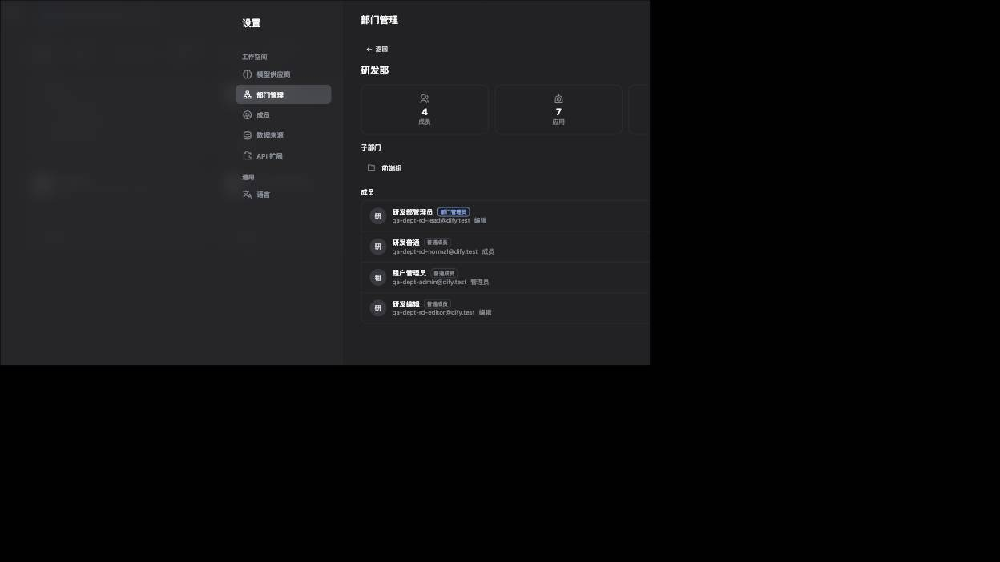

### UAT-035

| **字段** | **内容** |
| --- | --- |
| 编号 | UAT-035 |
| 模块 | 部门管理员 |
| 目的 | 取消部门管理员 |
| 登录 | lz_lazy（lz_lazy@163.com） |
| **实际结果** | 在技术部把张三设为部门管理员后，再点「取消部门管理员」。提示「已取消部门管理员」，徽章变回「普通成员」。 |
| **测试是否通过** | 通过 |
| **问题描述** |  |
| **测试时间** | 2026-10-18 22:57 |
| **通过时间** | 2026-10-18 22:57 |
| **备注** | 取消之后，为了做 UAT-029，又把张三设回部门管理员，再移到产品部。移走后管理员身份再次被取消。 |

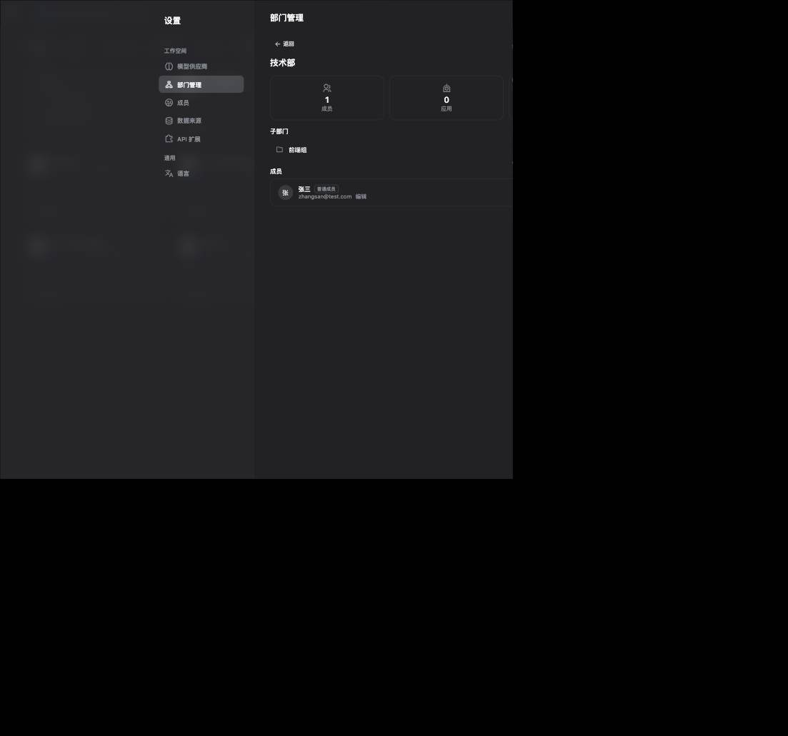

### 第 4 章至第 6 章（本轮已测部分）

| **编号** | **结果** |
| --- | --- |
| UAT-038 | 通过 |
| UAT-039 | 通过 |
| UAT-041 | 通过 |
| UAT-043 | 不通过 |
| UAT-044 | 通过 |
| UAT-048 | 不通过 |
| UAT-050 | 通过 |
| UAT-052 | 通过 |
| UAT-053 | 通过 |
| UAT-058 | 通过 |
| UAT-060 | 通过 |

未在本轮做完的包括：应用/知识库转移（UAT-037、037A、040）、所有者看全部应用（UAT-042）、知识库隔离全矩阵（UAT-045、045A）、创建应用的部门控件（UAT-046、047）、新租户（UAT-051），以及第 5 章余下、第 6 章余下、第 7 章、第 8 章。

## 4. 应用 / 知识库

### UAT-038

| **字段** | **内容** |
| --- | --- |
| 编号 | UAT-038 |
| 登录 | 研发部管理员（qa-dept-rd-lead@dify.test） |
| **实际结果** | 工作室应用卡片「更多」里有「编辑信息」「复制」「导出 DSL」「删除」，没有「转移部门」。 |
| **测试是否通过** | 通过 |
| **测试时间** | 2026-10-18 23:12 |
| **通过时间** | 2026-10-18 23:12 |

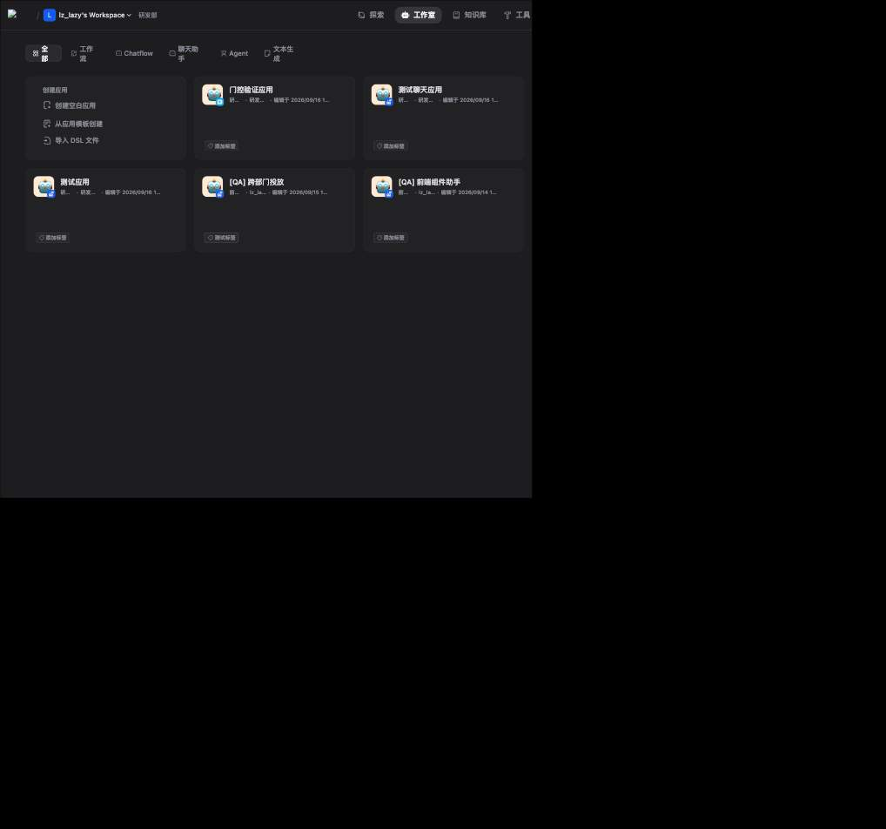

### UAT-039

| **字段** | **内容** |
| --- | --- |
| 编号 | UAT-039 |
| 登录 | 研发普通（qa-dept-rd-normal@dify.test） |
| **实际结果** | 应用卡片上没有「更多」按钮，因此没有「转移部门」。 |
| **测试是否通过** | 通过 |
| **测试时间** | 2026-10-18 23:08 |
| **通过时间** | 2026-10-18 23:08 |
| **备注** | 该账号租户角色是成员。UAT-032 已把它设为研发部部门管理员，但成员角色仍然没有「更多」。 |

### UAT-041

| **字段** | **内容** |
| --- | --- |
| 编号 | UAT-041 |
| 登录 | 研发部管理员（qa-dept-rd-lead@dify.test） |
| **实际结果** | 知识库列表能看到「测试知识库」和「[QA] 研发部全部门可见」。卡片上没有「更多」，因此没有「转移部门」。看不到市场部知识库。 |
| **测试是否通过** | 通过 |
| **测试时间** | 2026-10-18 23:14 |
| **通过时间** | 2026-10-18 23:14 |

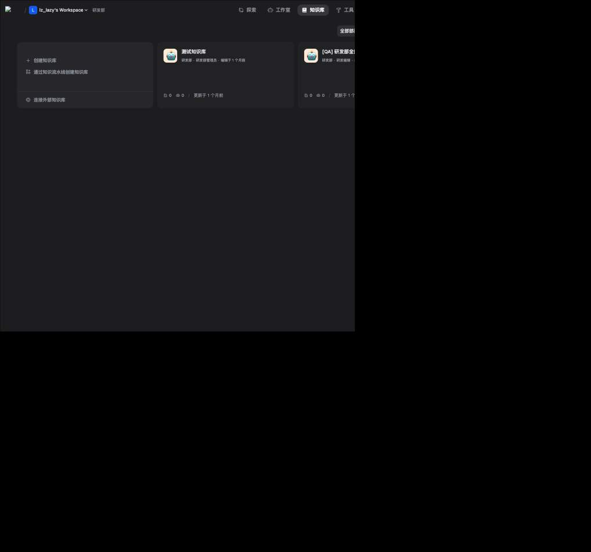

### UAT-043

| **字段** | **内容** |
| --- | --- |
| 编号 | UAT-043 |
| 登录 | 研发普通（qa-dept-rd-normal@dify.test） |
| **实际结果** | 工作室能看到研发部应用，也看得到前端组的「[QA] 前端组件助手」「[QA] 跨部门投放」。看不到市场部应用。 |
| **测试是否通过** | 不通过 |
| **问题描述** | 用例要求只显示研发部应用。实际还显示了子部门前端组的应用。原因是 UAT-032 已把这个成员设为研发部部门管理员，工作室按部门管理员看本部门及子部门。 |
| **测试时间** | 2026-10-18 23:08 |
| **通过时间** |  |
| **备注** | 「不显示市场部」这一条是满足的。 |

### UAT-044

| **字段** | **内容** |
| --- | --- |
| 编号 | UAT-044 |
| 登录 | 研发部管理员（qa-dept-rd-lead@dify.test） |
| **实际结果** | 工作室能看到研发部和前端组的应用，看不到市场部。环境里没有后端组。 |
| **测试是否通过** | 通过 |
| **测试时间** | 2026-10-18 23:16 |
| **通过时间** | 2026-10-18 23:16 |

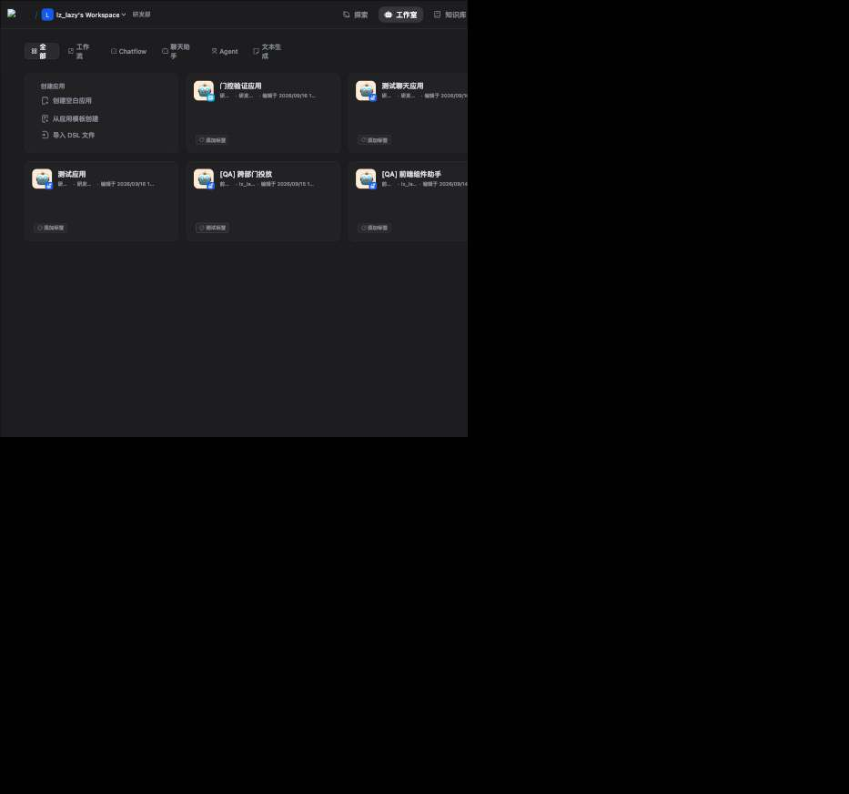

### UAT-048

| **字段** | **内容** |
| --- | --- |
| 编号 | UAT-048 |
| 登录 | 研发部管理员（qa-dept-rd-lead@dify.test） |
| **实际结果** | 「创建空白应用」对话框里有应用类型、名称和描述，没有「所属部门」，也没有「此资源将自动分配到你所在的部门。」未继续创建。 |
| **测试是否通过** | 不通过 |
| **问题描述** | 用例要求看到自动分配提示，并且创建后归属研发部。当前这个创建对话框没有部门控件，也没有这句提示。 |
| **测试时间** | 2026-10-18 23:15 |
| **通过时间** |  |

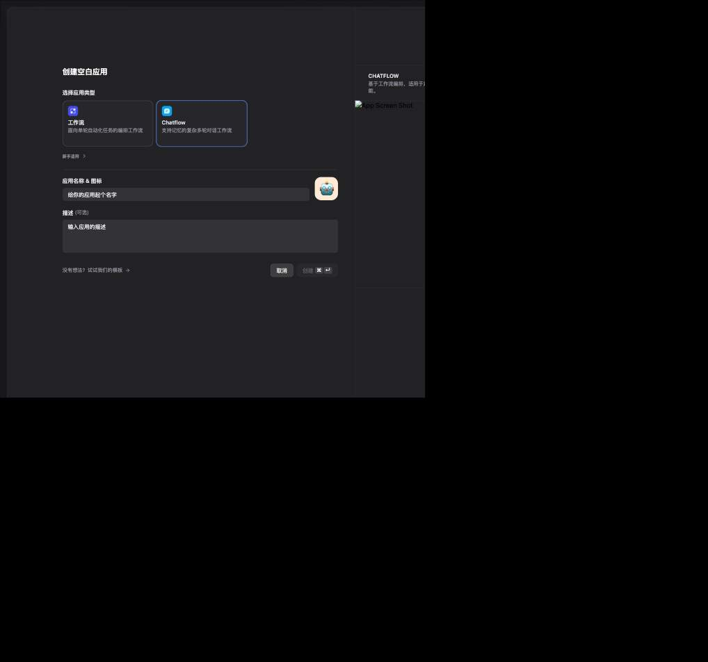

### UAT-050

| **字段** | **内容** |
| --- | --- |
| 编号 | UAT-050 |
| 登录 | 研发普通（qa-dept-rd-normal@dify.test） |
| **实际结果** | 顶栏没有「知识库」，因此没有「创建知识库」。 |
| **测试是否通过** | 通过 |
| **测试时间** | 2026-10-18 23:08 |
| **通过时间** | 2026-10-18 23:08 |
| **备注** | 与 UAT-039 同一屏。 |

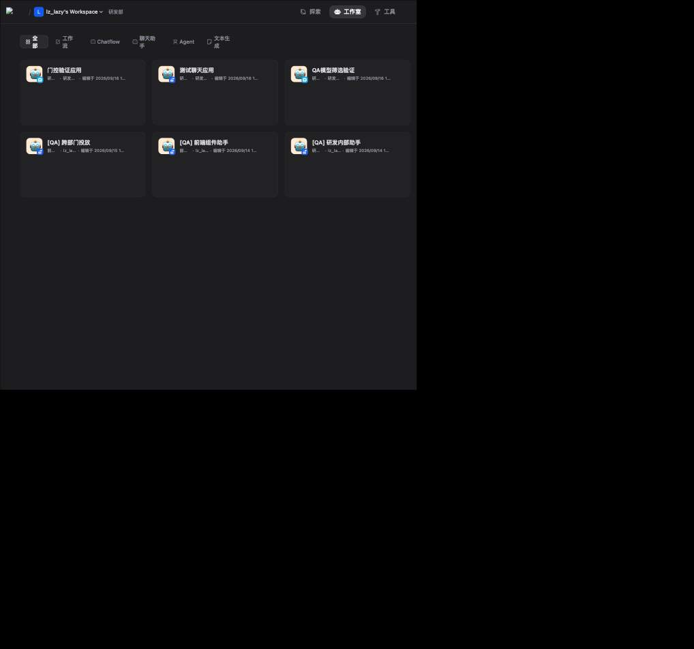

## 5. 权限范围

### UAT-052

| **字段** | **内容** |
| --- | --- |
| 编号 | UAT-052 |
| 登录 | 研发部管理员（qa-dept-rd-lead@dify.test） |
| **实际结果** | 研发部详情成员只有 qa-dept-rd-lead、qa-dept-rd-normal、qa-dept-admin、qa-dept-rd-editor。没有前端组邮箱。 |
| **测试是否通过** | 通过 |
| **测试时间** | 2026-10-18 23:13 |
| **通过时间** | 2026-10-18 23:13 |

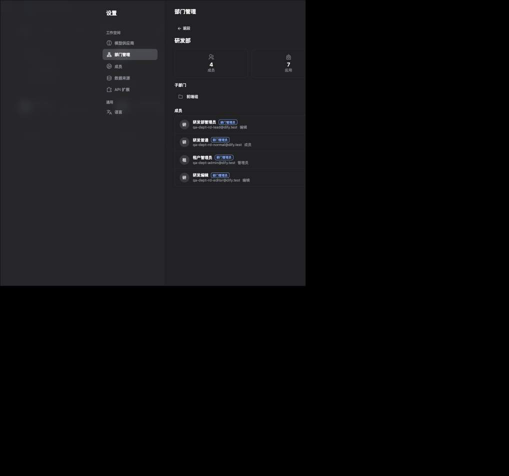

### UAT-053

| **字段** | **内容** |
| --- | --- |
| 编号 | UAT-053 |
| 登录 | 研发部管理员（qa-dept-rd-lead@dify.test） |
| **实际结果** | 市场部、产品部的「管理」是禁用的。研发部和其下前端组的「管理」可以点。没有单独的错误提示。 |
| **测试是否通过** | 通过 |
| **测试时间** | 2026-10-18 23:13 |
| **通过时间** | 2026-10-18 23:13 |

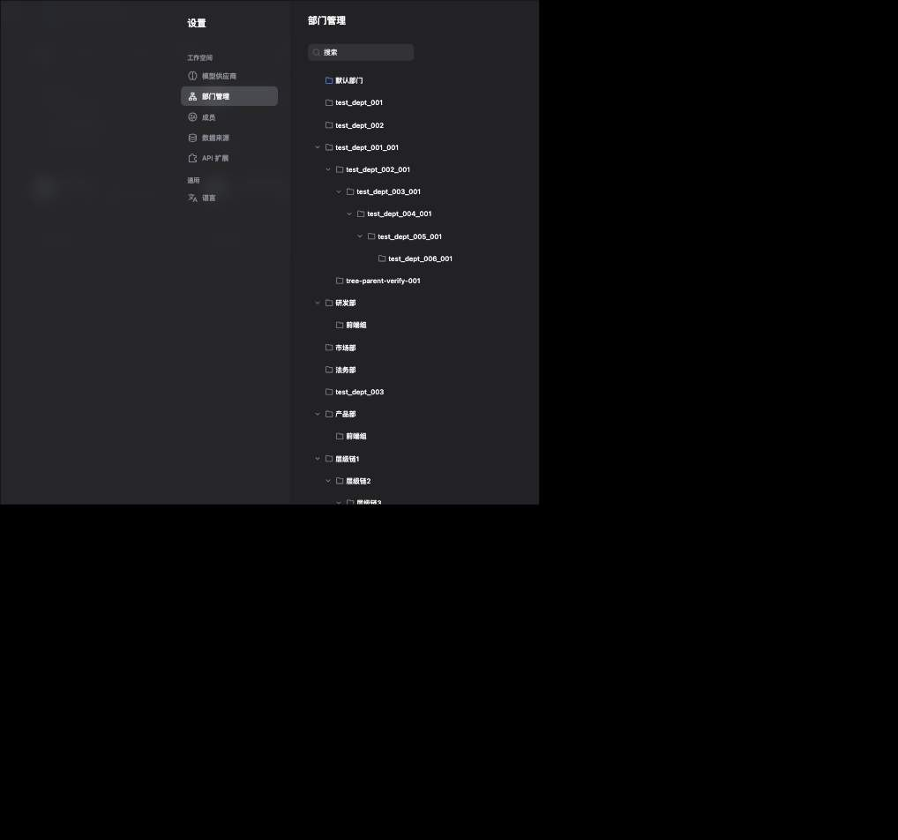

## 6. 探索与发布

### UAT-058

| **字段** | **内容** |
| --- | --- |
| 编号 | UAT-058 |
| 登录 | 研发普通（qa-dept-rd-normal@dify.test） |
| **实际结果** | 探索里能看到「[QA] 研发内部助手」「测试聊天应用」「门控验证应用」。看不到「[QA] 市场文案助手」。另外也能看到只发到前端组的「[QA] 前端组件助手」。 |
| **测试是否通过** | 通过 |
| **测试时间** | 2026-10-18 23:10 |
| **通过时间** | 2026-10-18 23:10 |
| **备注** | 多看到前端组应用，是因为这个账号已被设为研发部部门管理员。市场部应用仍然不可见，按用例第二条通过。 |

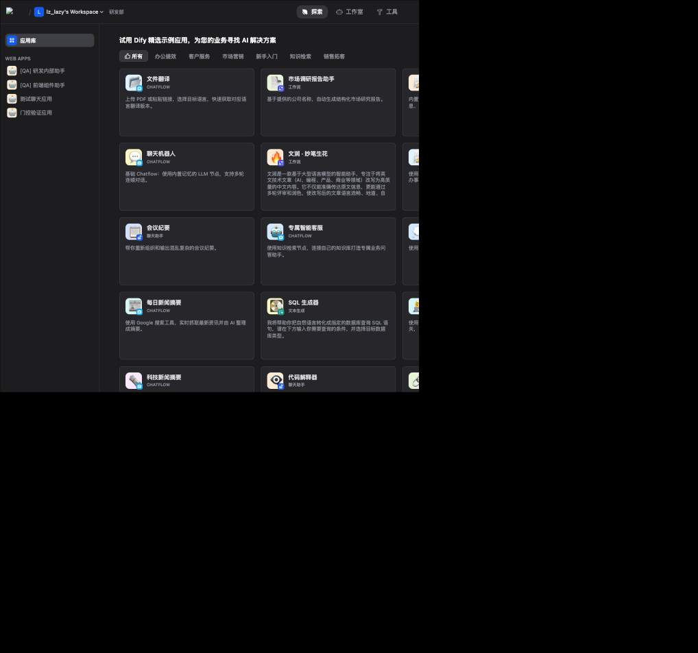

### UAT-060

| **字段** | **内容** |
| --- | --- |
| 编号 | UAT-060 |
| 登录 | 研发部管理员（qa-dept-rd-lead@dify.test） |
| **实际结果** | 探索里能看到发到研发部或前端组的应用：研发内部助手、前端组件助手、测试聊天应用、门控验证应用。看不到市场文案助手。 |
| **测试是否通过** | 通过 |
| **测试时间** | 2026-10-18 23:16 |
| **通过时间** | 2026-10-18 23:16 |

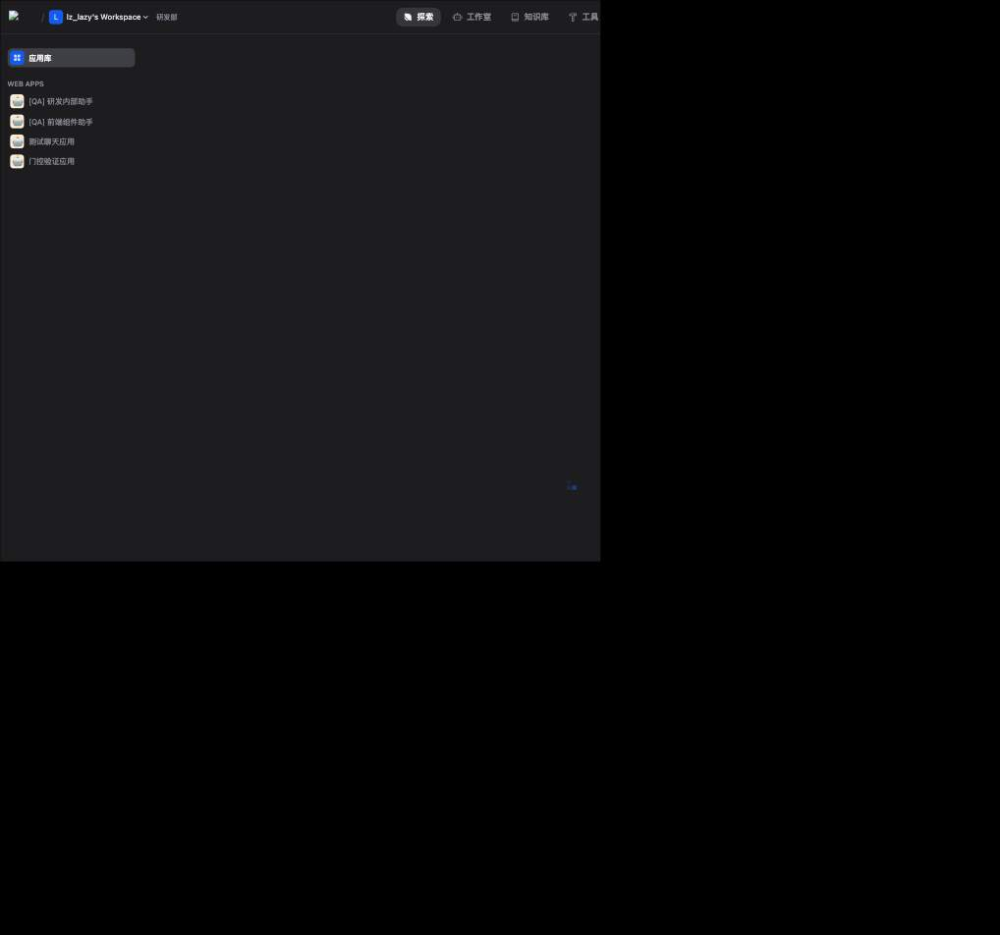

### UAT-069

| **字段** | **内容** |
| --- | --- |
| 编号 | UAT-069 |
| 登录 | 研发部管理员（qa-dept-rd-lead@dify.test） |
| **实际结果** | 门控验证应用的应用信息里，发布部门显示「研发部, 前端组」。点「编辑发布部门」后，研发部和其下前端组可以勾选。市场部仍在列表里，勾选框禁用，锁图标的说明是「发布到该部门需要管理员权限」。 |
| **测试是否通过** | 通过 |
| **测试时间** | 2026-10-18 23:28 |
| **通过时间** | 2026-10-18 23:28 |
| **备注** | 入口在应用名称旁的信息面板，不是监测页本身。公开访问地址是 /chat/XbMGW1bLl7U6LkOq。 |

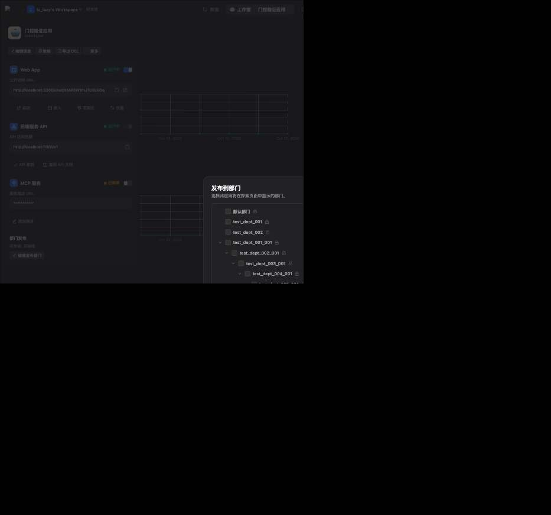

## 7. 聊天 URL 与嵌入

### UAT-075

| **字段** | **内容** |
| --- | --- |
| 编号 | UAT-075 |
| 登录 | 未登录 |
| **实际结果** | 打开 /chat/XbMGW1bLl7U6LkOq 后进入登录页，没有聊天界面。地址带 redirect，里面包含这段聊天路径。实际形态是 /signin?redirect=/webapp-signin?redirect_url=/chat/XbMGW1bLl7U6LkOq。 |
| **测试是否通过** | 通过 |
| **测试时间** | 2026-10-18 23:30 |
| **通过时间** | 2026-10-18 23:30 |

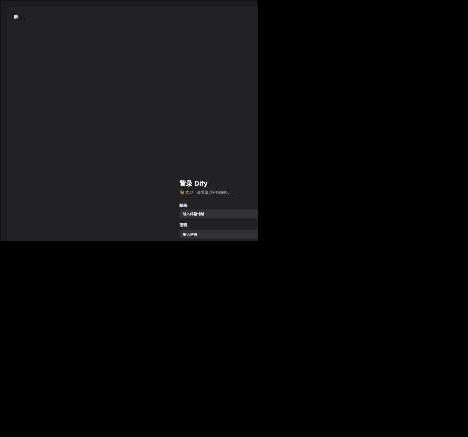

### UAT-076

| **字段** | **内容** |
| --- | --- |
| 编号 | UAT-076 |
| 登录 | 研发普通（qa-dept-rd-normal@dify.test） |
| **实际结果** | 从上面的登录页登录成功后进入工作室 /apps，没有按 redirect 进入聊天。 |
| **测试是否通过** | 通过 |
| **测试时间** | 2026-10-18 23:32 |
| **通过时间** | 2026-10-18 23:32 |

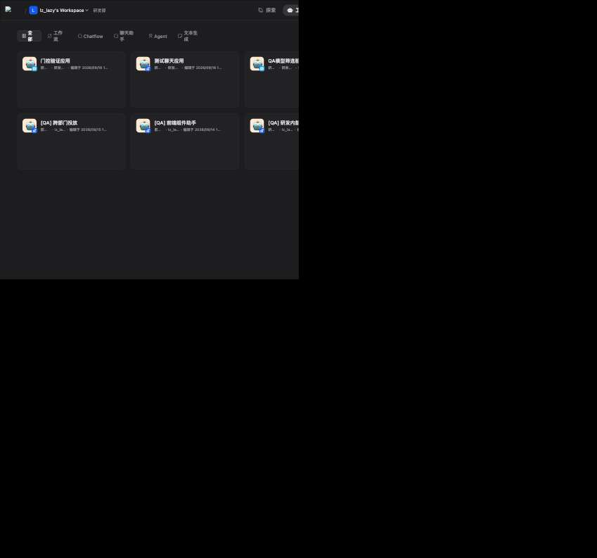

### UAT-077

| **字段** | **内容** |
| --- | --- |
| 编号 | UAT-077 |
| 登录 | 研发普通（qa-dept-rd-normal@dify.test） |
| **实际结果** | 已登录后再打开 /chat/XbMGW1bLl7U6LkOq，没有二次登录，直接进入「门控验证应用」的对话页。该应用已发布到研发部。 |
| **测试是否通过** | 通过 |
| **测试时间** | 2026-10-18 23:33 |
| **通过时间** | 2026-10-18 23:33 |

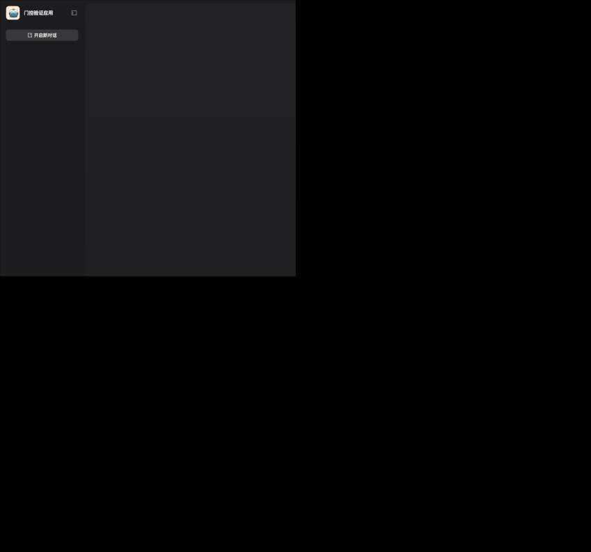

### UAT-084A

| **字段** | **内容** |
| --- | --- |
| 编号 | UAT-084A |
| 登录 | 打开时未再走登录 |
| **实际结果** | 打开 /chatbot/XbMGW1bLl7U6LkOq（没有 embed_token）后，页面停在该地址，显示「嵌入链接无效」，没有跳到控制台登录。 |
| **测试是否通过** | 通过 |
| **测试时间** | 2026-10-18 23:34 |
| **通过时间** | 2026-10-18 23:34 |

### UAT-078

| **字段** | **内容** |
| --- | --- |
| 编号 | UAT-078 |
| 登录 | 研发普通（qa-dept-rd-normal@dify.test） |
| **实际结果** | 打开只发布到市场部的「[QA] 市场文案助手」运行链接 /chat/LC3BLtoD5HEk0uJ9。页面文案是 You do not have permission to access this app.，按钮是 Return to Console。没有进入聊天。 |
| **测试是否通过** | 通过 |
| **测试时间** | 2026-10-18 23:45 |
| **通过时间** | 2026-10-18 23:45 |

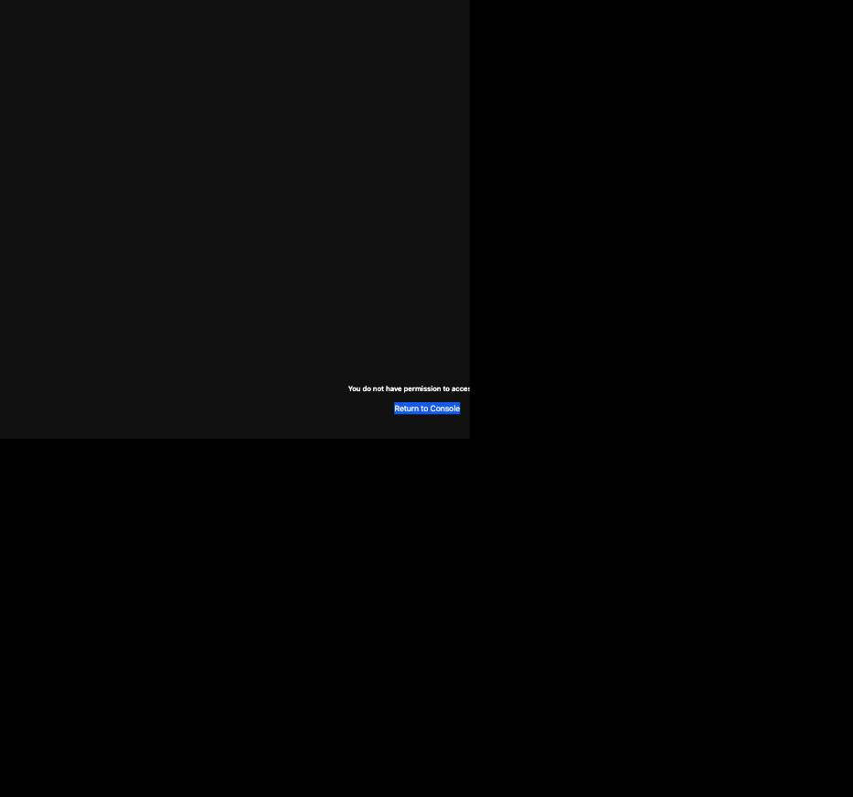

### UAT-079

| **字段** | **内容** |
| --- | --- |
| 编号 | UAT-079 |
| 登录 | lz_lazy（lz_lazy@163.com，默认部门） |
| **实际结果** | 打开同一条只发到市场部的运行链接，页面同样是 You do not have permission to access this app.，按钮 Return to Console。所有者没有被放行。探索应用库里仍能看到「[QA] 市场文案助手」。 |
| **测试是否通过** | 通过 |
| **测试时间** | 2026-10-18 23:40 |
| **通过时间** | 2026-10-18 23:40 |
| **备注** | 探索列表见 UAT-059 截图。 |

## 4. 应用（所有者）

### UAT-042

| **字段** | **内容** |
| --- | --- |
| 编号 | UAT-042 |
| 登录 | lz_lazy（lz_lazy@163.com） |
| **实际结果** | 工作室同时能看到研发部、前端组、市场部、默认部门的应用，没有按所属部门截断。 |
| **测试是否通过** | 通过 |
| **测试时间** | 2026-10-18 23:38 |
| **通过时间** | 2026-10-18 23:38 |
| **备注** | 没有把应用个数写成通过条件。 |

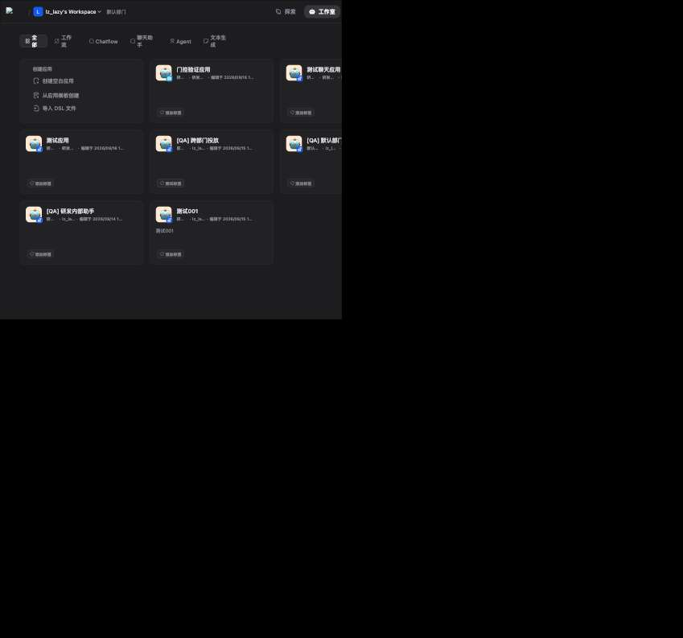

### UAT-047

| **字段** | **内容** |
| --- | --- |
| 编号 | UAT-047 |
| 登录 | lz_lazy（lz_lazy@163.com） |
| **实际结果** | 「创建空白应用」对话框里没有「所属部门」下拉，也没有「自动分配（无部门）」。未继续创建。 |
| **测试是否通过** | 不通过 |
| **问题描述** | 用例要求第一项是「自动分配（无部门）」，不选部门时落到默认部门。当前创建对话框没有这个控件。与 UAT-048 是同一个对话框。 |
| **测试时间** | 2026-10-18 23:42 |
| **通过时间** |  |

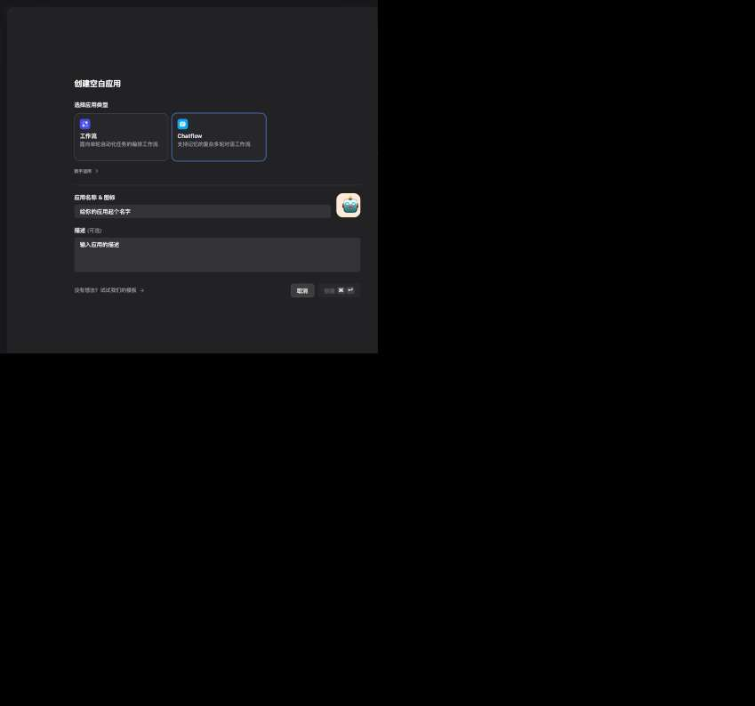

## 6. 探索

### UAT-059

| **字段** | **内容** |
| --- | --- |
| 编号 | UAT-059 |
| 登录 | lz_lazy（lz_lazy@163.com） |
| **实际结果** | 探索应用库能看到已发布应用，包括市场文案、研发内部、前端组件、默认部门应用、跨部门投放、测试聊天、门控。同时列出了用例数据里记为未发布的「测试001」「测试应用」「测试工作流」「QA模型筛选验证」。 |
| **测试是否通过** | 不通过 |
| **问题描述** | 用例要求未发布到任何部门的应用不出现。这四个名称出现在应用库里。本轮没有逐个打开核对它们现在是否已经发布，若其实已发布，这条应改判通过。 |
| **测试时间** | 2026-10-18 23:41 |
| **通过时间** |  |

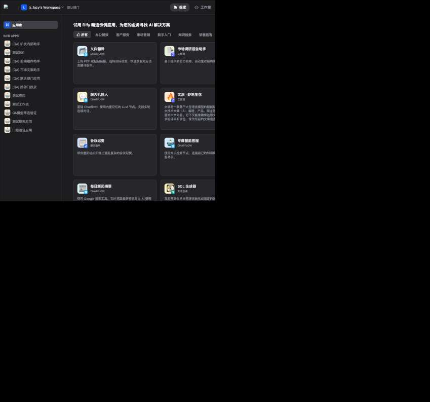

### UAT-045

| **字段** | **内容** |
| --- | --- |
| 编号 | UAT-045 |
| 登录 | 研发编辑（qa-dept-rd-editor@dify.test） |
| **实际结果** | 知识库列表能看到「测试知识库」和「[QA] 研发部全部门可见」。看不到市场部知识库，也看不到 lz_lazy 创建、权限为「只有我」的「[QA] 研发知识库」。 |
| **测试是否通过** | 通过 |
| **测试时间** | 2026-10-18 23:52 |
| **通过时间** | 2026-10-18 23:52 |
| **备注** | 该账号在 UAT-031 已被设为研发部部门管理员。同部门「所有部门成员」库仍然可见。 |

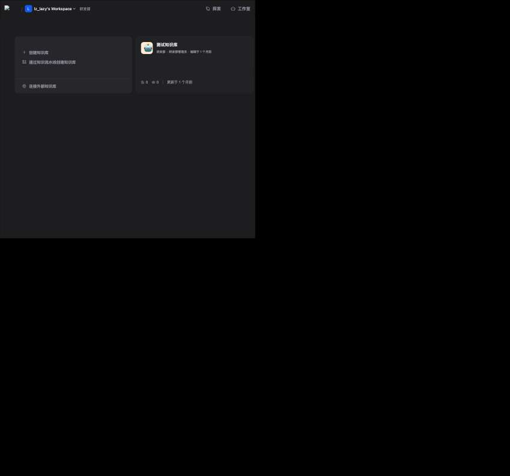

### UAT-054

| **字段** | **内容** |
| --- | --- |
| 编号 | UAT-054 |
| 登录 | 研发编辑（qa-dept-rd-editor@dify.test） |
| **实际结果** | 工作室能看到研发部和前端组的应用，看不到市场文案，也没有市场部。 |
| **测试是否通过** | 不通过 |
| **问题描述** | 用例要求只显示研发部应用。实际还显示前端组应用。原因是 UAT-031 已把研发编辑设为研发部部门管理员。 |
| **测试时间** | 2026-10-18 23:53 |
| **通过时间** |  |

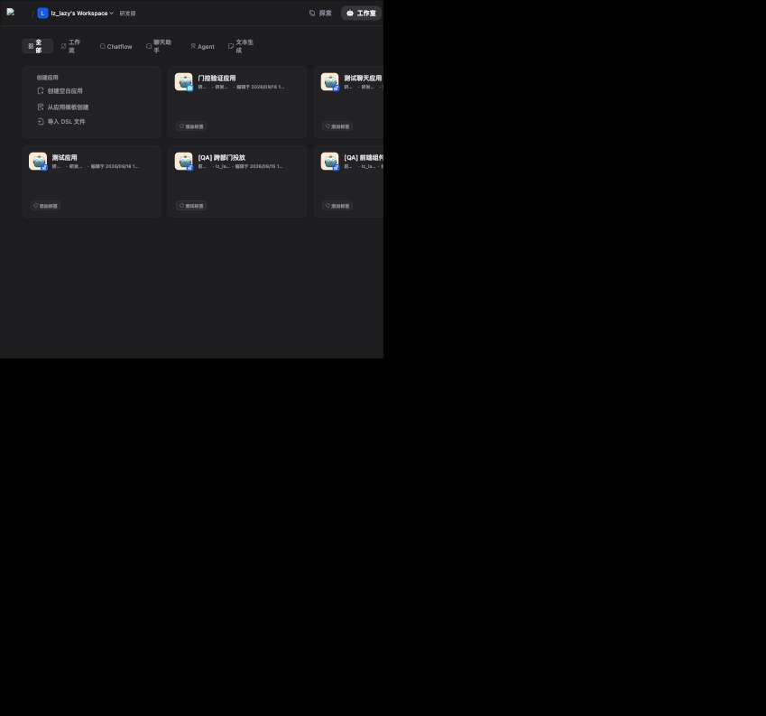

### UAT-061

| **字段** | **内容** |
| --- | --- |
| 编号 | UAT-061 |
| 登录 | 研发普通（qa-dept-rd-normal@dify.test） |
| **实际结果** | 探索应用库只有「[QA] 研发内部助手」「[QA] 前端组件助手」「测试聊天应用」「门控验证应用」。没有「测试001」「QA模型筛选验证」「测试应用」「测试工作流」。 |
| **测试是否通过** | 通过 |
| **测试时间** | 2026-10-18 23:48 |
| **通过时间** | 2026-10-18 23:48 |
| **备注** | 前端组件助手出现，是因为这个账号已被设为研发部部门管理员。未发布应用没有出现。 |

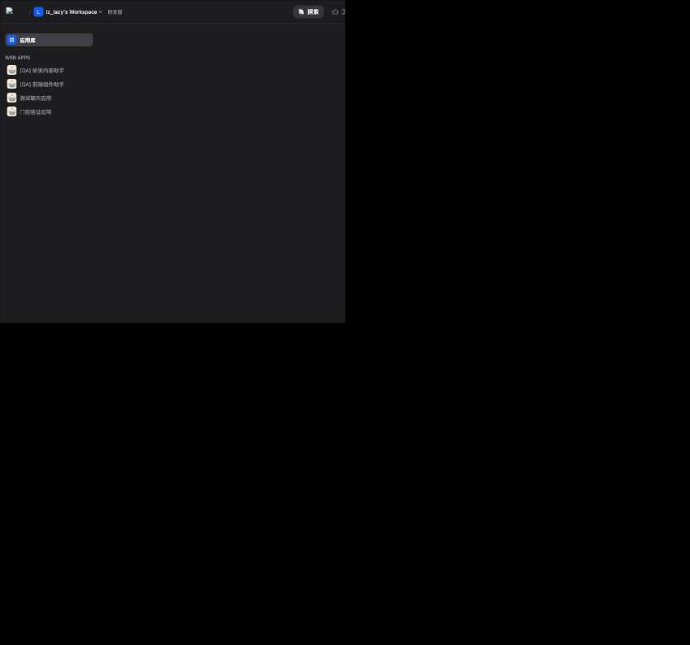

### UAT-067

| **字段** | **内容** |
| --- | --- |
| 编号 | UAT-067 |
| 登录 | 研发编辑（qa-dept-rd-editor@dify.test） |
| **实际结果** | 编辑门控验证应用的发布部门时，研发部可勾选，市场部和产品部锁定。其下前端组也可以勾选。 |
| **测试是否通过** | 不通过 |
| **问题描述** | 用例要求只能勾选研发部。前端组也能勾选，因为该编辑已被设为研发部部门管理员。市场部锁定，这一点与用例一致。 |
| **测试时间** | 2026-10-18 23:55 |
| **通过时间** |  |

### UAT-070

| **字段** | **内容** |
| --- | --- |
| 编号 | UAT-070 |
| 登录 | 研发普通（qa-dept-rd-normal@dify.test） |
| **实际结果** | 能打开门控验证应用的监测页。侧栏没有「编排」。点应用名称没有打开发布部门面板，页面上没有「编辑发布部门」，也没有报错。 |
| **测试是否通过** | 通过 |
| **测试时间** | 2026-10-18 23:50 |
| **通过时间** | 2026-10-18 23:50 |

### UAT-046

| **字段** | **内容** |
| --- | --- |
| 编号 | UAT-046 |
| 登录 | 研发编辑（qa-dept-rd-editor@dify.test） |
| **实际结果** | 工作室「创建空白应用」弹窗里没有部门选择，也没有「此资源将自动分配到你所在的部门。」 |
| **测试是否通过** | 不通过 |
| **问题描述** | 用例要求出现这句提示。工作室创建弹窗没有所属部门，和 UAT-047、UAT-048 相同。 |
| **测试时间** | 2026-10-19 00:46 |
| **通过时间** |  |

### UAT-037

| **字段** | **内容** |
| --- | --- |
| 编号 | UAT-037 |
| 登录 | lz_lazy@163.com 转移；研发普通、市场编辑核对 |
| **实际结果** | 所有者在「[QA] 研发内部助手」的更多菜单里点「转移部门」，目标选市场部。卡片归属从研发部变为市场部。研发普通工作室不再出现该应用。市场编辑工作室能看到它。 |
| **测试是否通过** | 通过 |
| **测试时间** | 2026-10-19 00:54 |
| **通过时间** | 2026-10-19 00:58 |
| **备注** | 用例写目标「产品部」。本次按报告约定把移动类用例的产品部做成市场部。应用转移的成功提示在截图前已消失；同一套转移在 UAT-040 抓到「部门转移成功」。测完尚未转回研发部。 |

### UAT-037A

| **字段** | **内容** |
| --- | --- |
| 编号 | UAT-037A |
| 登录 | 研发普通看探索；市场编辑看探索和工作室 |
| **实际结果** | 转移后发布部门仍是研发部。研发普通探索应用库仍有「[QA] 研发内部助手」。市场编辑工作室能看到该应用，探索应用库没有它，只有「[QA] 市场文案助手」和「[QA] 跨部门投放」。 |
| **测试是否通过** | 通过 |
| **测试时间** | 2026-10-19 00:56 |
| **通过时间** | 2026-10-19 01:02 |
| **备注** | 与 UAT-037 是同一次转移。 |

### UAT-040

| **字段** | **内容** |
| --- | --- |
| 编号 | UAT-040 |
| 登录 | lz_lazy@163.com |
| **实际结果** | 「[QA] 研发知识库」更多菜单有「转移部门」。目标选市场部，提示「部门转移成功」，卡片归属变为市场部。 |
| **测试是否通过** | 通过 |
| **测试时间** | 2026-10-19 00:57 |
| **通过时间** | 2026-10-19 00:57 |
| **备注** | 用例写产品部，本次选市场部。测完尚未转回研发部。该库原先是所有者的「只有我」，转移后的跨账号可见性未在本条展开。 |

### UAT-074

| **字段** | **内容** |
| --- | --- |
| 编号 | UAT-074 |
| 登录 | 研发编辑（qa-dept-rd-editor@dify.test） |
| **实际结果** | 探索应用库有「[QA] 研发内部助手」（已发到研发部）。工作室列表没有这个现属市场部的应用，因此没有它的发布部门编辑入口。 |
| **测试是否通过** | 通过 |
| **测试时间** | 2026-10-19 01:06 |
| **通过时间** | 2026-10-19 01:06 |
| **备注** | 用 UAT-037 转走后的「[QA] 研发内部助手」充当「属其他部门、已发到研发部」的应用。 |

### UAT-084

| **字段** | **内容** |
| --- | --- |
| 编号 | UAT-084 |
| 登录 | lz_lazy@163.com |
| **实际结果** | 门控验证应用概览点「嵌入」，iframe 地址是 `/chatbot/XbMGW1bLl7U6LkOq?embed_token=`。打开后停在嵌入页，输入框为「和 门控验证应用 聊天」，没有跳到登录页。 |
| **测试是否通过** | 通过 |
| **测试时间** | 2026-10-19 00:48 |
| **通过时间** | 2026-10-19 00:48 |

### UAT-084B

| **字段** | **内容** |
| --- | --- |
| 编号 | UAT-084B |
| 登录 | lz_lazy@163.com 重置；无登录窗口打开旧地址 |
| **实际结果** | 确认框文案是「重置后已嵌入外站的代码将失效，需要重新复制。确定重置吗？」。重置后公开访问 URL 仍是 `/chat/XbMGW1bLl7U6LkOq`。旧 embed_token 打开显示「嵌入链接无效」，不跳登录。新 token 能打开同一嵌入聊天框。 |
| **测试是否通过** | 通过 |
| **测试时间** | 2026-10-19 00:50 |
| **通过时间** | 2026-10-19 00:51 |

### UAT-091

| **字段** | **内容** |
| --- | --- |
| 编号 | UAT-091 |
| 登录 | lz_lazy@163.com 设置；研发编辑、租户管理员、研发部管理员分别核对 |
| **实际结果** | 研发编辑的模型权限弹窗说明含「默认模型始终可用且不可取消勾选。」系统推理模型 qwen3.8-max 已勾选且不能取消。另勾选 qwen3.8-flash 后保存，弹窗关闭，没有成功提示。研发编辑在门控验证应用的模型列表里只看到 qwen3.8-max 和 qwen3.8-flash。租户管理员同一位置还能看到 qwen3.7-max、qwen3.6-plus、DeepSeek-R1、kimi-k2.5。研发部管理员的成员表头是姓名、上次活动时间、角色，没有「模型权限」列。 |
| **测试是否通过** | 通过 |
| **测试时间** | 2026-10-19 01:00 |
| **通过时间** | 2026-10-19 01:12 |
| **备注** | 白名单目前停在「默认模型 + qwen3.8-flash」，尚未按 UAT-092 改回全选。 |

### UAT-085

| **字段** | **内容** |
| --- | --- |
| 编号 | UAT-085 |
| 登录 | 未登录 |
| **实际结果** | 打开 `/chat/XbMGW1bLl7U6LkOq?embed_token=` 后进入控制台登录页，地址带 `redirect`，没有免登录进运行页。 |
| **测试是否通过** | 通过 |
| **测试时间** | 2026-10-19 01:16 |
| **通过时间** | 2026-10-19 01:16 |

### UAT-092

| **字段** | **内容** |
| --- | --- |
| 编号 | UAT-092 |
| 登录 | lz_lazy@163.com 全选；研发编辑核对选择器 |
| **实际结果** | 研发编辑的模型权限里勾选「全部模型」后，90 个勾选框都是选中。保存后弹窗关闭，没有成功提示。研发编辑再打开门控验证应用的模型列表，能看到 qwen3.8-flash、qwen3.7-max、qwen3.6-plus、DeepSeek-R1、kimi-k2.5、qwen3.5-plus 等保存时已有的模型。 |
| **测试是否通过** | 通过 |
| **测试时间** | 2026-10-19 01:20 |
| **通过时间** | 2026-10-19 01:24 |
| **备注** | 全选后名单里仍有记录。本轮没有再新增模型，所以「之后新加的模型不会自动出现」没有另做验证。 |

### UAT-093

| **字段** | **内容** |
| --- | --- |
| 编号 | UAT-093 |
| 登录 | lz_lazy@163.com 去掉白名单；研发编辑打开对话 |
| **实际结果** | 先把门控验证应用的草稿模型改成 qwen3.8-flash。所有者再取消该模型勾选并保存。研发编辑回到编排，节点仍显示 qwen3.8-flash，并标「不兼容」。模型列表里没有 qwen3.8-flash，列表从 qwen3.8-max 开始。预览输入「你好」后出现「停止响应」，没有报错提示。约两分钟没有正文，随后点了停止。 |
| **测试是否通过** | 通过 |
| **测试时间** | 2026-10-19 01:28 |
| **通过时间** | 2026-10-19 01:32 |
| **备注** | 提交没有被白名单拦住。节点上的「不兼容」是选择器提示，不是运行报错。测完已把草稿模型改回 qwen3.8-max。白名单里目前没有 qwen3.8-flash。 |

